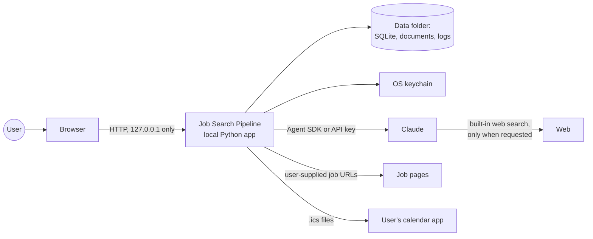
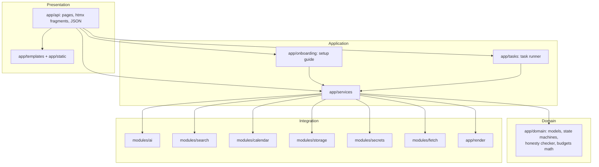
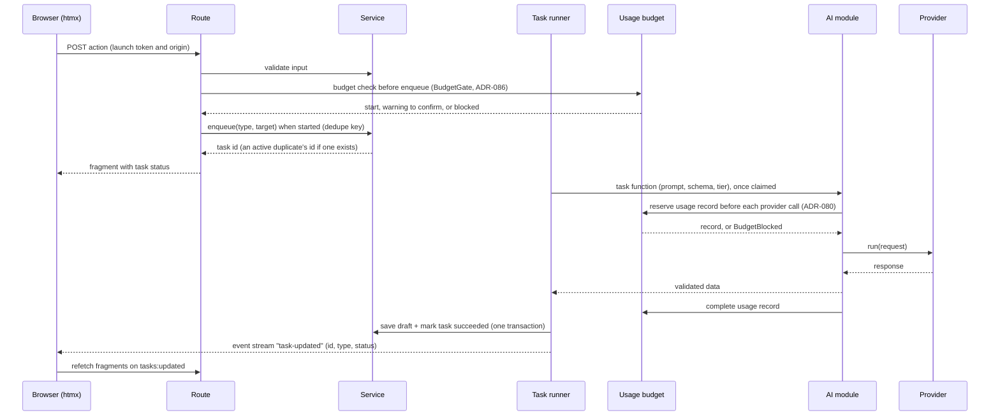

# Job Search Pipeline — Technical Specification

Version 1.0 · 2026-10-03 · Audience: the maintainer and the Claude Code agents that build this app

This is the implementation contract. It turns the product and design documents into architecture, interfaces, rules, a milestone roadmap with test plans, and a description of the agentic system used to build the app. The keywords MUST, MUST NOT, SHOULD and MAY are used as in RFC 2119.

## Contents

0. How to use this document
1. System overview
2. Architecture
3. Cross-cutting implementation rules
4. Testing strategy
5. Roadmap and milestone test plans
6. The agentic development system
7. Appendices: commands, test markers, environment variables, glossary

---

## 0. How to use this document

### 0.1 Sources and precedence

| Priority | Source | Holds |
| --- | --- | --- |
| 1 | `docs/DECISIONS.md` | Recorded decisions (newest entry wins) |
| 2 | `docs/TECHNICAL_SPEC.md` (this file) | Architecture, contracts, rules, roadmap, test plans |
| 3 | `docs/references/detailed-design.md` | Screens, interactions, UX rules, data model draft |
| 4 | `docs/references/product-spec.md` | Original product vision |

When two sources disagree, agents MUST stop and ask the user, then record the answer in `docs/DECISIONS.md`. Agents MUST NOT silently pick one.

### 0.2 Where to look

| You need | Read |
| --- | --- |
| What to build next | `docs/PROGRESS.md`, then section 5 for that milestone |
| How modules may depend on each other | 2.3 |
| Interfaces for AI, search, calendar, secrets, storage | 2.4 |
| Security rules | 2.9 and 3.3 |
| The honesty rule and how it is enforced | 3.1 |
| How to test and what "done" means | 4 |
| How the agents, skills and hooks work together | 6 |
| What a screen looks like and how it behaves | `docs/references/detailed-design.md` |

---

## 1. System overview

### 1.1 Purpose

A local, open-source web app that helps one person run a job search: it collects job postings, summarizes and assesses them, helps the user position themselves for each role with a growing bank of personal facts, drafts tailored CVs and cover letters, tracks applications on a board, and prepares the user for interviews. The user always submits applications personally.

### 1.2 Engineering principles and how they are enforced

| Principle | Enforcement |
| --- | --- |
| Human in the loop | The app never submits applications or automates employer sites. AI output is always a draft until the user approves it. |
| Honesty first | Generated text must cite the confirmed facts it uses; uncited or unsupported content is flagged and blocks approval (3.1). |
| Local-first and private | Server binds to 127.0.0.1 only; data lives in a data folder outside the repository; secrets live in the OS keychain (2.9). |
| Swappable providers | AI, search, calendar, secrets and storage sit behind Python protocols with capability flags and shared contract tests (2.4, 4.1). |
| On demand | AI and web search run only from explicit user actions, as visible, cancellable background tasks, under optional usage budgets (2.5, M2). |
| Reusable by anyone | No personal data, criteria or credentials in code; everything is configurable; a fictional demo dataset ships in `demo/`. |
| Testable | Clock, id generation and providers are injected; tests never touch the network or real providers unless explicitly marked live (4). |

### 1.3 Non-goals

Automatic applying; scraping sites whose terms forbid it; a hosted or multi-user service; native mobile apps; real-time collaboration; background processes that run while the app is closed.

### 1.4 Quality targets

| Attribute | Target | How it is checked |
| --- | --- | --- |
| Responsiveness | Page and fragment requests p95 under 150 ms server time with 1,000 jobs, excluding AI tasks | Performance test in M4 and M9 |
| No lost work | Every user edit autosaves; every task ends in a terminal state | Integration and failure-injection tests (M2) |
| Privacy | No secret ever appears in logs, responses, exports or the database | Automated scans in tests (M0, M1) |
| Accessibility | WCAG 2.2 AA on core flows | axe-core checks in e2e tests, plus a manual keyboard and screen-reader pass (M9) |
| Portability | macOS, Linux; Python 3.11 and newer (Windows suspended, ADR-061) | CI matrix (4.6) |

---

## 2. Architecture

### 2.1 Context



Everything runs on the user's computer. The only outbound traffic is: calls to the configured AI provider, web search performed by that provider when the user asks for it, and fetching a job page URL the user pasted.

### 2.2 Components



### 2.3 Layering and dependency rules

These rules are enforced by import-linter contracts in `pyproject.toml` and checked by `uv run lint-imports` on every verification run.

1. `app.domain` MUST be pure Python: no I/O, no framework imports, nothing from other `app` packages.
2. `app.modules.*` MAY import `app.domain`. They MUST NOT import `app.services`, `app.api`, `app.onboarding` or `app.tasks`.
3. Vendor SDKs MUST be imported only inside the provider package that wraps them. For example, `claude_agent_sdk` is imported only in `app.modules.ai.providers.claude_sdk`, and `keyring` only in `app.modules.secrets.providers.keyring_store`.
   PDF and Word parsing follow the same rule: `pypdf` only in `app.modules.extract.providers.pdf`, `docx` only in `app.modules.extract.providers.docx` (ADR-089). Job page fetching too: `httpx` only in `app.modules.fetch.providers.guarded` (the contract is narrowed to that module; ADR-098 update of M4.1). Rendering follows the same rule: `typst` only in `app.render.providers.pdf` (ADR-108), and `docx` only in `app.render.providers.word` and the extractor's Word adapter (ADR-106).
4. `app.services` MAY import `app.domain` and the public interface of each module (`app.modules.<name>`, not its `providers` subpackage). Services MUST NOT import FastAPI, Starlette or Jinja2.
5. `app.api` MAY import services, onboarding and the task runner's public functions. It MUST NOT import `app.modules.*` or `sqlite3`.
6. `app.tasks` MAY import services and domain. Task handlers are thin: they call a service function. The runner reaches the AI module and storage only through services; the 2.5 diagram shows the logical flow (ADR-034).
7. Provider selection happens in one place, `app/wiring.py`, which builds concrete providers from settings and hands them to services through constructor injection.
8. `app.render` (M6; ADR-106, ADR-108) sits in the layer beside `app.modules`. Its interface (`app/render/__init__.py` and `app/domain/rendering.py`) imports no vendor library, and each file format has one provider module under `app/render/providers/`. Services may use the interface but not the providers. The API and the task handlers may not import `app.render` at all, `app.render` may not import services, and providers are chosen only in `app/wiring.py` (`Wiring.document_renderers()`). These rules are the layering, service, API, task and provider contracts in `pyproject.toml`.

### 2.4 Key interfaces

Signatures are abbreviated. Implementations MUST keep these shapes unless an ADR changes them. The code versions, with fetching behind an injected `JobPageFetcher`, are recorded in ADR-036.

```python
# app/modules/ai/__init__.py
class AIProvider(Protocol):
    name: str
    capabilities: AICapabilities   # web_search, speech_to_text, text_to_speech,
                                   # reports_token_usage
    async def test_connection(self, model: str) -> ConnectionResult: ...
    def known_models(self) -> list[ModelChoice]: ...
    async def run(self, request: AIRequest, cancel: CancelToken) -> AIResponse: ...

@dataclass(frozen=True)
class AIRequest:
    task: str                      # e.g. "tailor_cv"
    prompt_id: str
    prompt_version: str            # e.g. "3", or "3+override" (ADR-055)
    system: str
    user: str                      # rendered prompt; untrusted content already delimited (3.3)
    output_schema: dict            # JSON Schema the response must satisfy
    model: str                     # resolved from the task's tier (Fast or Thorough)
    allow_web_search: bool = False
    on_tool_use: Callable[[str], Awaitable[bool]] | None = None   # budget hook; False blocks
    on_usage: Callable[[ProviderUsageSnapshot], None] | None = None   # provider-reported usage, during the call (ADR-078)

@dataclass(frozen=True)
class AIResponse:
    raw_text: str
    data: dict                     # parsed JSON object; schema validated by the task executor (ADR-054)
    model: str
    usage: TokenUsage | None       # when the provider reports it

# Each AI task is registered in app/modules/ai/tasks.py (TASK_SPECS, see 3.6) and takes the
# named inputs its prompt declares. As built in M4 (ADR-098 item 7, which amends the earlier
# example that passed preferences to summarize_job):
#   summarize_job: posting_context (JSON: the job text and the controlled lists with their
#                  aliases, as one untrusted block) and job_id; no facts, no preferences
#   assess_fit:    job_context (posting and requirements with ids), facts (the code-owned block
#                  from facts_for_ai), preferences (the user's numbered lines) and job_id
```

Added in M2 (ADR-078, ADR-080). `ProviderUsageSnapshot` (service, window, unit, used, limit, utilization, resets_at, observed_at) is validated when built. `UsageMeter` is implemented by the usage service (`ServiceUsageMeter`, `app/services/usage_meter.py`), never by a module. `run_task` requires `meter`, so a provider call can't run uncounted.

```python
# app/modules/ai/__init__.py (ADR-080)
class UsageMeter(Protocol):
    def reserve(self, *, tier: str, task_type: str, task_id: str | None, kind: UsageKind) -> str: ...
    def complete(self, record_id: str, *, success: bool, tokens: TokenUsage | None) -> None: ...
    def snapshot(self, snapshot: ProviderUsageSnapshot) -> None: ...

class AITaskRunner(Protocol):
    async def run_task(self, task: str, inputs: Mapping[str, object], cancel: CancelToken, *,
                       meter: UsageMeter, tier: Tier | None = None, task_id: str | None = None) -> TaskResult: ...
```

```python
# app/modules/search/__init__.py
class SearchProvider(Protocol):
    name: str
    mode: Literal["delegated", "standalone"]   # delegated: the AI provider searches itself
    storage_allowed: bool | None               # None means unclear: do not cache derived output
    reports_usage: bool
    async def search(self, query: str, limit: int) -> list[SearchResult]: ...   # standalone only

# app/modules/calendar/__init__.py (M5, ADR-102/103)
@dataclass(frozen=True)
class EventData:
    uid: str                         # stable event row id
    title: str
    starts_at: datetime               # aware
    ends_at: datetime                 # aware, not before starts_at
    time_zone: str                    # IANA name
    details: str = ""
    sequence: int = 1                 # positive row version
    all_day: bool = False             # deadline / offer_deadline only
    location: str = ""
    cancelled: bool = False
    event_type: EventType = "interview"  # interview, follow_up, deadline, offer_deadline

class CalendarProvider(Protocol):
    name: str
    supports_sync: bool
    def export_event(self, event: EventData) -> CalendarFile: ...               # .ics bytes
    async def sync_event(self, event: EventData) -> ExternalRef: ...           # later providers

# app/modules/secrets/__init__.py
class SecretStore(Protocol):
    available: bool
    def get(self, key: str) -> str | None: ...
    def set(self, key: str, value: str) -> None: ...
    def delete(self, key: str) -> None: ...
# Implementations: KeyringSecretStore, EnvSecretStore (read-only fallback), MemorySecretStore (tests).

# app/modules/storage/__init__.py
class Database:
    def transaction(self) -> ContextManager[Connection]: ...  # BEGIN IMMEDIATE ... COMMIT
# Repositories are plain functions or small classes per aggregate (jobs, facts, applications...).

# app/modules/fetch/__init__.py (ADR-036, ADR-098)
class JobPageFetcher(Protocol):
    async def fetch(self, url: str, limits: FetchLimits) -> FetchedPage   # SSRF-guarded (2.9)
def page_text(page: FetchedPage) -> str                                   # readable text, no tags

# app/domain/clock.py and ids.py
class Clock(Protocol):
    def now(self) -> datetime: ...   # always UTC
class IdFactory(Protocol):
    def new(self) -> str: ...
```

Text extraction (M3, ADR-089, ADR-092): `app.modules.extract` exports `DocumentKind`, the `TextExtractor` protocol, `sniff_type(data)`, `extractor_for(kind)` and `extract_text(path, kind, timeout)`. The composition root injects sniffing/extraction functions into the service, which calls them from a worker thread; services cannot import this module directly because it reaches its adapters (ADR-092 item 7). Extraction spawns a child process with a cleared environment and a deadline; PDF/Word libraries stay in their adapters. `app.api.uploads.read_upload` reads one file or pasted text in memory, caps actual bytes at 10 MB, and never trusts a client filename as a path.

Job fetching and intake (M4, ADR-036, ADR-098):

- `app.modules.fetch` exports `FetchLimits` (5 MB, 15 s, 5 redirects; an implementation clamps to these, so callers can only lower them), `FetchedPage`, the `JobPageFetcher` protocol and `page_text`. `guard.check_url` accepts only http and https, refuses numeric host spellings and userinfo tricks, and refuses a URL when any DNS answer is not a global unicast address (explicit address tables; IPv4-mapped, 6to4 and NAT64 forms included). `providers/guarded.py` (`GuardedJobPageFetcher`) is the only `httpx` user. It checks every redirect hop again, connects to the address it checked while keeping the original `Host` header and TLS server name, sends no cookies, ignores proxy and netrc settings (`trust_env=False`), reuses no connection, reads text content types only, counts the 5 MB cap on decoded bytes (one content coding, decoded with `zlib`), and applies one 15 s deadline that includes DNS. HTTP error statuses and refused URLs raise `FetchRefused`; connection failures and the deadline raise `NetworkUnavailable`. The URL is never logged or put into an error's detail.
- `FakeJobPageFetcher` serves fictional `*.example.test` pages. `Wiring.job_page_fetcher()` returns it for those hosts only while fakes are allowed (tests, demo); every other URL still goes to the guarded fetcher.
- The fetch runs inside the Add-job request (`POST /inbox/intake`), awaited, with "Fetching the page…" shown. It is not a background task: its result decides what the form shows next, and it uses no AI budget (ADR-098 item 4). `JobIntakeService.add_url` fetches, runs `page_text` in a worker thread (raw markup capped at 512 Ki characters, two-second await limit, parser depth and work limits), cleans control, bidi and zero-width characters, refuses text over 50,000 characters instead of cutting it, and treats fewer than twelve words as "no job text". A refused or failed fetch answers 422 with the paste-text message, opens the text box and keeps the URL as the link to the original. `add_text` stores pasted text with an optional http or https link, which is stored and never fetched.
- The posting is stored before any AI request (snapshot, source with canonical URL, capture time). `summarize_job:<job id>` then starts as a background task through the budget gate, and `assess_fit:<job id>` runs after a successful summary as its own task (ADR-098 items 4 and 5). Duplicates are found by word-multiset similarity (0.80) and merged as another source; "Not a duplicate" splits them and remembers the pair.

Document rendering (M6, ADR-106 to ADR-116). Services hand a `RenderDocument` to one renderer per file format and get the bytes back. The export service runs the render on a worker thread, serialised by its own lock, before its short write transaction.

```python
# app/render/__init__.py (ADR-106, ADR-108)
class DocumentRenderer(Protocol):
    format: str                       # "pdf" or "docx"
    media_type: str
    def render(self, document: RenderDocument) -> RenderedFile: ...
@dataclass(frozen=True)
class RenderedFile:
    content: bytes
    page_count: int | None            # None for Word, which has no fixed pages
class RendererUnavailable(Exception): ...   # the library cannot be imported or loaded

# app/domain/rendering.py (pure)
@dataclass(frozen=True)
class RenderDocument:                 # title, author, page_size ("A4" | "Letter"), header_lines,
    ...                               # sections (heading, lines, entries of heading and lines),
                                      # photo bytes and photo_type ("jpeg" | "png"), both or neither
def clean_render_text(text: str) -> str: ...   # drops control characters except tab and newline
```

- `app/render/providers/pdf.py` (`PdfRenderer`, format `pdf`) uses `typst==0.15.0` (ADR-108), imported only when the first render runs, so the app starts and Word export works without it. The typesetting source is one static template with no `#import`, `#read` or `eval`; the document reaches it only as JSON in `sys_inputs`. Each compile runs in a fresh, empty temporary folder that is removed afterwards, and the only file it can hold is the photo, under a fixed name. Fonts are the bundled Libertinus Serif from the wheel, with system fonts ignored. The timestamp comes from the injected clock, in whole seconds, and the library's Creator and Producer entries are blanked. Bidi override and isolate characters are removed before typesetting. A run of more than fifty characters without a space gets zero-width spaces every twenty-five characters, so it can wrap.
- Caps: 2,000 pieces (headings and lines) and 200,000 characters per document, title and author included; a photo of at most 5 MiB, 4,000 pixels a side and 16 million pixels, measured from its header. A document over a cap raises `RenderTooLarge`. The 10-second limit runs the compile on a worker thread, with at most four compiles in flight. A compile that times out cannot be cancelled and keeps its slot until it ends (`RenderTimedOut`). A library failure, or a photo that does not match its stated type, raises `RenderFailed`.
- `app/render/providers/word.py` (`WordRenderer`, format `docx`) uses python-docx with styles set in code (Arial; headings keep with the next paragraph). Core properties come from the document and the clock. The template's thumbnail and custom XML are dropped, and every zip entry takes the clock's time. Word files keep bidi controls.
- `Wiring.document_renderers()` returns `(PdfRenderer(clock), WordRenderer(clock))`. An unavailable PDF renderer leaves Word export working and shows the install message.

### 2.5 Runtime flows

Page and fragment requests: route → service → repository → template. Full pages render the app shell; htmx requests (`HX-Request: true`) receive fragments only.

AI actions:



The budget check runs in the route, before anything is queued, so a start that is blocked or waits for a confirmation queues nothing (ADR-086). The executor's reserve is the second check: it counts each provider call before the call and refuses it at the blocking point (ADR-080). Budgets are per service and count requests only (ADR-076 items 4 and 5); the rules are in 3.7.

### 2.6 Process model

One Python process runs Uvicorn with the FastAPI app. The task runner is an asyncio worker started in the app's lifespan, with a semaphore limiting concurrent external calls (default 1, user-configurable up to 3). Each Agent SDK call runs the Claude Code CLI as a subprocess, which the SDK manages. Nothing runs when the app is closed.

### 2.7 Data storage

Data folder layout:

```
<data folder>/
  app.db                    SQLite database (WAL mode)
  backups/                  automatic copies before migrations (last 5 kept)
  documents/<application>/  exported CVs and letters, by version (M6; folder 0700, files 0600)
  imports/                  uploaded CV files
  assets/                   the CV photo, photo-<generated id>.jpg or .png (M6; 0600)
  prompts/overrides/        user-edited prompt templates
  exports/                  JSON exports
  logs/                     rotating logs (redacted)
```

SQLite settings: `journal_mode=WAL`, `foreign_keys=ON`, `busy_timeout=5000`. Transactions are short and use `BEGIN IMMEDIATE` for writes.

Migrations are numbered SQL files in `app/modules/storage/migrations/NNNN_description.sql`, applied in order, each in a transaction, and recorded in `schema_migrations`. They are forward-only. Before applying pending migrations to an existing database, the app copies `app.db` to `backups/`. A test MUST prove that a fresh database and a database upgraded step by step end with identical schemas. On POSIX systems, database files and backups are created with 0600 permissions and data folders with 0700 (ADR-038).

Full-text search uses FTS5 tables for facts and jobs, kept in sync by triggers.

The table list in `detailed-design.md` (State machines and database schema) is the starting point for the schema. Every mutable table carries `created_at`, `updated_at` and an integer `version` for optimistic concurrency.

M6 storage (ADR-110, ADR-116). Migration `0006_tailoring.sql` adds 13 tables, all `WITHOUT ROWID`. `angles`, `workspaces`, `cv_templates`, `documents` and `document_versions` are mutable and carry `created_at`, `updated_at` and `version`. `gap_checks`, `gap_check_facts`, `angle_proposals`, `document_units`, `document_unit_facts`, `document_sent_facts`, `document_exports` and `application_submissions` are append-only: triggers refuse their UPDATE, DELETE and replacement. A document version is inserted only as a draft. Units, citations and sent-fact rows can be added only to a draft, its content never changes, and its status moves only draft → approved → sent. `applications_delete_only_untouched` refuses any application that has a tailoring row, so a tailoring row makes the application "touched". Personal details have no table. They are the versioned setting `personal_details` (name, email, phone, location, up to three http or https links, and the photo's stored name). Date of birth, nationality and marital status are never stored. Export files live in `documents/<application id>/` under code-built names, `cv-v<n>-<24 hex>.pdf` or `.docx` and `cover-letter-v<n>-<24 hex>.pdf` or `.docx`, where the hex is the start of the version id's SHA-256. Each export row keeps its format, stored name, size, SHA-256 and page count. An exported file embeds the contact details as they stood at its first export; later edits do not rewrite it.

M7 storage (ADR-120, ADR-122). Migration `0007_sessions.sql` adds three `WITHOUT ROWID` tables with explicit keys, created/updated/version columns and replacement guards. `enrichment_questions` holds only per-item backlog state: exactly one target (a cluster key, a fact id or a capture-note id), cooldown, "ask me later" and not-sure state, the asked count, the last outcome and at most five earlier wordings. `sessions` holds the focus (`most_useful`, `cluster`, `job`, `role`, `skill`, `fact` or `capture_note`), the length (3 or 5) and `open|ended`; a partial unique index allows one open session. `session_answers` holds the answer text as the person wrote it (at most 4,000 characters), the outcome, the question and its why with their provider, model and prompt provenance and a `fallback` flag, the draft-fact link, the missing parts and flagged claims, and the structure provenance. Task links clear when a task is deleted; the wording stays. Sessions refer to jobs, never applications, so `applications_delete_only_untouched` is unchanged. Session drafts are ordinary facts with source `session`, stored in the existing fact tables. Two versioned settings hold the session choices with no table change: `sessions` (frequency `never`, `weekly`, `twice_weekly` or `after_application`, default weekly; length; the ask-later default; pause) and `session_suggestion` (the last reset, written by a dismissal or a start). Answers and generated questions stay after their draft is discarded; no purge exists yet (TD-300).

### 2.8 Configuration

- **Bootstrap config:** `config.toml` in the platform config folder (`platformdirs.user_config_dir("jobpipeline")`), holding `data_dir` (absolute path; `~` is expanded) and the app version that created it. Its absence means first run (see M1). The file is always parsed, so malformed TOML is reported even with `--demo` or `--data-dir`.
- **Settings:** a `settings` table of JSON values, each validated by a typed model (providers, tiers, budgets, preferences, lists, statuses, appearance, session frequency).
- **Precedence:** CLI flag, then environment variable, then bootstrap config, then defaults (port 8000, log level INFO). See 7.3 for environment variables and defaults.
- **Environment variables:** listed in 7.3. `ANTHROPIC_API_KEY` and `CLAUDE_CODE_OAUTH_TOKEN` are fallbacks only, for systems without a keychain and for development.

### 2.9 Security model

1. The server MUST bind to 127.0.0.1. Requests whose `Host` header is not `127.0.0.1:<port>` or `localhost:<port>` are rejected (defeats DNS rebinding).
2. A random launch token (32 bytes, URL-safe) is generated at startup and embedded in the base template. htmx sends it on every request as `X-JP-Token` via `hx-headers`. Every fragment, JSON and state-changing endpoint MUST require it. Full-page GETs, static files and `GET /health` MAY omit it (ADR-023).
3. State-changing requests MUST also carry an `Origin` or `Referer` matching the app's own origin.
4. Jinja2 autoescaping stays on. AI output and job text MUST NOT be marked safe. Where Markdown from AI is rendered, it is converted and then sanitized with nh3.
5. Uploads: 10 MB limit, type checked by content (PDF, DOCX, plain text), stored under the data folder with generated names, parsed with timeouts. The CV photo is a separate image upload: JPEG or PNG by content, at most 5 MB (the cap is enforced while the upload streams), with its metadata removed and its headers checked (M6, ADR-112).
6. Job URL fetching: http and https only; the resolved address MUST NOT be private, loopback, link-local or multicast, checked again after each redirect; 5 MB and 15 s limits; no cookies. This module never crawls: one user-supplied URL at a time. As built (M4.1, ADR-098): a URL is refused when any of its DNS answers is not a global unicast address; at most 5 redirects, each checked again; the connection goes to the address that was checked, with the original host as `Host` and TLS server name; proxy settings and `.netrc` are ignored; the size cap counts decoded bytes; only text content types are read; the fetched URL is never logged. Fetched text is untrusted content (3.3). Known gaps are listed in `docs/TECH_DEBT.md` (TD-225 to TD-233).
7. Untrusted content (job text, web results, CV text) is delimited and treated as data (3.3). Plain AI tasks run with no tools allowed; only explicitly requested web questions allow the provider's web search tool.
8. When the app calls the Agent SDK, it MUST isolate the call from any developer configuration: run in an empty temporary working directory and disable loading of filesystem settings (the SDK's `setting_sources` option at the time of writing; verify against the installed SDK version).
9. Secrets live only in the keychain (or the environment fallback). They MUST NOT be stored in the database, written to logs, returned by any endpoint, or included in exports. A logging filter redacts configured secret values and token-shaped strings.
10. The app sends no telemetry.
11. Every HTTP response, rejections included, carries `X-Frame-Options: DENY`, `Content-Security-Policy: frame-ancestors 'none'`, `X-Content-Type-Options: nosniff` and `Referrer-Policy: same-origin`, so no other site can frame the app and trick a click (ADR-039). Every non-static response also carries `Cache-Control: no-store`, including pages, fragments and refusals (ADR-093).
12. Only routes the server registers as pages (`register_pages`, `tags=[PAGE_TAG]`) and that dispatch actually picks may load without the token, and only without `HX-Request`; every other route needs it by default. GET and HEAD routes MUST NOT have side effects: no writes, tasks, provider calls, secret reads or exports, since they skip the origin check. Successful token-free page GETs return full HTML; an unknown/unsafe fact id returns a fixed plain-text 404 that echoes nothing (ADR-094). The M2 routes aren't pages either, so each needs the token: `GET /events` (the live-update stream, `text/event-stream`, still side-effect free; ADR-077), `GET /tasks/panel`, `GET /tasks/indicator`, `GET /tasks/{id}`, `GET /settings/usage`, `GET /settings/testing-tools`, and the POST routes `/tasks/practice`, `/tasks/{id}/cancel`, `/tasks/{id}/retry`, `/settings/usage/budgets` and `/settings/usage/concurrency`, which also need the origin (rule 3). The browser's reader for `GET /events` sends the token as a header; there is no cookie and no token in a URL (ADR-076 item 1, ADR-077). Never add CORS headers, and never put the token in a URL or log (ADR-039).
   Fact pages `/facts`, `/facts/new`, `/facts/{id}/edit` and `/facts/{id}/merge` can load without the token; they read only and return full HTML (ADR-093, ADR-094). A fact editor may prefill a capture note by safe id. Writes to fact wording and role data use POST bodies; GET filters are read-only. `/facts/library`, `/facts/drafts`, `/facts/{id}/history` and `/facts/{id}/refine` are protected fragments, never pages. Query strings are removed from access logs (2.10).
   Job and company pages (M4; ADR-094 pattern, ADR-098, ADR-099, ADR-100). These five GET routes are registered as pages, so they load without the token and read only: `/inbox` (its filter, view, group-by, saved-view and page values are query values of the same route), `/inbox/values`, `/jobs/{id}`, `/companies` and `/companies/{id}`. They show stored job data (snapshots, summaries, notes, removal reasons) to anyone on this computer who can load a page. A job or company id is one path segment of the safe shape (`is_safe_id`), checked before any lookup; any other shape or an unknown id answers a fixed plain-text 404 that echoes nothing. A GET never marks a card seen, starts a task or changes a filter or view: a card is marked seen by the POST it sends once it is displayed, and the next card is prefetched by GET without marking it. A filter form is a plain GET to `/inbox`; its fragment answer sets `HX-Push-Url` to the `/inbox` page address, never to a fragment route (a reload of a fragment route answers 403). The company list's sort and page values and its htmx fragment are the same routes with `HX-Request`, so the fragment needs the token.
   Token-protected GET fragments added in M4 (never pages, no side effects): `/inbox/queue`, `/inbox/jobs/{id}/card`, `/inbox/jobs/{id}/detail` (the drawer), `/inbox/jobs/{id}/header`, `/inbox/jobs/{id}/summary`, `/inbox/jobs/{id}/fit` and `/settings/shortcuts`. Token-protected POST routes, which also need the origin (rule 3): `/inbox/intake`, `/inbox/jobs/{id}/not-duplicate`, `/inbox/jobs/{id}/seen`, `/inbox/jobs/{id}/triage` (snooze, remove, to apply, undo, restore), `/inbox/jobs/{id}/summarize`, `/inbox/jobs/{id}/assess-fit`, `/inbox/jobs/{id}/edit` (fields and notes), `/inbox/jobs/{id}/detail-triage`, `/inbox/jobs/{id}/split`, `/inbox/values/{id}` (map, add as new value, ignore), `/inbox/saved-views`, `/inbox/saved-views/{id}` (rename, delete), `/companies/{id}/edit` and `/settings/shortcuts`. Writes to an existing record (triage, field and note edits, value mapping, saved views, company edits, the shortcuts switch) carry the record's version and answer 409 with the reload prompt when it is stale. Form bodies are read with a size cap (a plain-text 413) and a fixed field list (a plain-text 400).
   M5 pages (ADR-102): `/board` (including `view=table`, sort, page and Closed state), `/applications/{id}` and `/` (Today) are read-only pages; htmx requests still require the token. Application ids are checked before lookup and use the fixed non-reflecting `ApplicationNotFound` 404. Protected GET fragments: `/board/columns`, `/applications/{id}/detail`, `/today/content`, `/notifications/panel`, `/notifications/count`. Protected POSTs (also origin checked): `/applications/{id}/status`, `/interview-date` and `/feedback` under the same application prefix; `/applications/{id}/notes` and `/notes/{note_id}`; `/applications/{id}/events`, `/events/{event_id}` and `/events/{event_id}/cancel`; `/applications/{id}/contacts`, `/contacts/new`, `/contacts/{contact_id}/unlink` and `/interactions`; `/companies/{id}/contacts` and `/contacts/{contact_id}`; `/reminders/{key}/done`, `/dismiss` and `/snooze`; `/notifications/seen`; `/settings/board/statuses`, `/settings/board/statuses/{key}/rename`, `/move` and `/delete` under that status prefix, and `/settings/board/reminders/{key}`. Settings > Board is a section of `/settings`, not a separate page or GET route. All fragment and action routes retain the default token requirement. GETs mark no reminder seen; `/notifications/seen` takes only the displayed occurrence keys. Board actions read only the validated `/board` path and `closed=1` from `HX-Current-URL` to retain the Closed view; this header never authorizes an action.
13. The launch token stops other websites from acting through the browser; it is not authentication. Any local process or other user on the same computer can load a page and read it. Pages with a fact id in the path expose that fact locally, the same as the library; the id is not an authorization boundary (ADR-094). The same holds for `/inbox`, `/jobs/{id}` and `/companies/{id}`: job text, summaries, your notes and your removal reasons are readable by any local process that loads them. M5 adds application status/history, notes, rejection feedback, event details and contact/interaction data to local pages. Company pages expose contact names, emails, phones and notes without a token; application pages expose linked contacts and interactions. Board and Today expose application and reminder summaries. These features send none of that data to AI. M6 extends this rule to personal details (name, email, phone, location, links and photo, from the `personal_details` setting only; see the M6 paragraph after rule 12): they are never in any AI request, because the code builds the CV header and the letter frame from them and they are not inputs to any task. They stay out of logs, task and usage rows, events and error copy, and form errors name fields without echoing a value (TD-280). The token-free pages hold no personal value: Settings and the Tailoring steps load the details through protected routes, and the photo preview is an inline data URI inside a protected fragment. Two limits remain. A name or phone typed into a kept CV line or a letter note is sent to the model as typed (TD-286, ADR-115), and model text is not checked for URLs or e-mail addresses (TD-294).
14. The data folder is locked while the app runs (ADR-072, ADR-076 item 9, M2.4). Before logging, the database, migrations or the AI temporary clean-up, the CLI and the app's start take `flock(LOCK_EX | LOCK_NB)` on `<data folder>/.lock`. The file is created with mode 0600 and refused unless it is a private regular file owned by the user with one link. A second copy gets `DataFolderInUse`, whose message names no path, and exits. The lock is POSIX only; where `fcntl` is missing it does nothing (ADR-061). The operating system releases it when the process exits or is killed.

M5.5 application detail (ADR-102): `/applications/{id}` is a read-only full page with the same safe-id check and fixed, non-reflecting 404 as the job pages; htmx requests still need the launch token. `/applications/{id}/detail` and all note/event POST routes are protected; writes also need the origin. The approved exception to rule 12's export wording is `GET /applications/{id}/events/{event_id}/ics`: it builds calendar bytes in memory, writes no files or rows, calls no external service, requires the token header, and returns a fixed `jobpipeline-event.ics` attachment with `text/calendar` and `no-store`. The fetch-and-save helper never puts the token in a URL. Like the other token-free pages, the application page makes its stored notes and event details readable locally (rule 13).

M6 routes and files (ADR-106 item 10, ADR-112, ADR-114 to ADR-116). The Tailoring tab is the existing token-free page `GET /applications/{id}?tab=tailoring[&step=1..5]`. It is read only, its resume step is derived, and its contact block (step 3) and letter frame (step 4) are placeholders that load protected fragments. The protected GET fragments are `/applications/{id}/tailoring/{step}`, `.../tailoring/3/contact`, `.../tailoring/3/version/{version id}`, `.../tailoring/4/frame`, `.../tailoring/4/version/{version id}`, `/settings/details`, `/settings/cv-templates`, `/settings/cv-templates/{code}` and the export download below. The protected POSTs also check the origin and carry the version they change: `/applications/{id}/tailoring/country`, `.../tailoring/1/check`, `.../1/facts`, `.../2/propose`, `.../2/angle`, `.../3/generate`, `.../3/approve`, `.../3/unit/add`, `.../3/unit/{unit id}/{edit|remove|confirm}`, the same under `.../4/`, `.../5/export`, `.../5/applied` (the Submit move), `/settings/details`, `/settings/details/photo`, `/settings/details/photo/remove`, `/settings/cv-templates/{code}` (save or approve) and `/settings/cv-templates/{code}/draft`. Citations are never posted. A CV line added by hand posts its text, section and role, which the service checks against the document. A letter paragraph posts its text only.

The export download `GET /applications/{id}/exports/{export_id}` is the approved exception to rule 12's wording on exports, as the `.ics` download is (ADR-106 item 10). It reads one stored file, writes nothing and calls no provider. It needs the token header, checks the stored name, size and SHA-256 before it answers, and sends the fixed media type, the stored name as an attachment and `Cache-Control: no-store`. The browser's delegated `[data-file-download]` helper fetches it with the header, checks the name and type, and saves a blob. The token is never in a URL.

Assets and export folders (rule 12; ADR-112 items 9 and 11, ADR-116 item 4). `assets/` must be a real folder, created 0700, and links are refused. A photo is written exclusively with mode 0600, flushed to disk, and only then named in the `personal_details` setting. The old file is deleted after the setting changes, and a failed write removes the new file. Workspace open removes orphan files with generated photo names, and only regular files, never links, folders or other names. Export folders follow the same rules: directory-relative opens refuse links at every component, and a generated export file with no row is removed at workspace open.

M7 sessions and coverage routes (ADR-123, ADR-125, ADR-126, ADR-127). Token-free, read-only pages: `GET` and `HEAD /sessions/new` (the start form, with its defaults from Settings), `GET` and `HEAD /sessions/{sid}` (the session screen and its end summary; the id is checked for its safe shape before lookup, and an unknown or unsafe id gets the fixed, non-reflecting session 404), and `GET /facts?tab=coverage` (the Coverage tab, the fourth tab of the Fact bank; a plain page that needs no token). Protected GET fragments, which need the launch token and write nothing: `GET /sessions/{sid}/panel`, `GET /facts/coverage` (the Coverage table; the query value `page` picks a page of 50) and `GET /facts/coverage/{cluster_id}` (the confirmed facts behind one existing cluster, each with a link to its editor's Refine with AI; the Strengthen link that opens it is offered on Thin rows). A cluster id must have the exact twelve-hex-digit shape; any other id, or one that names no cluster now, gets one fixed plain-text 404 ("This requirement wasn't found. Reload the Coverage tab.") that repeats nothing from the request. The detail response's `HX-Trigger` announce header carries the cluster label; this is by design, and the label is escaped JSON (TD-312). Protected POSTs, which need the token and the origin (rule 3):
- `POST /sessions` starts a session with `focus`, `length` and, for the budget dialog, its confirmation fields. Every entry point posts here (the gap check, interview events, rejected follow-ups, capture notes and quality hints, ADR-126 item 1); M7.9 added no route. A start refused by the budget gate or the open-session check answers in the slot named by `HX-Target`, when it is one of `coverage-start` (a Coverage row), `today-session-refusal` (the Today block) or `session-refusal-<key>` (an entry point; the key matches `[A-Za-z0-9_-]{1,100}`). The slot shows only the reason, a Continue link or the budget dialog. A request without one of these slots gets the whole session screen.
- `POST /sessions/{sid}/answers`, `.../skip`, `.../not-sure`, `.../later`, `.../next` and `.../end`. Answers, skips, not-sure and later check the answer's version and the session's version; Next and End check the session's version. Any other action name answers the fixed 404.
- `POST /sessions/{sid}/drafts/{fid}/confirm` and `.../discard`, one draft at a time, only for drafts of this ended session.
- `POST /settings/sessions` saves the versioned `sessions` setting (Settings > Sessions). The version is checked before the values, so a stale version always gets the 409 reload prompt, and field errors are 422s that name their field.
- `POST /today/suggestion/dismiss` stores the reset in `session_suggestion`. It is not under `/sessions`, which the action route above owns.

Personal-details settings remain behind their existing protected fragments and are never read by the session screens.

M7 session text (rule 13 extended; ADR-121 item 5, ADR-122, ADR-123). Session questions, their why lines, the answers the person typed, the drafts made from them, and coverage cluster labels (the wording of a job's requirements) are readable locally on the session, Coverage and fact pages, like the other local content. They may be stored only where the leak test's allow-list says: answers in `session_answers` and `fact_versions`; questions in `session_answers` and `enrichment_questions`; why lines in `session_answers`; draft text in `fact_versions` and the fact search tables; labels in `job_requirements`, and in `enrichment_questions` through the cluster key of a cluster-targeted item, whose text key (`text:<signature>`, ADR-118) is built from the same requirement words. They never enter a query string, a task or usage row, an event, a diagnostic or an error message. AI requests receive them only as untrusted, delimited inputs of the task that needs them (3.3, 3.6), and never a fact marked never-use.

### 2.10 Logging and diagnostics

M5 extends AC-M1.4 to contact names, emails, phones and notes, interaction notes, application notes, rejection feedback, and event details (including interviewers and locations). They belong only in their local content tables, never task or usage rows, live-update events, logs or generic error text. Board and Today query strings are removed from access records just like inbox searches. Validation editors may redisplay the user's submitted values in escaped fields; diagnostic messages never interpolate those values. M5 cross-cutting scans cover stored-table allowlists, raw log messages, console and files, response headers, task/usage screens, real task event frames and a forced unexpected route error.

Standard library logging with a JSON formatter, rotating files in `logs/` (5 files of 1 MiB; ADR-037). Prompt contents and personal data are not logged. No prompt-debug switch is implemented; a future debug feature must preserve the CV/fact-text exclusions below (TD-151). `GET /health` returns app version, database status and task runner status.

Task, service, AI-module and event-stream loggers write constant format strings. Their arguments are ids, task type names, counts and exception type names, never provider output, error text, prompts or row content. `tasks.error` stores the error kind only, and each event frame carries an id, a type and a status only (ADR-088, ADR-077). The leak scans of AC-M1.4 cover tasks, usage rows, events and logs (spec 5, M2).

AC-M1.4 also covers CV text, fact wording and refine answers: these stay out of task/usage rows, events, logs and error copy. They belong in uploads, fact versions and local refine conversations/source snapshots (ADR-092, ADR-097). Uvicorn access records omit the complete query string before formatting, so a search cannot put fact text in a log (ADR-093).

M4 extends the same rule to job data: job text and snapshots, summaries, notes, removal reasons and company notes stay out of logs, `tasks` rows, usage rows, events and error copy (AC-M4.11 leak scans). The fetched URL is never logged, in a message, an error detail or a chained cause; the fetcher's errors name no address, and the `httpx` and `httpcore` loggers are dropped below WARNING and reduced to level, logger and exception type from there (`ClientRecordFilter`; the fetcher also holds those loggers at WARNING). The query string is removed from access records, so the inbox search and filters (`/inbox?search=`, `/inbox/queue?...`) and the company list values never reach a log. A uvicorn record that carries an exception (an unexpected error in a route) and the records of the uncaught-exception hooks are reduced to level, logger name and exception type (`ErrorRecordFilter`), because the exception text and traceback can quote the text being processed; the log still shows that an error happened and which kind. The CLI's start-up failure keeps its traceback in the log file, since no job text exists yet.

M6 extends the same rule to document text (CV and letter lines and paragraphs, angles, gap-check wording and notes), personal details and the photo. They stay out of logs, `tasks` and usage rows, events, error copy and access records. M6.12 adds the leak scans for them. One exception is stored, where other tasks store only ids: the free-text note of a CV start (up to 500 characters), a letter start (up to 500 characters) or a template draft (up to 300 characters) is kept in `tasks.input_ref` (TD-283; the template note is also recorded in the Consequences of ADR-112).

M7 extends AC-M1.4 to session answers, generated questions, why lines, session drafts and coverage labels. None of them may appear in logs, `tasks` or usage rows, live-update events, error copy or access-record query strings. The M7 leak checks (`tests/integration/test_m7_cross_cutting.py`) plant one marker of each kind, then scan the stored tables against an explicit allow-list of where that kind may live (rule 13), the logs, the task and usage rows, the event frames, error copy and access records. The named checks are `test_session_text_never_in_logs_task_rows_usage_or_events`, `test_session_query_strings_not_in_access_log` and `test_session_errors_carry_no_answer_text`. Session refusals name the state, never the text: `SessionAlreadyOpen` carries only the open session's safe id. A task's input row holds ids, a tier and an opaque snapshot fingerprint, never the wording (ADR-121 item 1, ADR-122 item 1).

### 2.11 Errors

| Error | Raised by | User-facing message pattern |
| --- | --- | --- |
| `ProviderNotInstalled` | AI provider | "Claude Code wasn't found. Install it, or choose Claude via API key." |
| `ProviderAuthError` | AI provider | "The token or key was rejected. Create a new one and paste it again." |
| `UsageLimitReached` | AI provider | "Your Claude plan's usage limit was reached. Try later or switch provider." |
| `ProviderRequestRejected` | AI provider | "Claude refused the request. Check the model in Settings > Providers." (unknown model, prompt too long, schema refused; ADR-057) |
| `BudgetBlocked` | Usage service | "Monthly limit reached for <service>. Resets on <date>." |
| `NetworkUnavailable` | Fetch, providers | "No connection. Nothing was lost; try again." |
| `InvalidModelOutput` | AI module | "The AI response didn't have the expected shape. Try again." (after one automatic retry) |
| `VersionConflict` | Repositories | "This item changed elsewhere. Reload to see the latest version." |
| `FetchRefused` | Fetch | "This address can't be fetched. Paste the job text instead." |
| `SecretStoreUnavailable` | Secrets (keychain store) | "Your system keychain isn't available. You can use an environment variable instead." (ADR-046) |
| `DataFolderInUse` | Workspace open | "This folder is already open in another copy of the app. Close that copy first, or choose another folder." (ADR-072, ADR-076 item 9) |
| `TaskNotRetryable` | Task service | "This task can't be retried. Only failed, cancelled or interrupted tasks can run again." (M2.7) |
| `TaskFailed` | Task runner | "This task stopped because of an unexpected problem. Try again." (an unexpected exception in a handler; M2.8) |
| `UnknownTaskType` | Task runner | "This task can't run in this version of the app." (M2.8) |
| `TierCapReached` | Usage service | "The Thorough limit for <service> is reached. It resets on <date>; you can run this once on Fast." (a `BudgetBlocked` subclass; the Fast sentence is offered only when Fast is free, otherwise the message ends after the date; ADR-079, M2.24) |
| `UsageLimitsUnreadable` | Usage service | "Your usage limits couldn't be read. Open Settings > Usage budgets and save them again." (ADR-079) |
| `BudgetNoticeRefused` | Usage service | "This warning can't be confirmed now. Reload the page to see your current usage." (ADR-079) |
| `PracticeNotOffered` | Practice service | "Practice tasks are only available while the fake provider is active." (M2.17) |
| `BUDGET_MESSAGE` (a constant, never raised: the copy for a stored `BudgetBlocked` kind) | Returned by `message_for_kind` (`app/domain/errors.py`), used by task views | "A monthly usage limit was reached. Open Settings > Usage budgets to see when it resets." (a stored kind keeps no service, tier or date; M2.19) |

M3 document, fact and refinement errors (ADR-089 to ADR-097):

| Error | Raised by | User-facing message pattern |
| --- | --- | --- |
| `UnsupportedDocumentType` | Extraction/upload service | "This file type isn't supported. Upload a PDF or Word file, or paste the text instead." |
| `UnreadableDocument` | Extraction/upload service | "This file couldn't be read. It may be damaged. Save it again, or paste the text instead." |
| `EncryptedDocument` | Extraction/upload service | "This PDF is protected by a password. Save a copy without the password, or paste the text instead." |
| `NoTextFound` | Extraction/upload service | "No text was found in this file. If it's a scan, paste the text instead." |
| `ParseTimedOut` | Extraction/upload service | "Reading this file took too long. Try again, or paste the text instead." |
| `UploadTooLarge` | Extraction/upload service | "This file is larger than 10 MB. Upload a smaller file, or paste the text instead." |
| `UploadNotAccepted` | Extraction/upload service | "Upload one file (PDF, Word or plain text), or paste the text instead." |
| `CvTextTooLong` | Extraction/upload service | "This CV has too much text to import in one go. Paste the part that matters most instead." |
| `NothingExtracted` | Fact/import/refine services | "Nothing could be listed from this CV. Try again, or paste the text instead." |
| `CvImportNotFound` | Fact/import/refine services | "This uploaded CV wasn't found. It may have been removed. Upload it again." |
| `CvImportBusy` | Fact/import/refine services | "This CV is being read. Cancel the task or wait for it to finish, then remove it." |
| `CvImportAlreadyDone` | Fact/import/refine services | "This CV was already imported. Its drafts are in your fact bank." |
| `ProviderNotConfigured` | Fact/import/refine services | "No AI provider is connected. Connect one in Settings > Providers, then try again." |
| `FactNotFound` | Fact/import/refine services | "This item wasn't found. Reload the page and try again." |
| `FactTransitionRefused` | Fact/import/refine services | "This can't be done to this fact in its current state. Reload to see the latest version." |
| `FactInputInvalid` | Fact/import/refine services | "This can't be saved as it is. Check what you typed and try again." |
| `SkillAliasTaken` | Fact/import/refine services | "Another skill already uses this name. Choose a different name." |
| `RefineNeverUse` | Fact/import/refine services | "This fact is marked "Never use in applications", so it is never sent to the AI. To refine it, change its privacy setting first." |
| `RefineNotAvailable` | Fact/import/refine services | "Only drafts and confirmed facts can be refined. Restore this fact first." |
| `RefineNotOpen` | Fact/import/refine services | "There is no open Refine with AI conversation for this fact. Start one first." |
| `RefineBusy` | Fact/import/refine services | "The AI has no question waiting for an answer right now." |
| `RefineTurnRunning` | Fact/import/refine services | "The AI hasn't answered yet. Wait for its answer, then try again." |
| `RefineStopping` | Fact/import/refine services | "The previous conversation is still stopping. Try again in a moment." |
| `RefineContextChanged` | Fact/import/refine services | "The privacy setting of a fact used earlier in this conversation has changed. Discard this conversation and start again." |
| `RefineAnswersUsed` | Fact/import/refine services | "This conversation already has three answers. Accept the suggestion, edit the fact yourself or discard it." |
| `RefineNoSuggestion` | Fact/import/refine services | "There is no suggested wording to accept yet." |
| `RefineClaimsUnacknowledged` | Fact/import/refine services | "This isn't in your fact bank. Confirm each item below is true, or edit it out, before accepting." |
| `RefineSuggestionStale` | Fact/import/refine services | "Your fact changed after this suggestion. Discard it and ask again, or keep editing it yourself." |

M4 job and company errors (ADR-098 to ADR-100):

| Error | Raised by | User-facing message pattern |
| --- | --- | --- |
| `JobTextNotFound` | Job intake service | "No job text was found. Paste the job text instead." (the page had fewer than twelve words, was too large to read safely, or was too complex to read) |
| `JobTextTooLong` | Job intake service | "This job has more than 50,000 characters. Paste a shorter posting instead." (a plain-text 413; the text is refused, never cut) |
| `JobLinkInvalid` | Job intake service | "Use an http or https link to the original posting." (a 422 tied to the link field) |
| `JobNotFound` | Job services and routes | "This job wasn't found. It may have been removed." (the fixed plain-text 404, also for an unsafe id) |
| `TriageNotAllowed` | Triage service | "This job can't be changed that way now. Reload to see its current state." |
| `JobTriageInputInvalid` (a `TriageNotAllowed`) | Triage service | A message tied to the snooze date or the removal reason, as a 422 (for example text allowed only with the reasons that take it) |
| `FitNotAvailable` | Fit service | "Summarize the job and add confirmed facts to see how you match." |

In the Add-job form, a refused URL (`FetchRefused`), a failed fetch (`NetworkUnavailable`) and a page without usable text (`JobTextNotFound`) all answer 422 with one message, "This page couldn't be fetched. Paste the job text instead.", open the text box and keep the typed URL as the link to the original. The Add-job form therefore never shows the "No connection" copy of `NetworkUnavailable`, because pasting works offline. Corrections to a job's fields and company details are validated by `JobEditInvalid` and `CompanyEditInvalid`, which are not `AppError`s: they answer 422 with "Check the highlighted fields." and one message per field (for example "Another company is already called that."). A company that does not exist answers the fixed plain-text 404 "This company wasn't found."; a value to map that does not exist answers "This value wasn't found." A stale job, company, saved view, value or shortcuts version answers `VersionConflict` (409, reload prompt).

M5 errors and refusals:

| Error | Raised by | User-facing message pattern |
| --- | --- | --- |
| `ApplicationNotFound` | Application services/routes | "This application wasn't found. It may have been removed." (fixed 404) |
| `StatusNotAllowed` | Status/application services | "This can't be done to this status now. Reload to see the latest statuses." or a field-specific refusal |
| `EventTimeInvalid` | Event domain rules | "This date or time can't be saved. Check it and try again." or a field-specific date/zone/duration message |
| `ReminderNotFound` | Reminder service/routes | "This reminder wasn't found. It may have been dealt with or removed." (fixed 404) |
| `ReminderRuleInvalid` | Reminder rule service | "This reminder can't be saved as it is. Check the number of days." or the days field message |
| `CalendarSyncUnsupported` | Calendar file provider | "Download the calendar file and open it in your calendar app." |

`DetailInvalid` and `ContactInvalid` are form-validation exceptions, not `AppError`s: 422 with "Check the highlighted fields." and field messages, preserving escaped typing in the submitting editor. Unknown contacts answer the fixed "This contact wasn't found." (404). Stale application, note, event, contact, status, rule or reminder versions use `VersionConflict` (409); Settings > Board refreshes its section, while application editors preserve typing. A malformed, unknown or repeated form field is 400; an oversized form is 413. Refused status moves do not create history or feedback. Skipping optional interview/feedback dialogs keeps the already saved status move.

M6 errors and refusals (ADR-106 to ADR-116):

| Error | Raised by | User-facing message pattern |
| --- | --- | --- |
| `RenderTooLarge` | PDF renderer, export | "This document is too large to export. Shorten the text or use a smaller photo." |
| `RenderTimedOut` | PDF renderer, export | "Creating the PDF took too long, or is still busy with another. Try again in a moment, or shorten the document." |
| `RenderFailed` | PDF renderer, export | "The document couldn't be turned into a PDF." (its detail names a fixed phrase or an error type, never document text) |
| `RendererUnavailable` (not an `AppError`) | PDF renderer, export | "PDF export needs typst. Word export still works; see the README." |
| `DetailsNotSaved` | Personal details service | "Your details couldn't be saved. Nothing was changed. Try again." |
| `PhotoNotSaved` | Personal details service | "The photo couldn't be saved or removed. Nothing was changed. Try again." |
| `ExportRefused` (a `ValueError`) | Export service | "Add your name in Settings > Your details before exporting."; "Approve the CV in step 3 before exporting."; "The files couldn't be saved. Nothing was changed. Try again." |
| `GenerateNotReady` (reasons `summary`, `requirements`, `facts`, `country`, `template`) | CV and letter starts | Says what to do first, for example "Choose the CV country first, so the right template is used." or "Approve a CV template for this country in Settings first." |
| `GenerateInProgress` | CV and letter starts | "A CV is already being made. Wait for it to finish." (a letter: "A letter is already being drafted. Wait for it to finish.") |
| `ReplaceNotConfirmed` | CV regenerate | "Confirm that you want to replace everything, including your edits." |
| `NothingToApprove` | CV and letter approval | "There is nothing to approve yet." |
| `ApprovalBlocked` | CV and letter approval | "1 line needs your check." or "N lines need your check." (a letter says paragraphs) |
| `UnitInvalid` | Line edit, add and remove | A message that says what to change (nothing written). A 121st line in one version gets "A CV can have at most 120 lines. Remove one before adding another." |
| `TemplateBusy` | Template approval | "A new draft is being made. Approve the template once it is ready." |
| `TemplateNotFound` | Template routes | A fixed plain-text 404 ("Not found") |
| `VersionConflict` | Every M6 write | The shared reload prompt (409), inside the form's own block. Whether typed text is kept depends on the form (ADR-112 item 5, ADR-111) |

Form refusals are `ValueError`s, not `AppError`s: `DetailsInvalid`, `PhotoInvalid`, `StyleInvalid`, `ReviewInvalid`, `AngleInvalid` and `CountryInvalid` answer 422 with a fixed message tied to the field, and never echo the entered value. Photo messages: "Choose a JPEG or PNG picture."; "The picture is too big. Choose one of 5 MB or less."; "The picture must be between 100 and 4000 pixels on each side." Detail fields name their rule, for example "Write the email as name@example.com." A download of a missing or unsafe export answers the fixed 404 "That file wasn't found."

M7 sessions and coverage errors and refusals (ADR-120 to ADR-127):

| Error | Raised by | User-facing message pattern |
| --- | --- | --- |
| `SessionNotFound` | Session services and routes | "This session wasn't found. Open Sessions to start another." (fixed 404 for a page, fragment or POST with an unknown or unsafe id) |
| `SessionEmpty` | Session start, answers and Next | "Nothing to ask right now. Add a capture note or save jobs to explore more experience." (no item is left to ask, or the session has its full length) |
| `SessionBusy` | Answers and Next | "Finish this question first, or end the session." (Next is asked while an answer of this session is still being structured) |
| `SessionAlreadyOpen` | Session start | "You already have an open session. Continue that session or end it first." (409, with a Continue link to the open session; carries only its safe id) |
| `VersionConflict` | Every session write | The shared reload prompt (409). For an answer, the typed text stays in its editor with its original versions (ADR-123 item 3) |
| Budget gate refusals (`BudgetBlocked`, `TierCapReached`, `UsageLimitsUnreadable`) | Start, answers, Next and follow-ups | The gate's usual dialog or blocked reason, unchanged (2.11 above; ADR-086). A refused start in an entry point or Today shows only the reason, not the whole screen (ADR-126 item 2) |
| `ProviderNotConfigured` | Start and answers | "No AI provider is connected. Connect one in Settings > Providers, then try again." |
| Form refusals (`ValueError`, 422) | Start, answers, later and drafts | "Choose a focus and 3 or 5 questions."; "Write an answer of up to 4,000 characters."; "Choose a date after today." Each keeps the typed text and names its field |
| Settings refusals | Settings > Sessions | "Session settings not saved." with a field-tied 422 per field; a stale version answers 409 with the reload prompt |
| Coverage cluster not found (fixed 404) | `GET /facts/coverage/{cluster_id}` | "This requirement wasn't found. Reload the Coverage tab." |

Each error has a stable `kind` (a class attribute, by default the class name); tasks store the kind, never the message or detail (M2.7).

Refusals of a start answer 409, for htmx and for a plain request, with the reason: a blocking point, a tier cap without a free Fast tier, or unreadable budgets (ADR-086). A warning that isn't confirmed answers 200 with the warning dialog for htmx, and 409 as text for a plain request (ADR-086). A stale version of a budget form, or of the guide's budget step, answers 409 with the reload prompt (`fragments/shell/_reload_prompt.html`, `role="alert"`): the form's own explanation, then a "Reload the page" link. In the usage budget forms the message is `VersionConflict`'s copy (ADR-081, ADR-087).

`CallCancelled` (AI module) is not a user-facing error: a cancelled call ends quietly and the task shows as cancelled (ADR-054).

### 2.12 Technology stack

| Concern | Choice | Notes |
| --- | --- | --- |
| Language | Python 3.11+ | Type hints everywhere |
| Packaging | uv, `pyproject.toml`, `uv.lock` | Console script `jobpipeline` |
| Web | FastAPI on Uvicorn, Jinja2 templates | Server-rendered pages and fragments |
| Interactivity | htmx (vendored, pinned); live updates use a small fetch-based reader (no `EventSource`, no SSE extension; ADR-077); SortableJS 1.15.x (vendored, MIT, loaded only by Board) for drag-and-drop; small vanilla scripts for shortcuts and the command palette | No frontend build step; vendor README records version, source and checksum |
| Database | SQLite via the standard library `sqlite3`, thin repositories, SQL migrations | No ORM |
| AI | `claude-agent-sdk` (Python) | Behind the AI module |
| Secrets | `keyring` | Env fallback |
| Paths | `platformdirs` | Bootstrap config and default data folder |
| Job page fetch | `httpx` with the SSRF guard | Runtime dependency since M4.1. Text extraction with the standard library `html.parser` (ADR-098); no new dependency |
| CV import | `pypdf`, `python-docx`, `python-multipart` | Approved in ADR-089; PDF fixtures passed. Word brings transitive `lxml`; parsing runs in a child process |
| Rendering | PDF via `typst==0.15.0` (Apache-2.0), Word via `python-docx` (ADR-106) | PDF library chosen at the M6.1 checkpoint from the ADR-107 comparison (ADR-108). Typst needs no system libraries and brings its font. Its template is static and data enters as JSON; the Linux check is a Docker dev script (`scripts/linux_render_check.sh`) |
| HTML sanitizing | `nh3` | For rendered Markdown. Not used in M4: summaries and job text are escaped plain text (ADR-098 item 2) |
| Calendar | `icalendar` (ADR-102) | Imported only inside `app.modules.calendar.providers.ics`; synchronous in-memory export with an injected clock; no sync or network |
| Validation | `pydantic` v2 | Settings, AI schemas, DTOs |
| Tests | `pytest`, `pytest-asyncio`, `hypothesis`, `pytest-cov`, Playwright for Python, axe-core injected through Playwright | 4 |
| Quality | `ruff` (lint and format), `mypy`, `import-linter`, `pre-commit` with `gitleaks` | 4.5 |

**Live updates (ADR-077, ADR-088).** There is no htmx SSE extension and no `sse-connect`. Pages that show task state set `data-events-url` (``); the setup guide doesn't, so it opens no stream. The reader in `app/static/js/app.js` sends `X-JP-Token` as a header on every attempt and never puts the token in a URL.

The stream at `GET /events` (`text/event-stream`, `Cache-Control: no-store`) sends:

- `event: resync` first, on every connection;
- `event: task-updated` for each committed task change, with JSON `{"id", "type", "status"}` and no other field (a closed serializer);
- `: keepalive` comments about every 15 seconds while idle.

It ends when shutdown starts (the CLI sets the shutdown signal before uvicorn waits for open connections), and when its client stops reading (a bounded queue of 100 frames; the page then reconnects and resyncs). The reader reconnects with a backoff of 1, 2, 4, 8, 16 and then 30 seconds, and resyncs on every connect. A 403 shows the restart message and stops. A hidden tab closes its stream. Tabs of one browser share one stream through a Web Lock and a BroadcastChannel, both named `jobpipeline-task-events`; without them each visible tab reads its own.

The reader turns `resync` and `task-updated` into the body events `tasks:resync` and `tasks:updated`, both with no detail. Listeners refetch and never read a status from an event, because events can arrive out of order. The other body events come from HTTP answers or page scripts, not from the stream:

- `tasks:resync`: on every connect, and when a tab is shown again; the server also sends it in an `HX-Trigger` header after a cancel or retry;
- `tasks:updated`: for each task change;
- `usage:changed`: sent by a budget save or removal once the swap has settled (`HX-Trigger-After-Settle`);
- `tasks:finished`: every `GET /tasks/indicator` answer sends it in an `HX-Trigger` header, with the detail `{"tasks": [{"key", "message", "age"}]}` (the key is the task id and attempt, and age is whole seconds since the task finished). The page announces each once in the live region, keeps its key in localStorage (`jobpipeline-tasks-announced`, the newest 50), and on the first answer of a page announces only tasks that ended in the last 10 seconds.
- `inbox:changed` (M4, ADR-098 M4.7): sent in an `HX-Trigger` header by the Add-job and "Not a duplicate" answers, and dispatched by `app/static/js/job-detail.js` after a change in the drawer; the inbox screen refetches `GET /inbox/queue` on it and keeps the focused card. It is not sent by the stream.

The refine panel owns the completion announcement for its turn, identified by task id and attempt in `data-task-announcement-key`. While a refine POST is in flight, indicator completions wait for its response or failure before choosing an owner. The indicator remembers the owned key without a second announcement, regardless of response order. Initial page markup for an already completed turn does not claim ownership: recent completions still announce on navigation. Other tasks still announce normally. A failed panel retaining an older editable suggestion does not claim the new turn's announcement (TD-222).

Who refetches: the top-bar indicator and the tasks panel refetch on `tasks:resync` and `tasks:updated`; an open panel also asks every 2 seconds while it shows a task with a progress bar (queued or running), and once a minute when idle; each task row refetches on both events; the usage panel refetches on `usage:changed` and on `tasks:updated` (after a one-second delay); Testing tools refetches on `usage:changed`. A part that holds an open dialog doesn't refetch (ADR-086). A failed or interrupted task that the open panel hasn't shown yet counts on the closed Tasks button as "needs attention"; the keys seen are kept per browser origin in localStorage (`jobpipeline-tasks-seen`, ids and attempts only; ADR-088).

New runtime dependencies require the user's approval and an ADR.

### 2.13 Repository layout

```
job-pipeline/
  app/
    api/            routes: pages, fragments, JSON; middleware (host, token, origin)
    onboarding/     setup guide: detection, step registry, steps/
    services/       jobs, companies, applications, facts, sessions, tailoring
                    (steps 1 to 5), documents, letters, exports, CV templates, personal details (M6),
                    prep, usage, settings, reminders, provider setup; M7: session answers, the backlog
                    (session_backlog), suggestions and preferences, the session screen, coverage views
    domain/         models, enums, state machines, honesty checker, budget math,
                    normalization, clock, ids, locales; M6: documents, master CV and diff, CV templates,
                    tailored CV, gap check, angles, cover letter, images, rendering, template draft;
                    M7: enrichment (backlog scores), coverage (clusters and strength), questions (the
                    question check), quality_hints, structured_answer, and the SESSIONS setting in settings
    modules/
      ai/           interface, prompt library, executor.py, schemas, tasks.py,
                    providers/ (claude_sdk.py, fake.py, session_scripts.py for the M7 fake output)
      search/       interface, providers/
      calendar/     frozen EventData/CalendarFile, provider protocol; providers/ics.py
      storage/      database.py, runner.py, migrations/ (0001 to 0006; 0004_jobs.sql adds companies,
                    jobs, sources, summaries, assessments, requirements, controlled values,
                    the unknown-value queue, saved views and jobs_fts; 0005_applications.sql adds
                    statuses/history, applications, contacts/links/interactions, notes, events,
                    reminder rules/states; 0006_tailoring.sql adds the 13 M6 tailoring tables; 0007_sessions.sql adds the three M7 session tables), repositories including board, detail, reminders, Today, tailoring, documents and exports, and M7 sessions, enrichment, session sources and coverage
      secrets/      interface, providers/ (keyring_store.py, env.py, chained.py,
                    redacting.py, memory.py)
      fetch/        guard.py (SSRF checks), text.py (page_text), content and codings helpers,
                    providers/ (guarded.py, fake.py, demo_pages.py) (M4; ADR-098)
      extract/      public sniff/extract interface, killed parser child, providers/pdf.py,
                    docx.py and text.py (M3; ADR-089)
    render/         DocumentRenderer interface and RenderedFile (__init__.py); providers/pdf.py (typst)
                    and providers/word.py (python-docx) (M6; ADR-106, ADR-108)
    tasks/          runner, handler registry, practice, cv_import, fact_refine, job_summary and
                    job_fit handlers, the M6 tailoring, documents and cv_templates handlers, and the M7
                    sessions handlers for enrichment_question and structure_answer (the event publisher is api/events.py; ADR-077)
    templates/      Jinja2 pages and fragments
    static/         vendor/ (htmx, SortableJS and licenses), js/ (app.js; shortcuts.js and
                    job-detail.js; board.js, status-menu.js, application-detail.js,
                    notifications.js, today.js and cv-step.js (M6)), css/
    wiring.py       builds providers and services from settings (ADR-047, ADR-059)
    config.py       runtime config and data folder resolution (ADR-025, ADR-030)
    logging_config.py  logging setup with redaction (ADR-030, ADR-070)
    cli.py          jobpipeline command
    main.py         app factory and lifespan
  prompts/          default prompt templates and output schemas per task (3.6): extract_cv,
                    refine_fact, summarize_job, assess_fit, the M6 tasks gap_check, propose_angles,
                    draft_cv_template, tailor_cv, draft_cover_letter, and the M7 tasks enrichment_question
                    and structure_answer
  demo/             fictional persona, facts and jobs (planned, M9)
  docs/
    PROGRESS.md     milestone tracking and session log
    DECISIONS.md    architecture decision records
    TECHNICAL_SPEC.md  this file
    live-check-m1.md  manual checklist for M1 live tests
    references/     product spec, detailed design
    acceptance/     acceptance reports per milestone
    development/    agent setup, handoffs and shared review notes
  scripts/          developer scripts (check_critical_coverage.py, linux_render_check.sh (M6.2, a Docker dev check), etc.)
  tests/
    unit/           fast unit tests
    integration/    fast integration tests with real SQLite
    contract/       provider contract tests
    e2e/            end-to-end browser tests with vendor/axe-core (MPL-2.0)
    live/           live tests against real Claude services (opt-in, M1+)
    fakes/          scripting helpers, the SDK replay transport and keyring backends
                    (app-selectable fakes live in app/modules/*/providers/)
    fixtures/       ai/, prompts/, cv/ (fictional PDFs, Word and text), jobs/ (fictional posting
                    pages with a manifest of duplicate relations, M4), import_violations/,
                    migration_hashes.json
    conftest.py     pytest configuration, keyring guard, session fixtures
    running_app.py  subprocess fixture (smoke and e2e)
    waiting.py      deadline-based waits (M2.3)
    asgi_stream.py  ASGI driver for the event stream (ADR-077)
    page_token.py   reads the launch token a page embeds (spec 2.9 rule 2)
    leak_scan.py    secret and personal-data leak scanner (M1.23, M2.26)
    setup_harness.py  completed setup helper
  .agents/skills/   shared procedures and native Codex workflows
  .claude/          native Claude agents, skill wrappers, rules, hooks, settings
  .codex/           native Codex agents, hooks, configuration and command rules
  AGENTS.md         shared coding-agent contract
  CLAUDE.md         imports AGENTS.md, adds Claude orchestration
  README.md         user guide and troubleshooting
  LICENSE           MIT license
  pyproject.toml    build config and dependencies
  uv.lock           locked dependency versions
  .env.example      sample environment variables (never commit with values)
  .gitignore        ignored files
  .gitattributes    vendored files marked -text (checksum invariant)
  .pre-commit-config.yaml  ruff format/check, gitleaks
```

---

## 3. Cross-cutting implementation rules

### 3.1 The honesty rule

The AI draws facts out of the user and rephrases them; it never invents experience. This is enforced in code, not only in prompts.

1. Generation tasks (`tailor_cv`, `draft_cover_letter`, `draft_narrative`, `adapt_answer`) receive only confirmed, current fact versions, each with an id such as `F12@3`, plus facts marked "never use in applications" removed and "generalize names" instructions applied.
2. Their output schemas require every content line or paragraph to carry a non-empty `fact_ids` list. Purely structural lines (headings, contact block) are typed `kind: "structure"` and need no ids.
3. After validation, `app/domain/honesty.py` checks every unit:
   - cited ids must exist in the input set, otherwise `unsupported`;
   - a content unit with no ids is `unsupported`;
   - numbers, percentages, years and money amounts that appear in the unit but in none of its cited facts are `needs_check`.
4. The UI shows these flags inline. Approval is blocked until each flagged unit is edited, removed, or confirmed by the user, and a user confirmation saves the claim as a new confirmed fact (the user is asserting it is true).
5. Feedback tasks (`answer_feedback`, `refine_fact`) may suggest wording but MUST NOT add claims; any claim not found in the fact bank is surfaced as "This isn't in your fact bank." with a checkbox per claim ("This is true; add it"). A ticked claim stays in the accepted wording of that fact and is recorded as the user's assertion on the conversation; it does not create a separate draft (ADR-089 item 5, ADR-097 update of 2026-10-19).
   M3 refinement checks against the target fact/role, the user's answers and the confirmed context sent in that request. `facts_for_ai()` is the shared context selector: confirmed, current, non-never-use only. Names in generalized context cannot support named claims. The suggestion keeps a source/version snapshot; Accept rechecks its claims, the target version and context privacy. The checker flags quantities (including number words), capitalized name tokens, controlled skill names and the model's `added_details`. Lower-case non-numeric embellishment and a lone capitalized word at a sentence start may escape it; users review the whole diff. CV import checks digit quantities against each source quote and leaves every unit a draft (ADR-092, ADR-097).
6. Tests MUST include adversarial fake outputs (invented employer, wrong id, inflated number, uncited paragraph) and prove each is flagged.

As built in M6 (ADR-106 item 8, ADR-109, ADR-113, ADR-115). `check_units` in `app/domain/honesty.py` compares each generated unit only with the facts it cites, and only facts sent in that request count as sent. It returns `unsupported` for a citation to a fact that was not sent, for a content unit with no ids, and for a structure unit whose text is not exactly a template heading (any other text is uncited content). It returns `needs_check` for a number, percentage, year, money amount or number word that none of the cited facts states; for a capitalised name or a controlled skill that none states (a fact marked "generalize names" never supports a name); for each `added_details` entry; for a citation to another role's fact, or a role header over a fact with no role; and for a word that mixes Latin letters with others. For letters only, the job's company and title may support a capitalised name (`name_sources`). `approval_blockers` checks the citations again at approval. A fact that is now never-use, archived, discarded, still a draft, missing, or at a version that doesn't exist is `unsupported`. A superseded version is `needs_check`. Approval is refused while any blocker stands (`ApprovalBlocked`, and nothing changes), and the flags are recomputed on every edit. The honesty notice is code-owned. The executor appends `HONESTY_NOTICE` as the last part of the system text of `generation` and `feedback` tasks, once, including on the retry; it is a suffix, not a prefix. Known limits, all recorded in `docs/TECH_DEBT.md` or the module docstring: number words are English only; a single capitalised word at a sentence start can escape the name check; a privacy change after generation is not caught (TD-277); model text is not checked for URLs or e-mail addresses (TD-294). The check helps, and the person still reads every word.

As built in M7 (ADR-117 items 6 and 7, ADR-121, ADR-122). Session drafts are checked against fewer sources than generated CV and letter units. Only three may support a claim: the person's own answers to this item in this session, the capture note or the quality hint's target fact, and the one existing role the person chose. The generated question is never a source, and neither is another item's answer. `resolve_structured_answer` flags any claim, number or added detail that these sources do not state. A flagged draft is `needs_check` and shows "This isn't in your answer", and each draft is confirmed or discarded one at a time; a flagged draft is confirmed only individually. Skills are kept only when the answer names them, and an unknown role key is cleared and flagged. A follow-up answer adds a version to the same draft and never confirms it.

Generated questions pass the code check `question_problems` (`app/domain/questions.py`) before they are kept. It flags a claim (a number, employer or skill that the item's sources do not state), a yes/no opener (did, were, was, have, has, is, are, do, does, can, could, would), a tag ending ("right?", "correct?", "didn't you?", "isn't it?"), and a question that is neither a question mark ending nor an invitation beginning "Tell me about" or "Walk me through". A question with a problem is replaced, with no extra request, by a code-owned open question and its why. The fallback text is fixed for each kind (a capture note, a quality hint, or a requirement cluster) and never contains a cluster label, so no label from a job text can reach it (ADR-121 item 3). The check is lexical and English only (TD-301), and it can miss a leading question. The person reads each question before answering it.

### 3.2 Drafts, approval and versions

AI output is stored with status `draft` and becomes `approved` only by a user action. Every edit to a fact or document creates a new version. Marking an application "Applied" freezes the document versions and fact versions it used; later edits create new versions and never alter what was sent.

As built in M6 (ADR-110, ADR-113, ADR-116). A document version moves draft → approved → sent and never backwards; a draft can't go straight to sent. Every edit, addition, removal and confirmation makes a new draft version, checked against the version the user saw. Editing an approved version makes a new draft, and approved and sent versions never change. The first move into an active status, which sets `applied_at`, freezes in the same transaction one version for each document. The choice is the latest exported approved (or sent) version, else the latest approved (or sent), else none; the chosen version becomes `sent` and an `application_submissions` row records it. The row is written once. Later moves never replace it. A later edit makes a new version. Exporting a version that already has files reuses them, so its files never change; a version with a missing format needs a new approved version for that format.

### 3.3 Untrusted content

Job postings, fetched pages, web search results, uploaded CV text and free-text user answers are untrusted input to prompts.

- They are inserted only through a template filter that wraps them:

  ```
  <untrusted_document source="job_posting" id="J42">
  ...content...
  </untrusted_document>
  ```

  Any occurrence of the closing tag inside the content is escaped.
- Every system prompt that includes untrusted content states that such content is data to analyze, never instructions. The renderer adds this notice itself, so templates and user overrides can't remove or reword it (ADR-055).
- Plain AI tasks run with no tools; web search is enabled only for explicitly requested web tasks.
- Model output is never executed, and never used to choose file paths or URLs to fetch automatically.

### 3.4 Determinism and testability

Services MUST NOT call `datetime.now()`, `uuid4()` or random functions directly; they use the injected `Clock` and `IdFactory`. Time is stored in UTC (ISO 8601); events also keep their IANA time zone name.

### 3.5 Concurrency

Mutable rows carry a `version` column. Updates include `WHERE version = ?`; a miss raises `VersionConflict`, shown to the user as a reload prompt. Background tasks follow the reliability rules in M2.

### 3.6 AI tasks and the prompt library

Each AI task has one prompt template, one output schema, a default tier, and fixture responses for the fake provider.

| Task | Default tier | Output, in brief | Milestone |
| --- | --- | --- | --- |
| `extract_cv` | Thorough | Draft roles, facts, stories, skills | M3 |
| `refine_fact` | Fast | Sharpening questions, suggested wording, no new claims | M3 |
| `summarize_job` | Fast | 2 to 3 line summary, structured fields, requirements marked must-have, key or nice-to-have; no URL fields | M4 |
| `assess_fit` | Fast | Each requirement met (with the fact ids it cites) or missing, and preference conflicts with a quote; no band and no prose about the user: the band is computed in code from the fact ids actually sent | M4 |
| `gap_check` | Thorough | Per requirement: met, partial or missing, with the fact ids it cites; framing ideas with cited ids. Code applies the counting rules and writes the worth-applying sentence | M6 |
| `propose_angles` | Thorough | 2–3 positioning angles, each with a one-line rationale, cited fact ids and an optional reused angle id | M6 |
| `tailor_cv` | Thorough | Up to 80 CV units, each with kind, section, role label, text (400 characters at most), fact ids and added details; no status field | M6 |
| `draft_cover_letter` | Thorough | Up to 8 body paragraphs, each with text (1,200 characters at most), fact ids and added details; the greeting, opening line, closing and name come from code | M6 |
| `draft_cv_template` | Thorough | A closed template specification with a short note per field; the person's style choices are pinned in code | M6 |
| `enrichment_question` | Fast | One open question and why it is asked | M7 |
| `structure_answer` | Fast | Draft fact or story, missing parts | M7 |
| `interview_questions` | Thorough | Questions with type and origin | M8 |
| `answer_feedback` | Thorough | Checklist results, unsupported claims, suggested facts | M8 |
| `draft_narrative` | Thorough | Narrative card with fact ids | M8 |
| `adapt_answer` | Thorough | Adapted answer with fact ids | M8 |
| `company_brief` | Thorough | Brief with sources (uses web search) | M8 |
| `group_removal_reasons` | Fast | Themes and suggested preference changes | M9 |

Prompt files live in `prompts/<task>/` as `prompt.md` (YAML front matter plus template) and `schema.json`. The format is specified in `.agents/skills/add-ai-task/references/prompt-file-format.md`. Rules:

- Any change to a prompt's wording or schema bumps its `version`.
- Every generated record stores `prompt_id`, `prompt_version` and `model`.
- User overrides live in `<data folder>/prompts/overrides/<task>/prompt.md` and win over defaults; "reset" deletes the override.
- Prompts MUST NOT contain personal data, names or criteria; everything personal arrives through inputs.
- Responses are parsed as JSON and validated against the schema; one automatic retry with the validation error appended, then `InvalidModelOutput`.

The `practice` task (M2.17, ADR-076 item 2) is not in this table and not in `TASK_SPECS`: it is a fake-only vehicle for the task runner, offered only when fake providers are allowed and the fake is the saved provider. It never reaches a real model, produces no user-facing content and so cites no fact ids; this exemption is for that task alone.

M3 registers `extract_cv` (extraction) and `refine_fact` (feedback). Extraction requires a `source_quote` per unit, no status field, and saves drafts atomically with task success. Refinement returns questions, an optional suggestion and `added_details`; it never writes a fact until explicit Accept. Both use the saved provider's service for the budget gate and usage meter, delimit untrusted text, and label fake output. A request-log case for every entry in `TASK_SPECS` proves never-use exclusion; new tasks must extend it. The settings list of tiers per task is deferred to M9 (ADR-089 item 9).

M4 registers `summarize_job` (kind summary) and `assess_fit` (kind feedback) (ADR-098, ADR-099):

- `summarize_job` (Fast; `TaskSpec("summarize_job", kind="summary")`) reads the job text and the controlled lists with their aliases, and nothing else: no facts and no preferences (ADR-098 item 7). Both go into one untrusted block (`posting_context`), so stored list values are data too. Its closed schema has the title, company, industry, department or team, work mode, locations, employment type, seniority, experience (min, max and text), salary (min, max, currency, period), posted date, the summary and the requirements; it has no URL field and no status field. Salary and experience numbers are kept only when the posting states them (`extract_quantities`), a posted date only as a source-literal ISO date; an unsupported group is left empty. Values are normalized to the controlled lists by value or alias (case, spacing and accents ignored); an unknown value is stored as written and queued for the user to map. A user-corrected field is never replaced by a later summary. Each run adds a new `job_summaries` row with provider, model, prompt id, prompt version and task id, written with task success in one transaction.
- `assess_fit` (Fast; `TaskSpec("assess_fit", kind="feedback")`) receives three delimited documents: the posting with its numbered requirements, the confirmed, current, non-never-use facts from `facts_for_ai` (versioned ids and wording; generalize-names policy kept), and the user's numbered preference lines. It returns, for each requirement, met or missing with the cited `fact_ids`, and conflicts with the numbered must-haves and deal-breakers with a quote from the posting. It returns no band. `app/domain/fit.py` computes the band: a requirement counts as met only if every fact id it cites was sent in that request; Strong = all must-haves and at least three quarters of the key requirements met; Stretch = any must-have missing or fewer than half the key requirements met; otherwise Possible. A conflict is kept only when its preference line exists and its quote occurs in the snapshot. One mechanical flag is added by code: the stated salary below the preferred minimum in the same currency and period. Jobs with conflicts are flagged, never hidden. Valid fact references prove which facts were sent, not that the match is true; the drawer therefore shows the user's own current fact wording, linked, and no AI-written explanation (TD-241). No request is made while no confirmed fact is usable. Each run adds a new `job_assessments` row with the fact versions used.
- Both tasks label fake output "Practice data (fake provider)"; the fake summary also says the posting was not read (ADR-088, ADR-089 item 8). The never-use request-log test covers both through their calling services.

M6 registers five tasks, all in `TASK_SPECS` and all started by a user action through the budget gate, each through its service (ADR-111 to ADR-115). Each start sends one request, plus at most one automatic retry on invalid output (TD-055 is unchanged).
- `gap_check` and `propose_angles` (feedback; dedupe `gap_check:<application id>` and `propose_angles:<application id>`) read the posting's requirements as summarized (TD-258) and the facts from `facts_for_ai` only. Untrusted blocks: `job_requirements` and `facts`, and for angles `other_angles` (up to ten angles from other applications). `resolve_gap_check` counts a verdict only if it cites at least one fact and every cited id was sent. `resolve_angles` keeps two or three angles, ignores unknown reuse ids, and checks the description and rationale, not the name.
- `draft_cv_template` (summary, so no honesty notice; dedupe `draft_cv_template:<CC>`) receives the country code and name, the style choices and an optional note of up to 300 characters, untrusted as `user_note`. It receives no facts and no personal details. The person's page count and photo choice are pinned in code, and a duplicate section is refused without a retry.
- `tailor_cv` (generation; dedupe `tailor_cv:<application id>`) needs an approved template for the application's country. Untrusted blocks: `job_requirements`, `facts`, `angle`, `template`, `note` (500 characters at most) and `kept_units`. Kept lines that cite withdrawn, generalized or superseded facts are withheld, and at most 80 are sent. The role key is the role label string. An invented role label is cleared and flagged.
- `draft_cover_letter` (generation; dedupe `draft_cover_letter:<application id>`) uses the untrusted blocks `job_requirements`, `facts`, `angle`, `note` and `kept_units`. Tone (`warm`, `formal`, `direct`) and length (`short`, `medium`, `long`) are plain fields checked against closed lists before and after the run.
- Schema conventions shared by the generation tasks: each unit or paragraph has `fact_ids` (pattern `F<number>@<version>`, at most 20, unique) and `added_details` (at most 10 items of 200 characters). Text may not contain control or bidi characters. No output has a status or approval field, and the `tailor_cv` schema refuses one. The honesty checker reads `added_details` by that exact name.
- Fake output is labelled "Practice data." (CV) or with the letter's practice notice, and its citations are checked like any other.

M7 registers two tasks, `enrichment_question` and `structure_answer`, both `TaskSpec(..., kind="feedback")` in `TASK_SPECS`, so the code-owned honesty notice is appended (ADR-109). Both default to Fast. Each is started by the user through the budget gate, through `SessionService`, and never chained; each question costs two requests (ADR-117 item 5, ADR-121, ADR-122). Both prompts are at version 2.

- `enrichment_question` (dedupe `enrichment_question:session:<id>`). Its input row holds the session id, the tier and an opaque snapshot fingerprint, never the wording. Untrusted blocks: the item (for a cluster, its label and up to five requirement wordings; for a quality hint, the hint and its fact; for a capture note, its text), related facts through `facts_for_ai` and `prompt_fact_block`, the session so far, and the earlier wordings when the person was not sure. The output has `question` (at most 300 characters) and `why` (at most 200), and no status or approval field. Its result is checked by `question_problems` (3.1). A follow-up for missing parts is another `enrichment_question` for the same item, at most one per item.
- `structure_answer` (dedupe `session:<id>`). Untrusted blocks: the question, this item's answers, the note or target fact, and the existing role labels and controlled skills. The output has `type` (`fact` or `story`), the text or the situation, action and result, an optional role key chosen from those given, skills, `missing` (from the closed list result, number, scale, own_part and context) and `added_details`. The draft's honesty check is `resolve_structured_answer` (3.1).
- Clusters are not an AI task. `cluster_requirements` in `app/domain/coverage.py` groups requirements in code, on read, with no request: a requirement that names a controlled skill or alias joins that skill's cluster; the others group by Dice similarity of their content words at 0.6 (ADR-118). Strength comes from the person's confirmed evidence, not from the model.
- Fake output for both tasks is labelled as practice data: the fake question's why line says so, and the fake draft's provenance uses the existing practice label (ADR-121, ADR-122).

### 3.7 Tiers and usage

Settings map two tiers, Fast and Thorough, to models offered by the active AI provider. Each task has a default tier; users can move tasks between tiers. Usage budgets are optional, per service and in requests (ADR-076 items 4 and 5). Token counts are recorded and shown; token budgets are deferred. Each budget has an allowance, a first and a second warning, a blocking point (at most the allowance), a reset day and optional per-tier caps. When a cap blocks a Thorough task, the app offers to run it once on Fast; it never switches silently. As built in M2:

- Services (ADR-079): `claude_subscription` (subscription token and existing sign-in together), `claude_api_key`, `web_search` and `fake` (only while fakes are allowed). Each has its own budget. The connection test counts one request on its provider's service, and is never warned or blocked (ADR-076 item 3).
- Cycles (ADR-076 item 8): a cycle starts at local midnight on the reset day, in the computer's time zone. Reset days 29 to 31 move to the last day of a shorter month. A service without a budget is shown by calendar month and is never blocked.
- Counting (ADR-079, ADR-080): a request is counted before it is made, in the same transaction as the block check, and completed afterwards whatever the outcome. An unfinished record still counts.
- Effective count (ADR-078, ADR-079): the higher of the local count and a provider-reported count, when that count has the budget's unit (requests) and window (month), and its reset is absent or equal to the cycle end. The Claude plan's utilization is shown for information only and is never compared.
- Warnings (ADR-076 item 7, ADR-086): each threshold is shown once per service and cycle, stored in `budget_notices`. The dialog says the number this request will reach ("This request will be number 10 of 40 this period"), because it counts the next request. The panel states the count used so far (ADR-085 item 1).
- Blocks (ADR-079, ADR-086): at the blocking point the start is refused before anything is queued, and the executor's reserve refuses the call too. The action is shown disabled, with the reset date.
- Unreadable budgets fail closed: nothing starts, and Settings shows a notice, never "No limit" (ADR-079, ADR-084).
- Saving (ADR-081, ADR-083): all budgets share one version; an all-empty save is refused; Remove clears a budget at once. "Background tasks at once" is stored and applies at the next start (ADR-082).
- Panel (ADR-085): each service shows its count against its allowance, its reset date, the unfinished calls, the local and provider counts with the one used, and a breakdown by tier and task.

### 3.8 Performance

Lists paginate (50 items). Indexes cover every list filter and sort. The inbox prefetches the next card. Fragment endpoints target under 150 ms server time. M7 adds the Coverage tab, the session panel, Today with a session suggestion and the session start. They are checked at 1,000 fictional jobs and 300 facts (`test_ac_m7_fragments_under_150ms_with_1000_jobs_300_facts`, median of five). The clustering and backlog reads are measured on this host and recorded in ADR-127, with the limits of the clustering in TD-302 and TD-303. The clustering is computed on each read without a cache; a cache keyed by a data stamp is the next step only if a measurement needs it (ADR-117 Consequences, ADR-118).

### 3.9 Accessibility and responsiveness

WCAG 2.2 AA. Every interactive element is reachable by keyboard; every drag-and-drop has a keyboard alternative; after each htmx swap, focus moves deliberately and status changes are announced through an `aria-live` region; status is never shown by color alone; targets are at least 24 by 24 px; reduced-motion is respected. Layouts work from phone width (360 px) upward.

### 3.10 Language and copy

The UI ships in English. User-facing strings live in templates or a messages module so they can be translated later. Tone: plain, warm, never blaming ("Closed: rejected", not "failed").

---

## 4. Testing strategy

### 4.1 Test types

| Type | Location | Marker | What it covers | Speed target |
| --- | --- | --- | --- | --- |
| Unit | `tests/unit/` | none | Domain logic, prompt rendering, schema validation, honesty checker, budget math, state machines, detection, normalization | Whole suite under 30 s |
| Integration | `tests/integration/` | `integration` | Services with a real SQLite file in a temp folder, routes through FastAPI's TestClient (including middleware), migrations, task runner with fakes | Under 2 min |
| Contract | `tests/contract/` | `contract` | One shared suite every provider implementation must pass (AI, search, calendar, secrets), run against fakes and recorded transports | Under 1 min |
| End-to-end | `tests/e2e/` | `e2e` | Playwright against the real app started in a subprocess with a temp data folder and fake providers; desktop and phone viewports; keyboard-only paths; axe-core checks | Under 10 min |
| Smoke | `tests/e2e/test_smoke.py` | `smoke` | Start the app, `GET /health` and `/`, stop | Under 20 s |
| Failure injection | `tests/integration/failures/` | `integration` | Process killed mid-task, network errors, invalid model output, cancel during a call, budget exhaustion | Under 2 min |
| Property-based | alongside unit tests | none | Hypothesis tests for normalization, dedupe similarity, budget cycles, honesty number extraction | Bounded examples |
| Live | `tests/live/` | `live` | Real providers, opt-in only: requires `JOBPIPELINE_LIVE_TESTS=1` (env), `-m live` (pytest), and credentials read from `JOBPIPELINE_LIVE_CLAUDE_OAUTH_TOKEN` (required) and `JOBPIPELINE_LIVE_ANTHROPIC_API_KEY` (optional; API-key test skips without it); never in CI by default; minimal calls | Manual |

### 4.2 Fakes and fixtures

- `FakeAIProvider` (`app/modules/ai/providers/fake.py`): returns scripted responses keyed by task and fixture name, records every request for assertions, and simulates auth errors, usage limits, network failures, latency, invalid output and token usage. Selectable in the running app only when `JOBPIPELINE_ALLOW_FAKE_PROVIDERS=1` (spec 7.3; ADR-044, ADR-054), or on the demo folder under `--demo` (ADR-088).
- `FakeSearchProvider`, `FrozenClock` (`tests/fakes/`), `SequentialIdFactory` (`tests/fakes/`).
- Test keyring backends (`tests/fakes/keyring_backends.py`): an autouse fixture pins an in-memory backend for every test; a guard backend fails on any use outside test bodies (M1.2, ADR-046). `PYTHON_KEYRING_BACKEND` is pinned for the test session.
- Replay transport (`tests/fakes/claude_transport.py`): runs the Claude Agent SDK's real protocol and parser against hand-written fixture frames instead of a process (M1.1, ADR-045).
- `MemorySecretStore` (`app/modules/secrets/providers/memory.py`): an in-memory secret store used by contract and unit tests (ADR-044 item 2).
- Secret leak scan tools (`tests/leak_scan.py`): detects saved credentials in responses, logs, database and files; used in integration tests (M1.23, ADR-070). It covers every table found in `sqlite_master`, the raw files of the data folder, log records before redaction, log files, console output, responses with their headers, and the event stream (M2.26, ADR-088).
- Process kill and restart (M2.3, M2.21): `RunningApp.kill()` sends SIGKILL to the running app, and `start_app(restart=True)` starts it again on the same folders. `wait_until` (`tests/waiting.py`) polls against a deadline, never with a fixed sleep. Failure tests live in `tests/integration/failures/`.
- ASGI stream driver (`tests/asgi_stream.py`, ADR-077): reads `GET /events` as raw ASGI. httpx's `ASGITransport` buffers the whole response, and Starlette's `TestClient` blocks on a stream that never ends.
- Demo harness: `start_app(demo=True)` (`tests/running_app.py`) starts the app in demo mode, with the demo's folders redirected into a temporary home (checked on macOS only, M2.26). `tests/e2e/test_m2_demo.py` runs the real CLI with `--demo` the same way.
- E2E seeding: a test may open a running app's temporary database from the test process to seed rows, such as usage records (ADR-085 item 5).
- Axe: the e2e axe checks for the M2 screens run in light and dark, at desktop and phone sizes (M2.20, M2.22 to M2.25).
- All test data is fictional. Real names, real CVs and real personal data MUST NOT be committed.

### 4.3 Coverage

- At least 85% line coverage across `app/`, excluding live-only provider code paths.
- At least 95% branch coverage for critical modules: `app/domain/honesty.py` and `app/domain/fact_selection.py` (both from M3, ADR-089 item 5), `app/domain/budgets.py`, `app/services/usage.py`, `app/tasks/runner.py`, `app/onboarding/detection.py`, `app/modules/fetch/guard.py`, and the security middleware (`app/api/security.py`, ADR-039). `scripts/check_critical_coverage.py` enforces this with a registry of these modules and the milestone that introduces each (ADR-028).
- M4 coverage facts (ADR-098): `guard.py` is registered from M4 and measured 100% branch coverage in M4.1. The fetcher that does the pinning, redirect re-checks and deadline (`app/modules/fetch/providers/guarded.py`) also measured 100% but is not in the registry: adding it needs the user's approval (TD-230). The registry is unchanged. The fetch tests use a fake resolver and `httpx.MockTransport`, so no coverage depends on the network. M4 acceptance runs `scripts/check_critical_coverage.py --milestone M4` against the final coverage run.

### 4.4 What every feature's tests must include

- The happy path, at the right layer.
- Each acceptance criterion as at least one named test (`test_ac_m4_6_snooze_returns_card_as_new`).
- Error paths that the user can see.
- For UI work: an e2e scenario, a keyboard-only path where relevant, a phone-viewport check, and an axe scan with no serious or critical violations.
- For AI work: fixture responses including at least one malformed and one adversarial output.

### 4.5 Commands

| Purpose | Command |
| --- | --- |
| Install | `uv sync`, then `uv run pre-commit install` once per clone |
| Install browsers for e2e (once) | `uv run playwright install chromium` |
| Format and lint | `uv run ruff format .` and `uv run ruff check .` |
| Types | `uv run mypy` (checks `app` and `scripts`, from `pyproject.toml`) |
| Module boundaries | `uv run lint-imports` |
| Fast tests | `uv run pytest -m "not e2e and not smoke and not live"` |
| End-to-end | `uv run pytest -m e2e` |
| Smoke | `uv run pytest -m smoke` |
| Coverage | `uv run pytest -m "not e2e and not live" --cov=app --cov-report=term-missing --cov-fail-under=85` then `uv run python scripts/check_critical_coverage.py --from-progress` |
| Quick verification (all of the above except e2e and coverage) | `bash scripts/verify.sh quick` |
| Full verification | `bash scripts/verify.sh full` |

### 4.6 Continuous integration

A GitHub Actions workflow (created in M0) runs on every push and pull request:

1. Lint, format check, types, import contracts, gitleaks.
2. Unit, integration and contract tests on Ubuntu and macOS, with the oldest and newest supported Python versions; smoke tests on both. macOS runs on pull requests to `main`, manual dispatch and weekly (ADR-032). Windows is suspended (ADR-061): no CI job, no new Windows work; existing Windows code stays as it is.
3. Smoke and e2e tests on Ubuntu with Playwright Chromium.
4. Coverage thresholds, with `scripts/check_critical_coverage.py --from-progress`: a critical module due before the current milestone in `docs/PROGRESS.md` that is missing (for example after a rename) fails. The current milestone's own modules are not required in CI while it is in progress (in M0 nothing is); milestone acceptance runs `--milestone M<n>`, which requires them, as the backstop.

Keychain access is never exercised in CI; tests use `MemorySecretStore`, and the keyring adapter is tested with a fake keyring backend.

### 4.7 Definition of Done (per task)

1. Every acceptance criterion has a passing test.
2. Quick verification passes; full verification passes when the task touched UI, migrations or the task runner.
3. The code reviewer has no unresolved critical findings; the security and UX reviewers were consulted when their areas were touched.
4. `docs/PROGRESS.md` is updated with the evidence; any new decision is in `docs/DECISIONS.md`.
5. No secrets, personal data, skipped tests or untracked TODOs were introduced.

---

## 5. Roadmap and milestone test plans

Each milestone ends with a usable, verified increment. Milestones are planned into tasks with `/plan-milestone`, built with `/next-task`, and closed with `/milestone-acceptance`, which also lists the manual checks the user performs.


| Milestone | Goal | Demo at the end |
| --- | --- | --- |
| M0 | Runnable, guarded skeleton | App starts, health check passes, all checks green |
| M1 | First-run experience with a working AI connection | Complete the setup guide with a real Claude connection |
| M2 | Reliable background AI work with optional budgets | Run, cancel and recover tasks; see budget warnings |
| M3 | Fact bank with CV import | Import a CV, review drafts, refine a fact with AI |
| M4 | Job intake and triage | Add jobs, triage the queue with the keyboard |
| M5 | Tracking | Move applications on the board; see Today |
| M6 | Honest tailoring and documents | Produce, review and export a tailored CV and letter |
| M7 | Ongoing enrichment | Run a short session that adds facts |
| M8 | Interview preparation | Generate, practice and debrief |
| M9 | Version 1.0 | Full accessibility pass, export/import, demo mode |
| M10 | Automated sourcing | New postings from watched companies appear in the inbox |

### M0 — Foundation and tooling

**Goal:** a runnable, verifiable skeleton with every guardrail in place before any feature work.

**Scope:**

- `pyproject.toml` managed by uv; ruff, mypy, pytest (markers from 7.2), pytest-cov, hypothesis, import-linter contracts for 2.3, pre-commit with ruff and gitleaks; GitHub Actions workflow (4.6).
- App factory and lifespan (open database, apply migrations, start the task runner stub); base template with vendored htmx; CSS tokens for light and dark themes; responsive app shell (sidebar collapses at narrow widths).
- `jobpipeline` CLI: `--port`, `--data-dir`, `--no-browser`, `--setup`, `--demo`, `--version`; opens the browser once the server responds.
- Bootstrap config and data folder resolution (`platformdirs`); demo mode uses its own folder.
- Database module, migration runner and migration `0001` (settings, setup_state, tasks, usage_records, schema_migrations). Every mutable table carries `created_at`, `updated_at` and `version` (2.7), even where the detailed design's table list omits them. No full-text search tables yet; the active-task dedupe index and `usage_records.task_id` come in M2 (ADR-027).
- Middleware: host check, launch token, origin check; binding to 127.0.0.1.
- Logging with redaction; `/health`.
- `app/domain` skeleton with `Clock` and `IdFactory`; module protocols from 2.4; fakes in `tests/fakes/`.
- `scripts/check_critical_coverage.py`; the smoke test; `.claude/skills/verify/scripts/verify.sh` running green.

**Acceptance criteria:**

- AC-M0.1 On a fresh clone, `uv sync` followed by `uv run jobpipeline --no-browser --data-dir <tmp>` serves `GET /health` with 200 within 5 seconds.
- AC-M0.2 A request whose Host header is not 127.0.0.1 or localhost with the right port is rejected.
- AC-M0.3 A fragment or POST request without the launch token gets 403; with it, the request is handled.
- AC-M0.4 Migrations create the schema on an empty database, are a no-op when re-run, and back up an existing database before applying new ones.
- AC-M0.5 Secret values registered with the redaction filter, and strings shaped like Anthropic keys or OAuth tokens, never appear in log output.
- AC-M0.6 `uv run lint-imports` passes; a fixture module that violates a contract is detected (contract self-test).
- AC-M0.7 Quick verification passes locally and CI is green on all three operating systems.

**Test plan:** unit tests for config precedence, token generation, redaction and migration ordering; integration tests for middleware cases and `/health`; smoke test via subprocess; manual check that gitleaks blocks a staged file containing a fake key.

**Exit checks:** full verification; the user opens the app and sees the empty shell in light and dark themes and at phone width.

### M1 — Secrets, AI provider and the setup guide

**Goal:** a new user can launch the app and, guided step by step, reach a working Claude connection.

**Scope:**

- Secrets module: keyring store, environment fallback, memory store for tests.
- AI module core: provider protocol, prompt loader and renderer with the untrusted filter (3.3), JSON schema validation with one retry, tier resolution.
- Claude provider built on the Agent SDK, supporting a subscription token (`claude setup-token`, passed as `CLAUDE_CODE_OAUTH_TOKEN` only to the SDK call's environment), an existing Claude Code sign-in, and an API key; isolation rules from 2.9; error mapping from 2.11; `test_connection` with one minimal request.
- Fake AI provider, selectable when allowed (4.2).
- Onboarding module (`app/onboarding/`): startup detection with the four cases in the detailed design; redirect middleware (303 for pages, `HX-Redirect` for htmx); step registry; steps 1 (welcome and data folder), 2 (AI provider), 5 (job preferences) and 6 (done). Steps 3 and 4 register in M2 and M3 (step 3, web search, was delivered in M2.25; ADR-087).
- Settings > Providers: change provider, replace key, test connection, map tiers.

**Acceptance criteria:**

- AC-M1.1 The four startup states (no bootstrap config; config but no database; database with incomplete setup; complete setup with a broken provider) each lead to the specified behavior.
- AC-M1.2 While setup is incomplete, every route except the guide, static files and `/health` redirects to the guide.
- AC-M1.3 With the fake provider, valid credentials show "Connected"; auth failure, CLI not found, usage limit and network failure each show their mapped message.
- AC-M1.4 No response, page, log or database row ever contains a saved secret (automated scan in integration tests).
- AC-M1.5 Without a keychain, the provider step explains the environment fallback, and the app works with the variable set.
- AC-M1.6 Each step saves when valid; restarting the server mid-setup resumes at the first unfinished required step.
- AC-M1.7 `jobpipeline --setup` reopens the guide without losing data; the Done step lists skipped steps.
- AC-M1.8 The guide completes with keyboard only, works at 390 by 844 px, and passes axe with no serious or critical violations.
- AC-M1.9 (live, opt-in) `test_connection` succeeds with a real subscription token and with a real API key.

**Test plan:** unit tests for detection, step ordering, error mapping and secret fallback; contract tests for secret stores and the AI provider against fakes; integration tests for routes, persistence and redirects; e2e scenarios for the full guide (desktop, phone, keyboard-only, axe); live test AC-M1.9 run by the user.

**Exit checks:** full verification; the user completes the guide with their own subscription token and once with an API key if they have one.

### M2 — Task runner, live updates and usage budgets

**Goal:** every AI action runs as a reliable, visible, cancellable background task, under optional budgets.

**Scope:**

- Task runner implementing these reliability rules:
  1. One source of truth: the tasks table, with states queued, running, succeeded, failed, cancelled, interrupted; every transition is a conditional update that succeeds only from the expected state.
  2. No duplicate work: a dedupe key (task type plus target); enqueueing an active duplicate returns the existing task.
  3. Atomic results: output and the succeeded state are written in one transaction; results are always new drafts, never overwrites.
  4. Crash recovery: on startup, running tasks become interrupted; failed and interrupted tasks are never retried automatically.
  5. Hung calls: a heartbeat while running; a watchdog interrupts tasks whose heartbeat stops beyond the task type's timeout.
  6. Cancellation: a flag checked between steps; the provider call is aborted where possible; partial output discarded.
  7. Usage accounting: a usage record is reserved before each external call and completed after it.
  8. Reconnecting pages re-fetch task state, so missed events don't matter.
  9. SQLite in WAL mode with a busy timeout and short transactions. The runner works on the event-loop thread, so its database calls go through `asyncio.to_thread` and nothing is awaited inside `Database.transaction()`: the transaction lock is per thread (ADR-038), so two coroutines interleaving inside one transaction would collide, and a blocking call would stall the loop.
  10. Failure tests for each of the above.
- A migration adding the unique partial index on active `tasks.dedupe_key` (queued or running) and a `task_id` link from `usage_records` to `tasks` (deferred from M0, ADR-027).
- An event stream at `GET /events` (`text/event-stream`) and a fetch-based live-update reader (no htmx SSE extension, no `EventSource`; ADR-077); top-bar task indicator and tasks panel. The browser's `EventSource` can't send the `X-JP-Token` header, so the stream is authorised as every other route is and read with `fetch`; decided in ADR-077 (never with the token in the URL; ADR-039).
- Usage service: optional budgets per service (ADR-076 item 4; allowance, two warnings, blocking point, reset day), per-tier caps, provider-reported usage where available (the higher count wins when unit and window match; ADR-078), warning dialogs once per threshold per cycle, blocking with alternatives, budget hook for web search tool calls (wired before M8; ADR-080).
- Setup step 3 (web search and optional budget; ADR-087); Settings > Usage budgets; usage breakdown by tier and task (ADR-081 to ADR-086).

**Acceptance criteria:**

- AC-M2.1 Enqueueing a duplicate active task returns the existing task id.
- AC-M2.2 Killing the process during a task leaves it interrupted after restart, with a working retry and no automatic retry.
- AC-M2.3 With a frozen clock, a task whose heartbeat stops is interrupted after its timeout.
- AC-M2.4 Cancelling discards partial output and ends in cancelled.
- AC-M2.5 An injected failure between writing a result and marking success leaves no orphaned draft.
- AC-M2.6 A crash during a provider call still leaves the reserved usage record counted.
- AC-M2.7 Threshold validation (first < second < block ≤ allowance); each warning appears once per cycle; the block disables the action with the reset date; cycles reset correctly on short months and reset days of 29–31.
- AC-M2.8 When the provider reports higher usage than the local count, the provider's number is used.
- AC-M2.9 After the event stream drops and reconnects, the tasks panel shows correct states.
- AC-M2.10 A provider without a budget is never blocked or warned.

**Test plan:** unit and Hypothesis tests for budget math and cycles; integration tests for the runner with the fake provider and injected exceptions; failure-injection tests with a real subprocess kill; e2e for the tasks panel, cancel and warning dialogs.

**Exit checks:** full verification, critical coverage for the runner and usage modules.

**Notes (decided during M2; the criteria above are unchanged):**

- Scope moves (ADR-076 item 12): the notifications list and Today's list of skipped steps move to M5. The per-task tier list stays deferred to M3 (ADR-069). The design's `GET /api/tasks/{id}` and `GET /api/usage` are fragment routes (`/tasks/{id}`, `/settings/usage`), with JSON in M9. Wiring the web-search budget hook into the Claude provider stays before M8 (ADR-057); until then the provider refuses web-search requests (ADR-080).
- Budgets are per service and count requests (ADR-076 items 4 and 5). Token budgets are not in M2.
- Setup step 3 (web search, optional, with an optional budget and "Skip for now") is in (M2.25, ADR-087). The guide has five steps: welcome, AI provider, web search, job preferences, done. The step numbers in the M1 scope above are M1's own.
- The practice task (fake-only, ADR-076 item 2) drives the runner, the tasks panel and the budget dialog until M3, when the first real task type arrives. `TASK_SPECS` stays empty until M3.
- Settings > Usage budgets, the usage panel and the warning dialog with blocked actions are built as M2.22 to M2.24 describe (ADR-081 to ADR-086).
- AC-M2.8 is proven with the fake provider's scripted snapshots (ADR-076 item 6). The Claude plan's utilization is information only.
- AC-M2.9's panel check is proven with the panel (M2.20), as the M2.18 note says (ADR-077).
- AC-M2.10: "provider" means a service (ADR-076 item 4).
- AC-M1.4 is extended to tasks, usage rows, events and logs (M2.26, ADR-088). AC-M1.7 has a real skipped step from M2.25: web search (ADR-087).
- Background tasks at once (1 to 3) applies at the next start (ADR-082).
- Known limit: heartbeats come only from handler steps, and nothing in the AI module beats during a provider call. A task type's timeout must therefore cover its longest call until such a hook exists (M2.10).

### M3 — Fact bank and CV import

**Goal:** the user's experience is captured as reviewable, versioned facts and stories.

**Scope:** roles, facts, stories, versions, skills from the controlled list, privacy options (never use, generalize names); drafts review (confirm, edit, merge, discard, batch confirm by source); library with filters and full-text search; editor with history and diff; capture inbox (basic); CV import (PDF, Word, pasted text → text extraction → `extract_cv` → drafts); setup step 4; Refine with AI (`refine_fact`); near-duplicate suggestions on demand.

**Acceptance criteria:**

- AC-M3.1 CV import produces only drafts; nothing becomes confirmed without a user action.
- AC-M3.2 Confirm, edit-then-confirm, merge, discard and batch confirm all work and are versioned.
- AC-M3.3 Every edit creates a version; the history view shows the diff.
- AC-M3.4 Facts marked "never use" never appear in any AI request (checked through the fake provider's request log); "generalize names" adds the instruction.
- AC-M3.5 Refine with AI: a fake response containing an invented claim is flagged and is never applied without explicit acceptance.
- AC-M3.6 Full-text search and filters by role, skill and status return correct results.
- AC-M3.7 Oversized, wrong-type and malformed uploads fail with friendly messages and leave no partial records.
- AC-M3.8 Setup step 4 works and, when skipped, is listed with a link on the Done screen. Today lists skipped steps from M5 (ADR-089 item 3).

M3 notes (ADR-089): near-duplicates use mechanical similarity on demand; the controlled skills list starts empty. Typed facts are confirmed immediately; imported output is always draft. The Coverage tab, quality hints, tag filtering, fact shortcuts, application-use links and per-task tier settings arrive in later milestones. Fake output is visibly labelled; its fixed suggestions are practice data, not analysis of the user's text.

**Test plan:** unit tests for extraction adapters with fictional fixture files and version logic; integration tests for the import pipeline with fake AI fixtures (including malformed output); e2e for import, review, confirm and refine, with axe and keyboard checks.

**Exit checks:** full verification; the user imports their own CV locally (never committed) and reviews the drafts.

### M4 — Job intake, inbox and companies

**Goal:** jobs arrive, are summarized and assessed honestly, and can be triaged quickly.

**Scope:** fetch module with the SSRF guard; manual intake by URL or pasted text; description snapshot; `summarize_job` and `assess_fit`; structured fields including industry, department or team, experience required and salary; normalization to controlled lists with aliases; deduplication with merge and split; inbox with queue and focused card, seen state, snooze, removal reasons, undo, shortcuts (J, K, A, R, Enter) and next-card prefetch; job detail drawer with fit explained through fact links and editable fields that survive re-summarizing; companies (entity, page, list); saved views; deal-breaker flags.

**Acceptance criteria:**

- AC-M4.1 URLs resolving to private, loopback, link-local or multicast addresses, non-http schemes, and redirects to any of these are refused with the paste-text message.
- AC-M4.2 The snapshot and source link are stored at intake; pasting text works when fetching fails.
- AC-M4.3 Fit bands follow the definitions; matched and missing requirements cite fact ids; deal-breakers are flagged, not hidden.
- AC-M4.4 Aliases normalize to controlled values; unknown values are queued for the user to map.
- AC-M4.5 Fixture duplicates merge above the similarity threshold; "not a duplicate" splits them.
- AC-M4.6 A card is marked seen when shown; a snoozed card returns as new on its date; removal accepts an optional reason; undo works within its window.
- AC-M4.7 The whole triage flow works by keyboard and announces each action to screen readers.
- AC-M4.8 Cards show industry, department or team, experience required and salary when present.
- AC-M4.9 User-corrected fields are preserved when a job is re-summarized.
- AC-M4.10 With 1,000 jobs, inbox fragments render under 150 ms server time.

**Test plan:** unit and property tests for the SSRF guard, normalizer and dedupe similarity; integration tests for the intake pipeline with fake fixtures (including a job posting containing prompt-injection text, which must not change the task's behavior); e2e for triage on desktop and phone and by keyboard; a performance test with generated data.

**Exit checks:** full verification; the user triages a few real postings locally.

**Notes (decided during M4; the criteria above are unchanged; ADR-098 to ADR-100):**

- Shipped in eleven tasks on one migration (`0004_jobs.sql`) and two AI tasks, with no new runtime dependency (`httpx` moved from the dev to the runtime group; text extraction uses the standard library). The sections that describe the result are 2.4 (fetching and intake), 2.9 rules 6, 12 and 13, 2.11, 2.13 and 3.6. The user screens are the Job inbox (`/inbox`, with the job drawer, filters, saved views and "values to map" at `/inbox/values`), the job page (`/jobs/{id}`) and Companies (`/companies`, `/companies/{id}`).
- Scope moves and choices: Apply marks a job "To apply", with undo, and M5 creates the application from it (ADR-098 item 3). The page fetch runs inside the Add-job request, not as a task (item 4). One added job makes up to two requests through the budget gate, summary and then fit as separate tasks, so a blocked fit cannot lose a paid summary; the gate still checks only the next request, which keeps TD-055 open in a narrower form, and Retry from the task panel still skips the warning dialog (TD-171). "Processing" is derived from an active `summarize_job` task and never stored. Out of M4: learning from removals, removal rules, auto-hide and "Hidden by your rules" (M9); the command palette and global shortcuts (M9); company contacts and history (M5); the company brief (M8); the watch toggle (M10); merging companies and editing requirements (technical debt).
- Fit: the model returns no band. The band comes from `app/domain/fit.py` (3.6). The only mechanical deal-breaker flag is salary below the preferred minimum in the same currency and period; the "employment type outside the preferences" flag was dropped by the user on 2026-10-19 because no preference holds employment type. Flagged jobs are never hidden and never auto-removed.
- Keyboard: J and K move through the queue, A marks to apply, R opens the removal reasons, Enter opens the details, Z undoes, Esc closes and `?` lists them. They are ignored while typing, with a modifier key, or while a dialog is open, and a versioned Settings switch "Use single-key shortcuts" (default on; WCAG 2.1.4) turns them off, leaving `?` available. Snooze is reachable from a card menu. Every action moves focus on purpose and is announced.
- Group-by counts are for the whole filter; the jobs listed are only the current page's, and a group shown in part reads "n of N on this page" (ADR-099). Company sort and paging load the whole company list per request, and a rename takes effect for later jobs (a later job for the old name creates a new company; ADR-100).
- Acceptance-criteria-to-test mapping: each AC has named tests `test_ac_m4_<n>_...` (the report `docs/acceptance/M4.md` lists them). Facts worth knowing: AC-M4.1 is proven at three layers (the guard, the fetcher with a fake resolver and `httpx.MockTransport`, and the Add-job route's paste-text answer). AC-M4.3's "matched and missing requirements cite fact ids" means a met requirement cites ids and a requirement citing an id that was not sent counts as missing. AC-M4.8's data side is covered by the summary service test `test_summary_saves_fields_company_requirements_with_provenance` and its card side by `test_ac_m4_8_card_shows_industry_department_experience_salary`. AC-M4.9 is covered by the domain property test, the service test and the browser edit-then-summarize-again test. AC-M4.10 is a `slow`-marked integration test that takes the median of five runs over the queue, two cards, a filter, group-by and search with 1,000 generated fictional jobs.
- AC-M1.4 is extended in M4.11 to job text, notes, removal reasons and fetched URLs: none of them appears in logs, `tasks` rows, the event stream or error text.
- Real postings behave differently from fixtures. Whether job boards accept the fetcher's default User-Agent, how salary, experience and date checks cope with real wording, and the realism of the prompts are checked only in the user's manual acceptance (TD-225, TD-240, TD-241). A dependency advisory check for `httpx`, `httpcore` and `h11` was not available in the project's tooling (TD-001).

### M5 — Applications board, tracking and Today

**Goal:** every application is tracked with status, events, contacts and reminders.

**Scope:** applications created by Apply; configurable statuses, each belonging to a phase (preparing, active, closed); board with columns, SortableJS drag-and-drop, a keyboard status menu, collapsed Closed column and a table view; application drawer; contacts and interaction log; events with time zones; calendar module with the .ics provider (interface ready for future sync providers that store external event ids); in-app reminder rules; Today screen; in-app notifications list.

**Acceptance criteria:**

- AC-M5.1 Status changes are recorded in history; custom statuses must belong to a phase.
- AC-M5.2 Drag-and-drop and the keyboard status menu produce identical results.
- AC-M5.3 Moving to Interviewing offers an optional date; moving to Rejected offers optional feedback.
- AC-M5.4 Generated .ics files parse correctly and keep the right time zone.
- AC-M5.5 With a frozen clock, due reminders appear on Today and in notifications; nothing runs while the app is closed.
- AC-M5.6 Today shows its blocks in priority order, hides empty ones, and says plainly when nothing is due. It lists skipped optional setup steps with links, including CV import (deferred from AC-M3.8, ADR-089 item 3).

**Test plan:** unit tests for reminder rules and .ics generation; integration tests for status history and phases; e2e for the board (drag and keyboard), drawer and Today, with axe and phone viewport.

**As built (ADR-102 to ADR-105):** Apply creates Preparing in the same transaction, and Undo/Back to queue deletes only an untouched application. Status phase is stored on the status; every move is recorded, and the first active move sets `applied_at` without document freezing (M6). Events store UTC instants and their IANA zone; gaps are refused and ambiguous input uses the first occurrence with a notice. Calendar files normally contain TZID/VTIMEZONE; UTC aliases use Z, and endpoints in the second repeated autumn hour export as UTC to preserve both instants (ADR-103). All-day deadlines use VALUE=DATE with an exclusive end. The .ics provider has `supports_sync=False`; `CalendarFile` contains filename, bytes and `text/calendar`, and future `ExternalRef` contains provider/external_id. The download route always names the file `jobpipeline-event.ics`.

Reminders are computed on read with no task, timer or closed-app work. Rule keys identify a status-history entry; event keys identify an event, so completing then rescheduling the same event does not create a new occurrence. Notifications mark only displayed keys seen by POST; `reminders:changed` refreshes local counts and content independently of the task event stream. Today has the five ordered blocks described above; fact drafts only in M5, no document drafts, prep state or suggested session yet. Contacts/notes/interactions cannot be deleted; events are cancelled. AI thank-you drafting, company merge and document freezing remain deferred (TECH_DEBT, M6). Cross-cutting acceptance includes privacy canaries, a real-CLI desktop/phone journey, and median-of-five response measurements below 150 ms for Board, table, drawer, Today and badge with 500 fictional applications. User acceptance also checks a downloaded file in their calendar app.

**Exit checks:** full verification.

### M6 — Tailoring, honesty enforcement and documents

**Acceptance carry-over:** on 2026-10-24 the user explicitly approved M5 without running
its manual checks and deferred them to M6 acceptance. Preserve the unperformed checklist
in `docs/acceptance/M6.md`, including native calendar import and the inbox retest, alongside
M6's own acceptance checks.

**Goal:** honest, reviewable, exportable CVs and cover letters for each application.

**Scope:** workspace stepper; `gap_check`, `propose_angles`, `tailor_cv`, `draft_cover_letter`; the honesty checker (3.1); diff view; edit preservation on regenerate; "save as fact?" for typed claims; country templates (`draft_cv_template`, review, reuse, optional photo slot and upload); renderer to PDF and Word; exports; submit and freeze; "used in" quick links in the fact bank. The milestone starts with a renderer spike that compares WeasyPrint with alternatives on all three operating systems and records an ADR.

**Acceptance criteria:**

- AC-M6.1 Every generated content unit cites confirmed fact ids; uncited or unknown citations are flagged and block approval until resolved.
- AC-M6.2 Numbers absent from the cited facts are flagged for checking.
- AC-M6.3 Regenerating preserves user edits unless "replace everything" is confirmed.
- AC-M6.4 Typing a new claim into a document triggers "Save this as a fact?".
- AC-M6.5 A country template is drafted once, approved, and reused; a photo appears only when the template has a slot and the user uploaded one.
- AC-M6.6 PDF and Word exports open and contain exactly the approved content (verified by text extraction).
- AC-M6.7 Marking an application Applied freezes document and fact versions; later edits create new versions; the drawer shows what was sent.
- AC-M6.8 When must-haves are missing, the gap check says plainly that the role may not be worth applying for (fixture).

**Test plan:** unit tests for the honesty checker including every adversarial case, and for diffing; integration tests for the tailoring pipeline with fixtures; e2e for the full workspace flow; renderer tests on the CI operating-system matrix.

**Exit checks:** full verification; the user produces and reads one real tailored CV locally.

**As built (M6.1 to M6.11; ADR-106 to ADR-116):** Steps 1 to 5 of the Tailoring tab are built, with the honesty review screen (step 3), the cover letter (step 4) and Submit with exports and the first-active freeze (step 5). Country templates, Your details and the photo are built in Settings. The renderer spike compared five PDF libraries on macOS arm64 and Linux (Docker), and the user chose typst 0.15.0 (ADR-107, ADR-108). Word uses python-docx. Migration 0006 holds all M6 schema; there is no migration 0007. "Used in" links, Documents sent and Today's document drafts are built (M6.11). M6.11 has no ADR; its decisions are recorded in `docs/PROGRESS.md`.

Deviations from the plan above: (1) the renderer spike covers macOS and Linux, because Windows is suspended (ADR-061); (2) the Linux render check is a local Docker run (`scripts/linux_render_check.sh`), and CI installs nothing extra for PDF and runs only after a push (ADR-106 item 2, ADR-108 item 3); (3) the honesty notice is a suffix, not a prefix (ADR-109); (4) `draft_cv_template` has no honesty notice, because it is a summary task (ADR-112 item 13); (5) the freeze picks the latest exported approved version first (ADR-116 item 1); (6) existing tests changed for M6 are listed in ADR-106 item 12, ADR-111 to ADR-116 and the Evidence lines of M6.3 to M6.11 in `docs/PROGRESS.md`.

Limits (TECH_DEBT): TD-043 is closed (M6.3). TD-277 and TD-279 to TD-295 record the M6 items, including the privacy change after generation, the facts block size, personal values in kept lines, the step-4 frame order and its English frame text, the Remove undo and the unchecked URLs and e-mail addresses in approved text. TD-045, TD-055, TD-171 and TD-258 stay open. Known honesty limits are in ADR-111, ADR-113 and ADR-115. Image checks read headers and metadata only, and do not decode pixels (ADR-112 item 12). The manual acceptance checks are in `docs/acceptance/M6.md`, and none has been run.

### M7 — Enrichment sessions and coverage

**Acceptance carry-over:** on 2026-10-29 the user approved continuing M7 and deferred the manual checks to the end of M7 or possibly M8. The unperformed M5 and M6 manual checks and the M6 live test are carried, unchecked, into `docs/acceptance/M7.md` alongside M7's own checks. This is not evidence that any check passed.

**Goal:** short, optional, recurring sessions grow the fact bank.

**Scope:** question backlog with the priority signals from the detailed design; session screen; `enrichment_question` and `structure_answer`; outcomes (answer, skip, not sure, ask me later with its menu); cooldowns; end-of-session summary; coverage view; capture inbox expansion; frequency settings and pause; entry points from applications, interviews and rejections.

**Acceptance criteria:**

- AC-M7.1 Backlog order follows the priority signals (fixture scenarios).
- AC-M7.2 Questions are open and non-leading: the prompt's golden test passes and generated questions in the opt-in live evaluation contain no embedded claims about the user.
- AC-M7.3 Each answer produces a draft and keeps the original answer.
- AC-M7.4 "Ask me later" choices and cooldowns schedule correctly (frozen clock).
- AC-M7.5 Coverage strength matches the definitions (Strong, Thin, None); selecting a row starts a focused session.
- AC-M7.6 Suggestions respect the configured frequency; pause stops them.

**Test plan:** unit tests for priority scoring and scheduling; integration tests for sessions with fixtures; e2e for a full session and the coverage view.

**Exit checks:** full verification; the user runs one real session.

**As built (M7.1 to M7.9; ADR-117 to ADR-126; M7.10 in ADR-127):** the enrichment backlog, the session screen and its end summary, the Coverage tab, Settings > Sessions, the Today suggestion and the five entry points (gap check, interview events, rejected follow-ups, capture notes and quality hints) are built. Coverage is computed on each read with no AI task. `enrichment_questions` keeps only per-item state, and migration 0007 adds three tables (ADR-120). A session asks 3 or 5 questions and only one can be open at a time. Each question costs two Fast requests, both started by the user, and an item gets at most one follow-up for missing parts. Session drafts are checked against the person's own answers and their chosen role only (ADR-122).

Deviations from the plan above: (1) Settings > Sessions is a collapsed disclosure, because Settings is at its 120-stop tab ceiling (ADR-125 item 1, TD-308); (2) a rejected or otherwise closed job's session focuses on the live clusters that share its requirements, not on the closed job's text (ADR-126 item 4); (3) every entry point and the Coverage and Today refusals share one slot helper keyed by `HX-Target` (ADR-126 item 2); (4) `SettingsService.load` reads through `db.read()` and never writes, so an offer does not open a write transaction (ADR-126 item 5); (5) the Today block reads "Session in progress" while a session is open, a deliberate addition to the design (ADR-125 item 2); (6) the fallback question is fixed text per kind, with no cluster label (ADR-121 item 3); (7) the Coverage detail's announce header carries the cluster label by design (TD-312); (8) the start recheck reads the backlog a second time only when the connection's change count moved (ADR-127, TD-311).

Limits (TECH_DEBT section 12): the question check and the fallback are English only (TD-301); requirement clusters are lexical English with a fixed threshold (TD-302, TD-303); kept answers have no purge (TD-300); the prompt and fixture follow-ups for the two tasks are deferred (TD-304 to TD-307); the Settings tab ceiling (TD-308); unreproduced e2e flakes under load and keyboard-start paths not walked in a browser (TD-309, TD-310); the closed-job corpus stamp and the critical-coverage registry (TD-313, TD-314). TD-055 and TD-171 are unchanged. The manual acceptance checks and the live test are in `docs/acceptance/M7.md`; none has been run. The user reviews cluster quality on real saved jobs, and the rejection scope on live clusters (ADR-126 item 4), at acceptance.

### M8 — Interview preparation

**Goal:** on-demand preparation that reuses past work.

**Scope:** prep tab; question generation from the job, the CV sent, and questions to ask them; question bank tagging and reuse ranking (detailed design); web questions through the search module (delegated web search with the budget hook), labeled with source and date; practice with `answer_feedback` and the honesty check; narrative cards (`draft_narrative`); debrief flow; `adapt_answer`; on-demand company brief; prep state on the board and Today; speech buttons only when the provider declares speech capabilities.

**Acceptance criteria:**

- AC-M8.1 For a new application, matching bank questions rank by the defined relevance, and new questions are generated only for uncovered requirements (checked through the fake provider's request log).
- AC-M8.2 Web questions run only on an explicit click; every web search tool call is counted; at the blocking point the web button is disabled with the reset date while regular generation still works.
- AC-M8.3 Reported-online questions carry their source and date; output derived from a provider whose storage rule is unclear is not cached.
- AC-M8.4 Practice feedback flags claims not in the fact bank and offers to add them as drafts.
- AC-M8.5 A debrief creates bank entries, draft facts and events, and suggests a status change the user confirms.
- AC-M8.6 Speech controls are hidden when the provider lacks the capability.

**Test plan:** unit tests for ranking; integration tests with fixtures and the budget hook; e2e for generate, practice and debrief.

**Exit checks:** full verification; the user prepares for one real or mock interview.

### M9 — Polish and version 1.0

**Goal:** a complete, accessible, shareable first release.

**Scope:** learning from removals (six-step design: mapping, explainable detection with a threshold, previewed suggestions, visible and reversible rules, no nagging, `group_removal_reasons` on request); prompts editor with overrides; per-task tier list (deferred from M3, ADR-089); lists and statuses editor; appearance settings; JSON export and import with a schema version (keys excluded); delete all data; demo dataset; full accessibility audit; performance pass; README and user guide; tag v1.0.

**Acceptance criteria:**

- AC-M9.1 Removal suggestions appear only above the threshold and without contradicting applications; flag is the default; rules are visible, editable and reversible; hidden jobs remain reachable.
- AC-M9.2 Prompt overrides survive updated defaults; reset restores the default.
- AC-M9.3 Export then import into a fresh data folder reproduces the data exactly (round-trip test), without keys.
- AC-M9.4 Demo mode never reads or writes the real data folder.
- AC-M9.5 axe reports no serious or critical violations on any page; the manual keyboard and screen-reader checklist passes.

**Test plan:** unit tests for suggestion rules; round-trip integration test; e2e across all pages with axe; manual checklist in `docs/acceptance/M9.md`.

**Exit checks:** full verification on all operating systems; the user reviews the README as a newcomer would.

### M10 — Automated job sourcing (after v1.0)

**Goal:** postings from watched companies arrive in the inbox without manual intake.

**Scope:** a sourcing interface with providers for the public job board endpoints of Greenhouse, Lever and Ashby; per-company watch settings; checks while the app is open plus "check now"; deduplication against existing jobs; per-source error isolation; respect for each source's terms and rate limits.

**Acceptance criteria:**

- AC-M10.1 New postings from a watched company appear as unseen cards with their source.
- AC-M10.2 Postings already in the inbox are deduplicated.
- AC-M10.3 One failing source never blocks others; errors are visible in the tasks panel.
- AC-M10.4 No source scrapes a site whose terms forbid it; each provider documents its terms check.

**Test plan:** contract tests per source with recorded responses; integration tests for dedupe and isolation.

---

## 6. The agentic development system

Claude Code and Codex share the project contract, procedures, verification and repository handoffs. Each tool uses native skills, agent definitions, hooks and permissions (ADR-096, superseding ADR-021). Detailed setup and maintenance: `docs/development/agents.md`. This changes development tooling; the application's Claude Agent SDK provider is independent.

### 6.1 Overview

One main session owns a checkout and coordinates the task. Claude uses its existing specialists; Codex normally executes development phases in the main session and delegates independent reviews. Both follow tests first, implementation, verification, review, fixes/re-verification, evidence and a task commit. Milestone acceptance needs the user's manual confirmation.

### 6.2 Building blocks

| Block | Shared source | Native loading |
| --- | --- | --- |
| Project contract | `AGENTS.md` | Codex reads it; `CLAUDE.md` imports it for Claude |
| Engineering rules | `.claude/rules/*.md` | Claude path matching; Codex explicitly reads matching rules from the AGENTS.md routing table |
| Procedure skills | Six procedure directories under `.agents/skills/` | Codex discovery; Claude skill wrappers load the shared body/references |
| Workflow skills | Tool-specific orchestration, same gates | `.claude/skills/` and `.agents/skills/` |
| Specialists | Shared role checklists in `.claude/agents/` | Claude Markdown agents; four Codex TOML reviewer profiles read the checklists |
| Verification/status | `scripts/verify.sh`, `scripts/next_task.py`, `scripts/session_context.py` | Both tools; old Claude paths remain compatible |
| Hook logic | `scripts/agent_support.py`, `scripts/agent_hook.py` | `.claude/settings.json` + wrappers; `.codex/hooks.json` |
| Native permissions | Same project authorization boundaries | Claude allow/ask/deny; Codex config, command rules, sandbox and approvals |
| Handoffs | `docs/PROGRESS.md`, `docs/DECISIONS.md`, `docs/acceptance/`, `docs/development/review-notes/` | Read on demand; status also injected by SessionStart |

### 6.3 Subagents

Claude retains `planner`, `test-author`, `implementer`, `verifier`, `debugger`, `code-reviewer`, `security-reviewer`, `ux-reviewer`, `prompt-engineer`, `docs-keeper` and their existing tool/model settings. The docs keeper edits documentation only and needs explicit authorization to change the spec or reference designs.

Codex's main session handles planning, tests, implementation, verification, debugging and records. It delegates an independent code review and triggered specialist reviews through `.codex/agents/` (`code-reviewer`, `security-reviewer`, `ux-reviewer`, `prompt-reviewer`). Profiles inherit the selected model, provider and permissions; role instructions do not create separate read-only sandboxes. When a client cannot select a profile, pass the same instructions to a generic subagent. If delegation is unavailable, independent review is outstanding, not replaced by self-review.

| Touched | Required independent review |
| --- | --- |
| Every implementation task | Code reviewer |
| Secrets, providers, fetching, uploads, middleware, credentials, coding-tool hooks/permissions | Security reviewer |
| Templates, static files, page routes | UX reviewer |
| Prompts, AI task contracts and fixtures | Prompt engineer in review mode (Claude) / prompt reviewer (Codex) |

Pass the task, criteria, relevant rules, diff scope and actual verification evidence to each reviewer. Fix critical findings; record unresolved non-critical findings. The main session records recurring reviewer lessons in shared notes; Claude's code reviewer may update those notes directly as its only non-native-memory edit.

### 6.4 Skills

| Skill name | Purpose |
| --- | --- |
| `plan-milestone` | Propose small testable tasks; write the plan only after approval |
| `next-task` | Full development loop for exactly one task |
| `run-milestone` | Eligible tasks back to back, one commit each, checkpoints and parking (ADR-065) |
| `verify` | Shared quick/full recipe before committing or claiming completion |
| `milestone-acceptance` | Full verification, criteria-to-tests report and user manual checklist |
| `add-ai-task` | Prompts, schemas, fixtures, task contract, honesty |
| `add-provider` | Interface/capability/secrets/budget/contract checks |
| `htmx-ui` | Fragment, focus, announcements, keyboard and live-update conventions |
| `db-migration` | Forward-only schema/data migrations and backup/equality tests |
| `background-task` | Task runner reliability and budget rules |
| `onboarding-step` | Registry, detection, persistence, redirects and tests |

Claude uses `/name`; Codex uses an attached skill or `$name` with ids/options in the request. Planning, task/milestone execution and acceptance require explicit invocation in both tools. Verification and procedures can be selected automatically. Codex invocation controls live in `agents/openai.yaml`; Claude's extensions remain in its own wrappers/workflows. Shared instructions contain no Claude argument substitutions or injected shell syntax.

### 6.5 Hooks and permissions

| Event | Behavior |
| --- | --- |
| SessionStart | Reload current milestone/open tasks and shared golden rules on startup, resume, clear and compaction; Codex also covers forks |
| PreToolUse | Normalize Claude tools and Codex patches/shell aliases; check secrets, real data/config folders, common dangerous/secret-printing commands and guardrail edits |
| PostToolUse | Format/lint existing changed Python files, including patch rename destinations, using offline no-sync uv; report remaining errors |

Codex patches carry their text in `tool_input.command`; renamed source/destination and deleted paths are checked. Malformed policy input or unrecognized file/patch shapes block with a reason. Informational/post-edit failures are advisory; explicit verification still gates completion. Hooks catch common mistakes and complement native permissions/sandbox and pre-commit/CI; arbitrary shell programs and every connector path are not fully interpreted or covered.

Claude keeps native allow/ask/deny rules. Codex config requests workspace-write, on-request approval, no sandbox network access, enabled hooks and up to three concurrent subagents. Native command rules request approval for common push/history/dependency/deletion commands. Higher-priority managed policies still apply. Project hook definitions require trust review in Codex; skipped/untrusted hooks are not active protection.

Guardrail changes need the user's explicit authorization. Claude can return `permissionDecision: ask`; current Codex cannot, so its adapter blocks and points to the maintenance instructions. After approval the user can temporarily disable only the project pre-tool hook in the native hook UI, re-enable it after the authorized edit, review/trust definitions and re-run synthetic probes. The agent never disables hooks or bypasses trust/sandbox on its own. No permanent maintenance environment switch.

### 6.6 The development loop

1. Plan from spec section 5 and the design. Propose criteria, tests, touched modules and checkpoints; wait for approval before writing tasks.
2. Inspect branch/status/history and resume task-owned work at its actual phase. Stop if ownership of changes is unclear.
3. Write behavior tests first and observe expected failures using fictional fakes/temp data. Claude delegates to test-author; Codex normally performs this phase itself.
4. Implement using the relevant shared procedures; Claude may delegate to implementer.
5. Run `bash scripts/verify.sh quick`, or full for templates/static/page routes/migrations/task runner changes. Claude normally delegates execution to verifier. Debug within scope; stop after three failed fixes of the same failure.
6. Obtain independent code review and the triggered specialist reviews; fix critical findings and cheap should-fix findings, record the rest, and re-verify after fixes.
7. Record task completion/evidence, leftovers and a dated session-log entry. Add an ADR for decisions. Stage only task-owned files and commit with a conventional task-id message; never bypass pre-commit.
8. Report and stop after one task, or continue eligible tasks under run-milestone/ADR-065. Local problems may be parked only with task-owned changes safely stashed and a recorded Blocked question; never stash another agent's work. Global problems/checkpoints/caps stop the run.
9. When all tasks are complete, run full verification and milestone-specific critical coverage. Map criteria to observed passing tests in `docs/acceptance/M<n>.md`. Present the user's manual checklist and wait for confirmation before accepting the milestone or advancing Current milestone. Suggest the user merge; no automatic merge/push.

### 6.7 When agents must stop and ask you

- Sources conflict, or the spec is ambiguous.
- A new runtime dependency or any stack change.
- Any change to the honesty rule, the security model, or stored personal data.
- Scope changes to a milestone.
- A test's expectation seems wrong; never weaken tests to get green.
- Three failed fixes of the same failure.
- Anything needing real credentials or the user's real data.
- Pushing, rewriting history or deleting data.

Existing authorization for the specific change remains valid; do not ask repeatedly for the same approved scope. Native sandbox/trust approval can still be required.

### 6.8 Shared memory and handoffs

- `PROGRESS.md` retains its parsed format: Current milestone, milestone headings, checkbox task ids, indented AC/Tests/Evidence and optional Checkpoint/Blocked lines, then a session log (ADR-065).
- ADRs append context/decision/consequences/date in `DECISIONS.md`; acceptance reports remain under `docs/acceptance/`.
- Recurring review lessons live in `docs/development/review-notes/`. Native Claude memory files route there; do not fork a second body of lessons.
- Prefer switching agents at committed task boundaries. Unfinished handoffs name the task/phase, changed files, actual tests/results, outstanding review, blockers/checkpoints and next action. The receiving agent inspects the diff before resuming.
- Integrated work stays on one milestone branch (`m<n>-<slug>`), conventional commits include the task id, and the user merges after acceptance.

### 6.9 Parallel work

One writer per checkout. Parallel implementation needs separate worktrees, disjoint files and one coordinator that alone updates shared progress and integrates verified/reviewed task commits. Never parallelize migrations, the same module or shared templates.

### 6.10 Usage awareness

Delegate where independent judgment, useful isolation or parallel work justify it. Subagents consume the same account limits. Claude's existing lighter verifier/docs models remain; Codex starts with model inheritance rather than hard-coded substitutions for Sonnet/Haiku. Keep skill descriptions precise and detailed references on demand.

### 6.11 Permission modes

Use normal native permission/approval modes and workspace trust. Codex requests workspace-write/on-request; managed policies may override it. Do not use bypass mode or bypass hook trust. Cache/browser downloads and local server tests can need targeted command approval; this does not authorize live-provider calls.

### 6.12 First session in a clone or worktree

Follow `docs/development/agents.md`: install dependencies/pre-commit and browsers as needed, review/trust project configuration and hooks, confirm instructions/skills/current status in a fresh session, then run shared verification. Resume the existing Current milestone rather than restarting the roadmap. Validate hook event dispatch separately from directly invoking the adapter.

### 6.13 Evolving the system

Keep shared rules/procedures/lessons in one maintained place and native wrappers small. Encode recurring issues in the appropriate rule, procedure or tested hook policy. Validate changed skills and both payload formats, prune stale review lessons, and re-review changed hook scripts as well as native hook definitions. Keep the root guide concise; use on-demand references for detail.

---

## 7. Appendices

### 7.1 App command

`jobpipeline [--port N] [--data-dir PATH] [--no-browser] [--setup] [--demo] [--version]`

### 7.2 Test markers

| Marker | Meaning |
| --- | --- |
| `integration` | Uses real SQLite and HTTP routes, with fake providers |
| `contract` | Shared provider contract suites |
| `e2e` | Playwright against the running app |
| `smoke` | Start, health check, stop |
| `live` | Real providers; skipped unless `JOBPIPELINE_LIVE_TESTS=1` |
| `slow` | Longer property or performance tests |

### 7.3 Environment variables and defaults

| Variable | Purpose | Default |
| --- | --- | --- |
| `JOBPIPELINE_DATA_DIR` | Data folder override; beats `--demo`, and the `--data-dir` flag beats it (ADR-025). When the folder is set by this variable, `--data-dir` or `--demo`, it can't be changed in step 1 | Precedence: `--data-dir` > `JOBPIPELINE_DATA_DIR` > `--demo` > bootstrap config > default |
| `JOBPIPELINE_CONFIG_DIR` | Config folder override for tests and manual checks. `config.toml` is parsed in demo mode too; demo mode ignores its `data_dir` and never writes it (ADR-025, ADR-044 item 4) | `user_config_dir("jobpipeline")` |
| `JOBPIPELINE_PORT` | Port override (1–65535, invalid values are `ConfigError`) | 8000 |
| `JOBPIPELINE_LOG_LEVEL` | Log level (`DEBUG`, `INFO`, `WARNING`, `ERROR`, case-insensitive) | `INFO` |
| `JOBPIPELINE_ALLOW_FAKE_PROVIDERS` | Exactly `"1"` makes fake providers selectable in the running app (tests and demos only; ADR-054). `--demo` on the demo folder offers the fake and the practice task without it; with `--data-dir` or `JOBPIPELINE_DATA_DIR` the variable is still needed (ADR-088) | unset |
| `JOBPIPELINE_LIVE_TESTS` | Exactly `"1"` enables live tests, which also need `-m live` (spec 4.1) | unset |
| `JOBPIPELINE_LIVE_CLAUDE_OAUTH_TOKEN` | Claude subscription token for live tests only (never read from keychain, ADR-044 item 10) | unset |
| `JOBPIPELINE_LIVE_ANTHROPIC_API_KEY` | Anthropic API key for live tests only (never read from keychain; test skips if unset, ADR-044 item 10) | unset |
| `JOBPIPELINE_E2E_CHROMIUM` | Path to a Chromium executable for e2e tests instead of Playwright's managed one (tests only; ADR-035) | unset |
| `ANTHROPIC_API_KEY` | Fallback credential when no keychain is available; stripped of whitespace; read-only (spec 2.9; ADR-047) | unset |
| `CLAUDE_CODE_OAUTH_TOKEN` | Fallback credential when no keychain is available; stripped of whitespace; read-only (spec 2.9; ADR-047) | unset |
| `PYTHON_KEYRING_BACKEND` | keyring library variable, honoured by the running app too: selects a keyring backend by class name; tests use it, and an autouse fixture pins an in-memory backend per test (ADR-046) | unset (uses OS discovery) |

Precedence for AI provider credentials (ADR-047): keychain (service `jobpipeline` in normal mode, `jobpipeline-demo` in demo mode) beats environment variables (`ANTHROPIC_API_KEY` or `CLAUDE_CODE_OAUTH_TOKEN`). Demo mode never reads environment credentials: wiring gives it an empty environment. Live tests read only from `JOBPIPELINE_LIVE_CLAUDE_OAUTH_TOKEN` (required) and `JOBPIPELINE_LIVE_ANTHROPIC_API_KEY` (optional), never from the keychain or other variables (ADR-044 items 7 and 10).

All credential values are registered with the log redactor; the app never writes them to logs or responses (spec 2.10, 3.3; ADR-037, ADR-070).

### 7.4 Glossary

- **Fact:** a single statement about the user (skill, tool, metric). **Story:** situation, action, result. Both are versioned.
- **Draft / approved / frozen:** AI output starts as a draft, becomes approved by the user, and is frozen when sent.
- **Angle:** a positioning chosen per application or role type.
- **Tier:** Fast or Thorough, each mapped to a model.
- **Budget, cycle:** an optional usage limit per service that resets on a reset day.
- **Task:** a background unit of work with a dedupe key and a terminal state.
- **Seen, snoozed:** inbox states replacing a "Later" button.
- **Phase:** preparing, active or closed; every status belongs to one.
- **Controlled list:** the allowed values for a structured field, with aliases.
- **Untrusted content:** any text that did not come from the user's own direct input, delimited before reaching a prompt.
- **Setup guide:** the onboarding module that runs on first launch and can be re-run.

### 7.5 Known technical debt

Accepted shortcuts to revisit; each names its trigger.

| Item | Why it is accepted now | Revisit when |
| --- | --- | --- |
| Tests use `httpx` with `starlette.testclient`, which Starlette deprecates in favour of `httpx2` (a `StarletteDeprecationWarning` in every test run). | Works with the versions locked in `uv.lock`; `httpx` became a runtime dependency in M4.1 for the job page fetcher (ADR-032, ADR-098); switching adds a dev dependency (user decision, 2026-10-03). | A Starlette or FastAPI upgrade drops `httpx` support in `TestClient`, or before M9 release hardening. |
