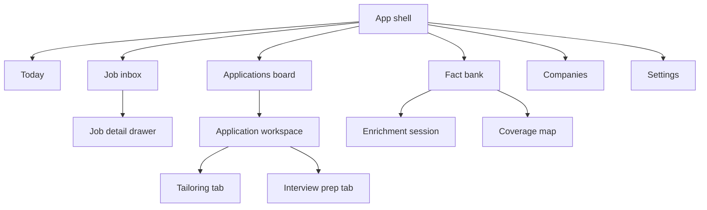
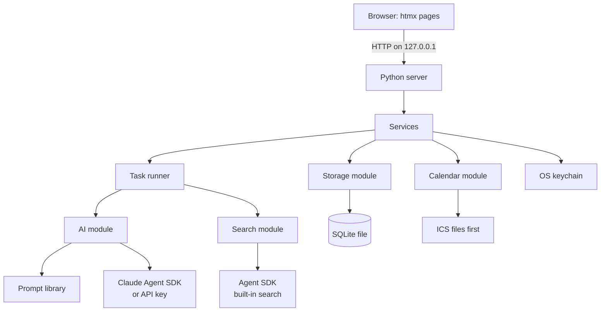
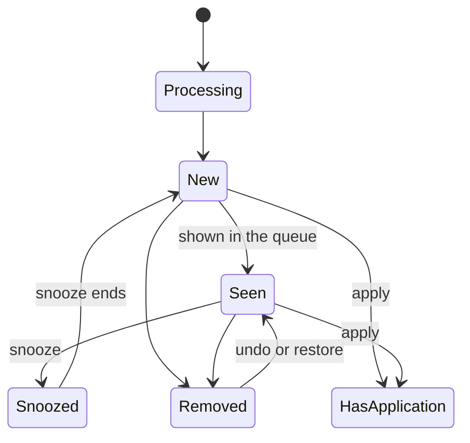
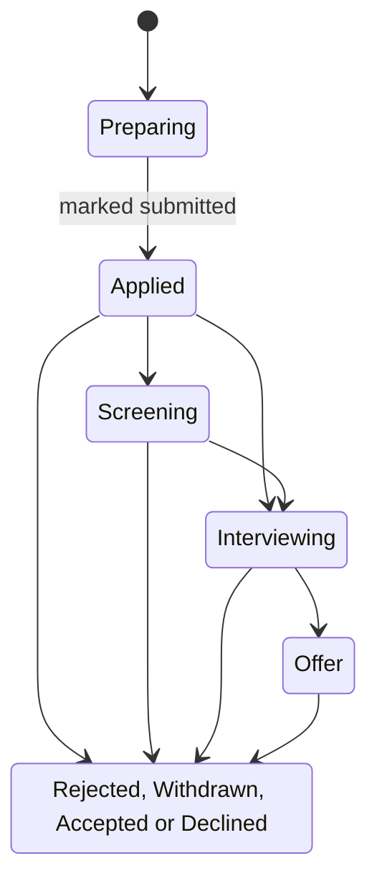
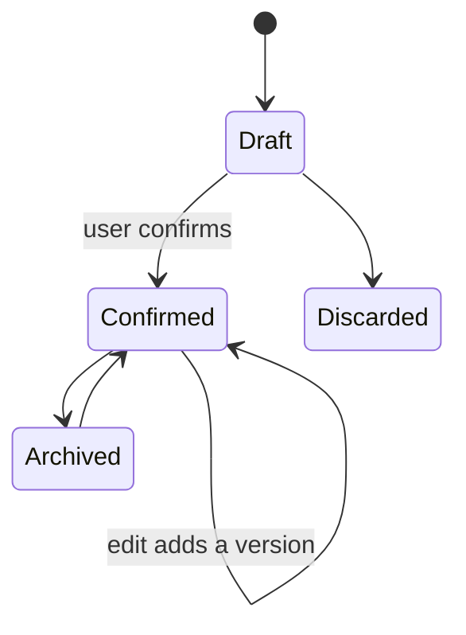

> Exported from the Claude Doc "Job Search Pipeline — Detailed Design" on 2026-10-03. Wireframes are not included in this export (they appear as placeholders); open the original doc to see them. This is the newest design source: where it differs from product-spec.md, this file wins.

# Job Search Pipeline — Detailed Design

Sep 26, 2026 · @Goncalo Silva

This document turns Doc into concrete screens, interactions and a technical blueprint, with low-fidelity wireframes for the core screens.

## UX principles

The app should feel fast for routine work, transparent about everything the AI produces, and calm during what is often a stressful time.

| Principle | What it means in the interface |
| --- | --- |
| Fast routine actions | Keyboard shortcuts for triage and navigation, one-tap removal reasons, autosave, instant updates with undo |
| AI output is reviewable | Every AI output carries a "Draft" badge until the user approves it, shows which facts it used, and can be edited or regenerated |
| No false precision | Fit shown as bands (Strong, Possible, Stretch) with matched and missing requirements, never a bare percentage |
| Progressive disclosure | Summaries first, full detail on demand; advanced settings collapsed by default |
| Calm, not gamified | No streaks, badges or guilt prompts; rejections recorded neutrally; optional features never nag |
| Never lose work | Autosave everywhere, undo for destructive actions, version history for documents and facts |
| Accessible by default | WCAG 2.2 AA contrast, full keyboard use, visible focus, status never shown by color alone, reduced-motion support |

**Layout system:**

- **Desktop-first,** responsive down to phone width, so every screen works on a small screen. Opening the app from a phone over the home network stays off by default; a later opt-in setting would add a login first.
- **App shell:** collapsible left sidebar for navigation; a top bar with search (command palette), a background-task indicator and notifications; the main area; and a right-side drawer for details.
- **Drawers keep context.** Opening a job or application slides in a drawer, so the user never loses their place in the inbox or board.
- **One pattern per purpose:** cards for things to decide on, tables for things to compare, drawers for detail, dialogs only for confirmations and budget warnings.
- **Comfort settings:** light and dark themes following the system, and a comfortable or compact density toggle.

## Information architecture

Six top-level areas cover the whole journey, and most detail opens in drawers or tabs rather than new pages.



**Sidebar, in order:** Today, Job inbox (badge: new jobs), Board, Fact bank (badge: drafts to review), Companies, and Settings pinned at the bottom.

**Available everywhere:** the command palette (Ctrl/Cmd+K) and a quick-add button for adding a job URL, jotting a fact, or logging an event.

| Screen | Purpose | Key actions | Wireframe |
| --- | --- | --- | --- |
| Setup guide (first run, re-runnable) | Get a new user working, provider first | Data folder, AI provider, search, CV import, preferences | Yes |
| Today | Daily overview | Open due items, start a session | No |
| Job inbox | Triage new jobs | Apply, remove, snooze, add job | Yes |
| Job detail (drawer) | Full posting and fit | Apply, open company | No |
| Company page | Everything about one company | Add contact, notes, see history | No |
| Application workspace | Tailor and submit | Approve CV and letter, mark submitted | Yes |
| Board | Track applications | Move status, open drawer | Yes |
| Fact bank | Browse and maintain facts | Confirm drafts, edit, capture | Yes |
| Enrichment session | Guided questions | Answer, skip, ask later | Yes |
| Interview prep (tab) | Prepare for interviews | Generate, practice, debrief | Yes |
| Settings | Providers, budgets, lists, prompts, data | Test connection, set budgets, export | Yes |

## Today and the setup guide

**Today** answers one question: what needs attention now. It is the default landing screen once setup is done.

Blocks, in priority order (empty blocks are hidden):

1. **Upcoming interviews** in the next 7 days, each with its prep state: not started, questions ready, or practiced.
2. **Due follow-ups and reminders.**
3. **New jobs** not yet seen in the inbox: a count plus the top three Strong fits.
4. **Drafts to review:** facts and generated documents awaiting approval.
5. **Suggested session** (optional): "3 questions, about 5 minutes", shown no more often than the user's chosen frequency, and dismissible.

A small neutral summary shows applications per status. When nothing is due, the screen says so plainly rather than inventing tasks.

**The setup guide** is a separate module (`app/onboarding/`) that walks a new user through everything the app needs, one step at a time. It opens automatically on first use and can be re-run from Settings at any time.

&#91;embedded content: Setup guide wireframe · AI provider step with token, test and progress\]

**When it opens.** At startup the app checks, in order:

1. No bootstrap config file in the system's config folder: first run, so the guide starts at Welcome.
2. The config points to a data folder with no database: the folder was moved or deleted, so the guide offers to locate it or start fresh.
3. A database exists but setup was never completed: the guide resumes at the first unfinished required step.
4. Setup is complete but a required provider no longer works (for example, its key was removed from the keychain): no wizard; a banner links straight to the provider step.

While setup is incomplete, every page except the guide, static files and the health check redirects to the guide.

| Step | What happens | Required |
| --- | --- | --- |
| 1. Welcome and data folder | Explains what the app does and what stays on this computer; the user picks the data folder (a sensible default per system), which creates the database. A "Try the demo" link opens a separate demo workspace instead. | Yes |
| 2. AI provider | Choose Claude via subscription or via API key, follow the inline instructions, paste the token or key, then test the connection. | Yes |
| 3. Web search | Uses the Agent SDK's built-in search by default; a usage budget can be set here. | No |
| 4. Import CV | Upload a PDF or Word file, or paste text. Extraction runs in the background and creates drafts to review now or later in the fact bank. | No, recommended |
| 5. Job preferences | Target roles, locations, work mode, minimum salary, must-haves, deal-breakers, and the country used for CV templates. | Yes |
| 6. Done | A checklist of what is configured and what was skipped, with links, and a first action: add a job. | — |

**Provider step details:**

- **Claude via subscription:** the user installs Claude Code, runs `claude setup-token` in a terminal and pastes the token. The app keeps it in the system keychain and hands it to the Agent SDK only when making calls. If the user is already signed in to Claude Code on this computer, the test can try that sign-in instead.
- **Claude via API key:** the user creates a key in Claude Console and pastes it.
- **Test connection** sends one very small request, which uses a tiny amount of the plan or credit. Failures map to plain advice: Claude Code not found, token expired (run `claude setup-token` again), usage limit reached, or no network.
- **Terms note:** Anthropic's terms ask developers building products or services with the Agent SDK to use API key authentication. The step says so and links to the current terms, so each user chooses knowingly.

**Behavior:**

- Each step saves as soon as it is valid, so closing the browser or the app never loses progress.
- Optional steps offer "Skip for now"; the Done screen and Today list anything skipped.
- Keys and tokens are never shown again after saving, and never written to logs, files or exports.
- If the system has no keychain, the step explains the environment-variable fallback instead of failing.
- The guide follows the same accessibility and responsive rules as the rest of the app.

**Module boundaries.** Each step is a small unit with an id, a title, a required flag, a completeness check and its own page fragment, registered in order. Adding or reordering steps touches only the onboarding module. Step progress lives in a setup\_state table; a small bootstrap config file in the system's config folder records where the data folder is.

## Job inbox

The inbox is built for fast, confident triage: one focused card at a time, with the queue alongside.

&#91;embedded content: Job inbox wireframe · queue and focused card\]

**Intake:**

- **Quick add.** Paste a URL or the job text into "+ Add job" or the command palette. If a page can't be fetched, the app asks for the text instead. The card appears immediately in a "Processing" state while the AI summarizes it.
- **Automated sources** (later phase) add new jobs as they are found.
- **Duplicates** are merged into one card that says "also posted on N sites". A "not a duplicate" action splits them again.

**Card anatomy:** title; company, its industry, and the department or team if stated; work mode; salary range if listed; experience required; age of the posting; fit band and source; a 2–3 line summary; matched and missing requirement chips; a link to the full description; triage buttons with their shortcuts.

**Fit bands:**

- **Strong:** meets all must-haves and most key requirements.
- **Possible:** meets must-haves, with some gaps.
- **Stretch:** significant gaps.
- A job that hits a deal-breaker is flagged "conflicts with your preferences", not hidden, unless the user turns on auto-hiding.

Bands describe how well the user's evidence matches the requirements, not how interesting the job is, and they never hide a job. They show where tailoring will need the most work and set honest expectations.

**Triage interactions:**

| Action | Shortcut | Behavior |
| --- | --- | --- |
| Apply | A | Creates an application in "Preparing"; the user can keep triaging and tailor later |
| Remove | R | Archives the card and shows one-tap reason chips (too junior, too senior, location, salary, industry, company, not interested, other); skippable; undo available for a few seconds |
| Next / previous | J / K | Moves through the queue; a card counts as seen once it has been shown, so no separate Later button is needed |
| Snooze | Card menu | Hides the card until a chosen date, then returns it to the queue as new |
| Open details | Enter | Opens the job detail drawer |

**Learning from removals.** Removals teach the app the user's real criteria, but only through suggestions the user approves, never by quietly hiding jobs.

1. **Capture.** Each reason chip maps to a preference field: too junior or too senior to seniority, location to location and work mode, salary to minimum salary, industry to excluded industries, company to excluded companies. "Not interested" and "other" accept optional free text.
2. **Pattern detection.** Deterministic, so it can always be explained. The app looks for removals with the same reason that also share a field value, for example four "location" removals that are all onsite roles outside the user's city. A suggestion needs a minimum number of matching removals (user-set, default 3) and no applications that contradict it, such as an onsite job the user applied to.
3. **Suggestion.** A dismissible card at the top of the inbox, such as "You removed 4 onsite roles for location. Flag onsite roles outside your city from now on?", with a preview of how many inbox jobs it would affect. Options: Flag them (default), Hide them, or Dismiss.
4. **Visible, reversible rules.** Accepted rules appear in Settings > Job preferences together with the removals that created them, and can be edited or switched off. Hidden jobs stay reachable through a "Hidden by your rules" view with a count.
5. **No nagging.** A dismissed suggestion returns only if the evidence for it doubles.
6. **Free-text reasons.** On request, the AI groups free-text reasons into themes and proposes preference changes, which go through the same suggestion step.

**Views.** Group by any structured field (company collapses several roles into one group), with counts per group. Filters can be saved as named views, such as "Remote, Strong fit".

## Job detail and company pages

The job drawer explains the fit in the user's own facts, and the company page gathers everything the user knows about one employer.

**Job detail drawer:**

- **Header:** title, company (links to its page), fit band, and the same triage buttons as the card.
- **Fit explained:** each key requirement is listed with the fact that matches it, or marked as missing. Each fact links to the fact bank, so the user can check or improve it.
- **Full description:** the snapshot taken at intake, with its capture date and a link to the original. If the original disappears, the snapshot remains.
- **Extracted fields:** editable. Values the user corrects are marked and never overwritten when the job is re-summarized.
- **Sources:** every posting merged into this card.
- **Notes:** free text.

**Company page:**

- **Header:** name, website, industry, size and locations, plus a "watch this company" toggle that follows its careers feed in the automated phase.
- **Roles:** every job seen at this company, with its state (new, later, removed, applied).
- **History:** past applications with dates and outcomes. When the user applies again within a period they choose, the app shows a gentle note (for example, "2 applications here in the last 30 days"). It never blocks.
- **Contacts:** name, role, how the user knows them, last contact date, and linked applications.
- **Research:** user notes, plus an optional on-demand AI company brief using web search. The brief is saved with its date and sources, and counts toward the usage budget.

**Companies list:** a sortable table with name, open roles, active applications and last activity.

## Application workspace

Each application gets one workspace where tailoring happens step by step, and nothing leaves the draft state without the user's approval.

&#91;embedded content: Application workspace wireframe · CV review with diff and facts used\]

**Layout.** A header with the job, company and status, and three tabs: Tailoring, Interview prep, and Timeline and contacts. Tailoring is a five-step stepper; steps can be revisited, and progress autosaves.

| Step | What the AI does | What the user does |
| --- | --- | --- |
| 1. Gap check | Maps each requirement to facts, lists gaps, suggests honest framing for related experience, and flags roles that may not be worth applying for | Reviews; can answer a few quick questions to add missing facts |
| 2. Angle | Proposes 2–3 positioning angles with a one-line rationale each, reusing angles chosen for similar roles | Picks or edits one |
| 3. CV | Builds the tailored CV from confirmed facts and shows the diff against the master CV | Approves, edits inline, or regenerates with a short note ("shorter", "emphasize leadership") |
| 4. Cover letter | Drafts from the same facts and angle, with tone and length settings | Edits and approves |
| 5. Submit | Shows a checklist and exports the files | Submits on the employer's site, then marks the application "Applied" |

**Diff conventions.** Added, removed, reworded and moved lines each carry a symbol as well as a color, so meaning never depends on color alone. Hovering a line shows the fact it came from.

**Editing rules:**

- User edits survive regeneration unless the user explicitly chooses "replace everything".
- If the user types a new claim directly into the CV, the app asks "Save this as a fact?", keeping the fact bank the single source of truth.

**Export and freeze.** Exported files are saved in the data folder under the application. Marking an application "Applied" records the date and freezes the versions sent. Later edits create new versions and never alter what was submitted.

**Formats and country templates.** Every document exports to both PDF and Word. The CV layout follows a template per country: the AI drafts a template specification from that country's conventions (sections and their order, length, photo slot, which personal details appear, date format). The user reviews it once, and it is reused for every application in that country.

For example, German CVs commonly include a photo, while US résumés usually leave it out. A photo appears only when the template has a slot and the user has uploaded one. A fixed renderer turns the approved template and the CV content into PDF and Word, so documents look consistent rather than being redesigned on each run.

## Tracking board

The board shows every application by status, and a drawer gives full detail without leaving the board.

&#91;embedded content: Tracking board wireframe · status columns and application drawer\]

**Columns.** One per user-defined status. Closed statuses (Rejected, Withdrawn) share a single collapsed "Closed" column that expands on demand. A sortable table view is available for users with many applications.

**Moving cards.** Drag and drop, or change the status in the drawer. Some moves offer an optional, skippable follow-up: moving to "Interviewing" asks "Add the interview date?"; moving to "Rejected" asks "Any feedback worth noting?", which can feed the fact bank.

**Card anatomy:** company, role, and one line of what comes next (the next event, or days since the last activity). Due follow-ups show a warning marker with text, not color alone.

**Application drawer:** status, next event and its prep state, contacts, the frozen documents sent, a timeline (status changes logged automatically, plus manual notes), and actions to open the workspace or add an event.

**Events:**

- Types: interview (round, format, interviewers), follow-up, deadline and offer deadline, each stored with its time zone.
- Each event can be downloaded as a calendar file (.ics), which works with any calendar app and needs no connection. Export sits behind its own calendar module, so one-click adding to Google Calendar, Outlook or other calendars can arrive later as new providers without changing the rest of the app.
- After an interview, an optional reminder to send a thank-you note, which the AI can draft on request.

**Reminders.** Rules per status, such as "remind me if an application sits in Applied for N days" (N set by the user). Reminders appear on Today and as a sidebar badge. Reminders are in-app only: they appear whenever the app is open, and nothing runs in the background.

**Contacts.** Stored per company and linked to applications, with a simple interaction log (date, channel, note).

## Fact bank

The fact bank is where the user sees, edits and grows everything the app knows about them, with drafts kept apart until confirmed.

&#91;embedded content: Fact bank wireframe · filters, fact list and story editor\]

**Tabs:**

- **Library:** browse by role, skill, tag or status, with full-text search. Each item lists the applications that used it as quick links, which open the application drawer.
- **Drafts to review:** facts from CV import, sessions, interview prep and claims typed into CVs. Actions: confirm, edit then confirm, merge with an existing fact, or discard. Drafts from one source can be confirmed together.
- **Coverage:** common requirements across saved jobs against the strength of the user's evidence.
- **Capture inbox:** quick notes waiting to be expanded.

**Two item types:**

- **Fact:** a single statement, such as a skill, tool, certification or metric.
- **Story:** situation, action and result, linked to a role and to skills.

**Editor fields:** role, skills (from the controlled list), tags and dates. Two privacy options protect the user: "never use in applications" and "generalize names", which makes the AI write "a large retail bank" instead of a confidential client's name.

**Refine with AI.** Any fact, including confirmed ones, has a "Refine with AI" action. It opens a short conversation about that one fact: the AI asks what would make it stronger (the result, the scale, a number) and can suggest clearer wording. The same rules as sessions apply: the AI never adds details the user did not give. Accepting a change saves a new version, and the user can always edit the fact directly instead.

**History and use.** Every edit creates a version, viewable as a diff. If a fact used in a sent application changes, its "used in" list notes that the sent version differs; sent documents never change.

**Quality hints.** Gentle, non-blocking suggestions such as "add a result?" or "add a number?". The enrichment backlog picks these up as questions.

**Coverage view.** A sorted table of requirement clusters, showing how many saved jobs ask for each and the evidence strength: Strong (two or more confirmed stories), Thin (facts but no story), or None. Selecting a row starts a session focused on it.

&#91;embedded content: Coverage view wireframe · requirements sorted by biggest gap\]

Rows with no evidence offer "Start session"; thin rows offer "Strengthen", which opens the related facts with "Refine with AI".

**Near-duplicates.** The AI suggests merging facts that say the same thing; the user decides.

## Enrichment sessions

Sessions are short, focused conversations that turn the user's memories into draft facts, one question at a time.

&#91;embedded content: Enrichment session wireframe · question, answer and live draft\]

**Starting points:** a suggestion on Today, "Start session" in the fact bank, a row in the coverage view, an application's gap check, a post-interview debrief, or a rejection. The user picks a length (3 or 5 questions) and a focus (a role, a skill, a job) or "most useful", which takes the top of the backlog.

**Question rules:**

- Open, non-leading questions ("Tell me about a time…", never "You led stakeholders, right?").
- One question at a time; follow-ups ask for what is missing (a result, a number, the scale) based on the answer.
- A short line explains why each question is being asked.
- The AI never suggests an answer or fills in details the user did not give.
- "I don't remember" is accepted gracefully and revisited later from a different angle.

**Answer handling.** The AI structures each answer into a draft fact or story, shown live below the question. The user's original answer is stored alongside the draft for reference. At the end, a summary lists the drafts created, to confirm, edit, discard, or leave in "Drafts to review".

**Backlog priority:**

| Signal | Effect on priority |
| --- | --- |
| Many saved or active jobs need the requirement | Raises it; applications in progress and upcoming interviews count most |
| Weak evidence (None, then Thin, then quality hints) | Raises it |
| Asked or skipped recently | Lowers it for a cooldown period |
| "Not sure" answer | Retried after the cooldown, phrased differently |
| "Ask me later" | Retried when the user chooses from a small menu: next session, in a week, in a month, or a date; the default is set in Settings > Sessions |
| Capture inbox note | Raises it |
| Related jobs removed or closed | Question expires |

**Frequency controls** (in settings): how often sessions are suggested (never, weekly, twice a week, after each application), default session length, and a "pause all suggestions" switch.

## Interview prep

Interview prep lives in a tab on each application and generates nothing until the user asks.

&#91;embedded content: Interview prep wireframe · labeled questions and practice feedback\]

**Questions.** "Generate questions" builds a first set from the job and the CV actually sent. Filters cover behavioral, technical, about your CV, and questions to ask them. Each question shows its origin. It starts with a short list of the most likely questions (about 10), and "show more" adds depth in batches.

**Web questions** have their own button, which states that it uses web search and shows the month's usage. Results are labeled "Reported online" with source and date.

**Practice.** The user answers in text (voice is a later option) and gets a feedback checklist:

- Does it answer the question?
- Is it structured (situation, action, result)?
- Is there concrete evidence?
- Is the length right, as estimated speaking time?
- Is it consistent with the CV sent?
- Honesty check: claims not found in the fact bank are flagged with "This isn't in your fact bank. Add it as a draft?"

Feedback is specific and kind, and points to relevant facts. Each question keeps its practice history and can be marked "ready".

**Narrative.** Cards for the recurring answers: tell me about yourself, why this role, why this company, why you are leaving, strengths, weaknesses, and salary expectations (drawn from job preferences). Each is built from the chosen angle and confirmed facts, and can be reused by other applications with the same angle.

**Debrief.** After an interview's date passes, Today offers an optional debrief: which questions were asked, how it went, what the user wishes they had said, and next steps. It produces question-bank entries, draft facts, new events, and a suggested status change for the user to confirm.

**Personal question bank.** Every question practiced or reported is kept and searchable, and new generation reuses it first, which saves usage.

**How the bank serves a new application:**

1. **Tagging.** Every bank question carries its type, the requirement clusters it tests (the same list the coverage view uses), role family and seniority, the company if it is company-specific, its origin, and how often it was asked in real interviews.
2. **Candidates.** For a new application, the app pulls bank questions whose requirement clusters match the job's key requirements, plus general behavioral questions. Company-specific questions are reused only for the same company.
3. **Ranking.** A question ranks higher the more it overlaps the job's requirements (weighted by how central each requirement is to the job), if it was asked in real interviews, and if its role family matches. Questions already marked ready move to an "Already prepared" group instead of disappearing.
4. **Filling gaps.** The AI generates new questions only for key requirements that no bank question covers, which keeps usage down.
5. **Carrying answers over.** A reused question brings its best practiced answer, with an "Adapt to this role" action that rewrites it for the new angle under the usual honesty rules.
6. **Merging duplicates.** Near-identical questions are merged, keeping the record of where each was asked.

**Prep state** (not started, questions ready, practiced) shows on the board card and on Today.

**Cost control.** Buttons state what they use. Generated sets are cached; regenerating asks for confirmation and keeps practiced answers.

## Settings and usage budgets

Settings hold everything that makes the app personal; a new user can start with defaults and change anything later.

&#91;embedded content: Settings wireframe · usage budget meter, thresholds and warning dialog\]

| Area | Contents |
| --- | --- |
| Providers | AI and search provider dropdowns, fields per provider, test connection, model per task tier |
| Usage budgets | Optional, per external service (AI or search): allowance, two warnings, blocking point, reset day; a provider without a budget runs without limits |
| Job preferences | Target roles, locations, work mode, minimum salary, must-haves, deal-breakers |
| Lists and statuses | Allowed values for grouping fields and skills, board statuses, removal reasons |
| Prompts | View, edit and reset each prompt; version shown |
| Sessions | Suggestion frequency, session length, pause switch |
| Appearance | Theme and density |
| Data and privacy | Data folder, export and import, demo mode, delete all data |

**Model per task tier.** Users can assign a faster, lighter model to routine tasks (summaries, field extraction) and a more capable one to tailoring and feedback. This stretches plan limits or API spend.

**How tiers work:**

1. Each AI provider lists the models it offers. In Settings > Providers, the user maps two tiers, Fast and Thorough, to one model each.
2. Every AI task has a default tier (see AI task contracts in the technical blueprint). An advanced list lets the user move any task to the other tier.
3. At run time the path is: task, then its tier, then that tier's model, then the provider call.

**Tiers and budgets:**

- A budget belongs to a provider, so tasks on both tiers count against it. The unit is requests, or tokens where the provider reports them.
- The usage panel breaks usage down by tier and by task, so the user can see where it goes.
- Each tier can optionally get its own cap inside the provider's budget, for example a monthly limit on Thorough tasks.
- When a cap blocks a Thorough task, the app offers to run it once on Fast. It never switches on its own, since quality may differ.
- On a Claude subscription, the plan's own limit is not expected to be visible to the app as a number (to confirm when building). A budget there is a self-imposed cap on requests; if the plan's limit is reached first, the app shows the provider's message.

**Key fields.** After saving, a key shows masked, with "Replace" and "Test connection". Keys live in the operating system's keychain. If no keychain is available (some Linux setups lack one), the app falls back to an environment variable and says so.

**Budget warnings:**

- The check happens before the request runs. If the action would cross a threshold, a dialog shows the count, the allowance and the reset date, with Continue, Not now and Change limits.
- Each threshold triggers a dialog once per cycle; afterwards, a small inline note shows the count instead.
- At the blocking point, the action's button is disabled with a plain explanation ("Monthly search limit reached. Resets on the 12th."), a link to settings. Features that don't need that provider keep working: interview questions still generate from the job and the CV, since web questions only run when the user asks for them.
- Threshold fields validate inline: first warning < second warning < blocking point ≤ allowance.
- The panel shows both the local count and the provider's reported count, and which one is in use.

**Search terms awareness.** Each search provider module declares whether saving AI output derived from its results is known to be allowed. When it is unclear (as with Brave's terms), selecting that provider shows a notice. The user can then choose "don't save output based on this provider's results", so those results are regenerated each time instead of cached.

## Cross-cutting UX

A handful of shared patterns make every screen behave the same way, so the user learns the app once.

**Command palette** (Ctrl/Cmd+K): searches jobs, companies, applications and facts, runs actions (add job, start session, new event), and lists recent items.

| Shortcut | Action |
| --- | --- |
| Ctrl/Cmd+K | Command palette |
| G then T, I, B or F | Go to Today, Inbox, Board or Fact bank |
| N | Quick add: job, fact or event |
| ? | Show all shortcuts |
| Esc | Close drawer or dialog |

Single-key shortcuts can be switched off, since they can clash with screen readers and other assistive tools.

**Background AI tasks:**

- Every AI action runs in the background; the interface never freezes.
- The top-bar indicator shows running tasks. Its panel lists each task with progress, a cancel button and a link to the result.
- Results arrive as drafts, with a notification.
- Failures state the reason and offer a retry, for example: "Your Claude plan's usage limit was reached. Try again later or switch provider in Settings."
- Tasks are stored in the database, so they survive page reloads. If the app restarts mid-task, the task is marked interrupted and can be retried.

These guarantees rely on the task reliability rules in the technical blueprint.

**Screen states:**

| State | Pattern |
| --- | --- |
| Empty | Explains what belongs here and offers the first action ("No facts yet. Import your CV?") |
| Loading | Placeholder shapes; AI text appears as it is written where the task supports it |
| AI working | "Writing a draft…" with a cancel button |
| Error | What happened, reassurance that nothing was lost, what to do next, and a retry |
| AI unavailable | Browsing and editing keep working; AI actions are disabled with the reason shown |

**Undo over confirmation.** Reversible actions (removing a card, deleting a note) happen immediately with an undo option. Confirmation dialogs are reserved for irreversible actions, such as deleting all data or discarding the user's edits.

**Notifications.** An in-app list for AI results ready, reminders due and budget warnings. Nothing is sent outside the app.

**Tone of voice.** Plain, warm and never blaming. Rejections read "Closed: rejected", not "failed". Dates show relative time, with the exact date on hover.

**Accessibility specifics:**

- Every drag-and-drop has a keyboard alternative (for example, a status menu on each board card).
- Focus stays inside open dialogs and returns to where it was on close.
- Screen readers are told when an AI task finishes.
- Status always uses text or an icon alongside color.
- Click targets are at least 24 by 24 pixels, per WCAG 2.2 AA.
- Animations respect the system's reduced-motion setting.

## Technical blueprint

One local server hosts the interface and a small API; services hold the product logic and reach the outside world only through the AI, search and storage modules.



Services cover jobs, companies, applications, facts, sessions, tailoring, interview prep and usage. Only the task runner calls external providers, which gives budget checks a single place to live.

**Stack** (decided): a Python backend, because the Claude Agent SDK, the keyring library and SQLite all work natively there, served by a lightweight web framework such as FastAPI, with Jinja2 templates. For the frontend, server-rendered pages with htmx, which is simpler to maintain.

**How htmx covers the interface:**

- Pages and fragments are rendered on the server; htmx swaps fragments in place for triage, drawers, tabs and filters.
- Live task updates use htmx's server-sent events extension.
- A few small scripts cover what must run in the browser: drag-and-drop on the board (SortableJS, the approach htmx's own examples use), keyboard shortcuts and the command palette.
- Performance: on the user's own machine a fragment round trip typically takes milliseconds, and there is no large JavaScript bundle to load. To keep triage instant, the next card in the queue is fetched ahead of time.
- Accessibility: after each swap, focus is moved deliberately and status changes are announced to screen readers, since swapped fragments otherwise go unnoticed.

**Task runner:**

- An in-process queue, persisted in a tasks table: type, status, progress, input and result references, error, timestamps.
- A small concurrency limit (user-configurable) to respect provider rate limits.
- Cancel support, and a budget check before every external call.
- Live updates to the interface through server-sent events.

**Task reliability.** This is the most bug-prone part of the app, so its rules are explicit:

1. **One source of truth.** The tasks table holds each task's state: queued, running, succeeded, failed, cancelled or interrupted. Every state change is a single conditional update that only succeeds if the task is still in the expected state, so two workers can never take the same task.
2. **No duplicate work.** Each task has a key made of its type and target (for example, tailoring the CV for one application). Starting a task that is already queued or running returns the existing one.
3. **Atomic results.** A task's output and its "succeeded" state are written in the same database transaction. Results are always new drafts linked to the task; a retry never overwrites earlier output.
4. **Crash recovery.** On startup, any task still marked running is set to interrupted, because the process running it is gone. Failed and interrupted tasks are never retried automatically, since a retry spends the user's allowance; retrying takes one click.
5. **Hung calls.** Running tasks update a heartbeat. A watchdog marks a task interrupted when its heartbeat stops for longer than that task type's timeout.
6. **Cancellation.** Cancelling sets a flag the task checks between steps, and aborts the provider call where the provider allows it. Partial output is discarded.
7. **Usage accounting.** A usage record is written before each external call and completed after it, so a crash can never undercount.
8. **Reconnecting pages.** When the event stream reconnects, the page re-fetches the current state of its tasks, so a missed event cannot leave it out of date.
9. **Database settings.** SQLite runs in write-ahead logging (WAL) mode with a busy timeout and short transactions, so the interface stays responsive while tasks write.
10. **Failure tests.** Automated tests kill the process mid-task, drop the network, return invalid output and cancel during a call, then check that every task ends in a correct state.

**Local routes (HTML fragments for htmx; JSON for export, import and tests):**

| Endpoint | Purpose |
| --- | --- |
| POST /api/jobs/intake | Add a job from a URL or text; returns job and task ids |
| GET /api/jobs | List with filters, grouping and saved views |
| PATCH /api/jobs/{id} | Triage actions and field corrections |
| GET /api/companies/{id} | Company page data |
| POST /api/applications | Create an application from a job |
| POST /api/applications/{id}/tailor/{step} | Run a tailoring step as a task |
| POST /api/applications/{id}/submit | Mark applied and freeze versions |
| /api/facts | Fact bank: list, create, edit, confirm, merge |
| POST /api/sessions | Start an enrichment session; answers go to /api/sessions/{id}/answers |
| POST /api/applications/{id}/prep | Generate question sets, optionally with web search |
| GET /api/tasks/{id} | Task status |
| GET, PUT /api/settings | Settings; never returns keys |
| PUT /api/secrets/{provider} | Store a key in the keychain; write-only |
| GET /api/usage | Budget status per service |
| POST /api/providers/{name}/test | Test a provider connection |
| /api/export, /api/import | Data backup, excluding keys |

Every API call must carry a random token generated at each launch and embedded in the app's own page, and the server checks the request's origin. Together these stop other websites from calling the local API.

**AI task contracts:**

| Task | Input | Output | Default tier |
| --- | --- | --- | --- |
| summarize\_job | Job text, preferences | Summary, structured fields, requirements | Fast |
| assess\_fit | Requirements, confirmed facts, preferences | Band, matched requirements with fact ids, missing, deal-breaker flags | Fast |
| extract\_cv | CV text | Draft roles, facts, stories, skills | Thorough |
| gap\_check | Requirements, facts | Requirement-to-fact map, gaps, framing ideas | Thorough |
| propose\_angles | Facts, job, earlier angles | 2–3 angles with rationale | Thorough |
| tailor\_cv | Facts, angle, master CV, style settings | CV sections, each line with its fact ids | Thorough |
| draft\_cover\_letter | Facts, angle, job, tone | Letter, each paragraph with its fact ids | Thorough |
| enrichment\_question | Backlog item, related facts, session so far | One question plus why it is asked | Fast |
| structure\_answer | Question, user's answer | Draft fact or story, missing parts | Fast |
| interview\_questions | Job, CV sent, question bank, optional search results | Questions with type and origin | Thorough |
| answer\_feedback | Question, answer, facts, CV sent | Checklist results, unsupported claims, suggested facts | Thorough |
| refine\_fact | One fact, related job requirements, conversation so far | Sharpening questions and suggested wording, with no new claims | Fast |
| adapt\_answer | Practiced answer, new job and angle, facts | Adapted answer with fact ids | Thorough |
| group\_removal\_reasons | Free-text removal reasons | Themes and suggested preference changes | Fast |
| draft\_cv\_template | Country, user's style preferences | Template specification for the user to review | Thorough |

**The honesty rule is enforced mechanically.** Every generated line or paragraph must cite the fact ids it relies on. Any line without one is flagged as unsupported for the user to review. Outputs are validated against a JSON schema, with one automatic retry on invalid output before reporting an error.

**Prompt files.** One file per task in the prompts folder, with a header (task, version, output schema, default tier) and a template with placeholders. User edits are saved as overrides in the data folder, so updated defaults never overwrite them.

**Calendar module.** Event export sits behind its own interface, like AI and search. The first provider writes .ics files. Later providers (Google Calendar, Outlook, CalDAV) can add one-click adding and updates; each synced event stores the provider's event id so later changes can be pushed to it.

**Optional speech.** AI providers declare whether they offer speech-to-text and text-to-speech. Microphone and read-aloud buttons appear only when the configured provider supports them, and run only on demand. If the main AI provider has no speech support, a separate speech provider can be added later through the same module pattern.

**Document rendering.** A fixed renderer turns approved CV templates and content into PDF (from HTML, for example with WeasyPrint) and Word (for example with python-docx).

**Repository layout:**

```
job-pipeline/
  app/
    api/          routes: pages, htmx fragments, JSON
    onboarding/   setup guide: step registry, first-run detection
    services/     jobs, companies, applications, facts,
                  sessions, tailoring, prep, usage
    modules/
      ai/         interface + providers
      search/     interface + providers
      calendar/   interface + providers (.ics first)
      storage/    repository interface + SQLite
    render/       CV and letter rendering (PDF, Word)
    tasks/        background task runner
    templates/    Jinja2 pages and fragments
    static/       htmx, small scripts, CSS
    cli.py        jobpipeline command (--setup, --demo, ...)
  prompts/        default templates and output schemas
  demo/           fictional persona and sample jobs
  docs/           technical spec, references, progress log
  tests/
  .claude/        agents, skills, rules and hooks for Claude Code
  CLAUDE.md
  .env.example
  README.md
  LICENSE
```

**User data folder** (outside the repository):

```
<data folder>/
  app.db
  documents/<application id>/
  imports/
  prompts/overrides/
  exports/
```

## State machines and database schema

Three lifecycles drive most of the app's behavior: jobs, applications and facts.

**Job lifecycle:**



**Application lifecycle** (default statuses):



Users can rename or add statuses, but each one belongs to a phase (preparing, active or closed). Reminders, the Closed column and Today rely on the phase, so custom statuses never break them.

**Fact lifecycle:**



**Database schema** (SQLite; key columns only):

| Table | Key columns |
| --- | --- |
| companies | id, name, website, industry, size, locations, watch, notes |
| jobs | id, company\_id, title, description\_snapshot, fields (JSON, with user corrections flagged), fit\_band, fit\_detail, triage\_state, snooze\_until, removal\_reason, found\_at |
| job\_sources | id, job\_id, source, url, found\_at |
| applications | id, job\_id, status, phase, angle\_id, applied\_at, notes |
| status\_history | id, application\_id, from\_status, to\_status, changed\_at |
| contacts | id, company\_id, name, role, email, relationship, notes |
| application\_contacts | application\_id, contact\_id |
| interactions | id, contact\_id, application\_id, happened\_at, channel, note |
| events | id, application\_id, type, starts\_at, time\_zone, details, reminder\_at, external\_calendar\_refs |
| documents | id, application\_id, type, version, content, format, status (draft, approved, sent), model, prompt\_version |
| document\_fact\_versions | document\_id, fact\_version\_id |
| roles | id, employer, title, start\_date, end\_date |
| facts | id, type (fact or story), status, role\_id, privacy (normal, never use, generalize), current\_version\_id |
| fact\_versions | id, fact\_id, version, text, situation, action, result, source, original\_answer, created\_at |
| skills | id, name, aliases |
| fact\_skills | fact\_id, skill\_id |
| angles | id, name, description |
| enrichment\_questions | id, text, requirement\_cluster, priority, status, cooldown\_until, origin |
| sessions | id, focus, started\_at, ended\_at |
| session\_answers | id, session\_id, question\_id, answer\_text, outcome, draft\_fact\_id |
| capture\_notes | id, text, created\_at, resolved\_fact\_id |
| interview\_questions | id, application\_id (empty for bank-only entries), company\_id, text, type, requirement\_clusters, role\_family, seniority, origin, source\_url, times\_asked |
| practice\_attempts | id, question\_id, answer\_text, feedback, created\_at |
| tasks | id, type, status, dedupe\_key, attempt, progress, heartbeat\_at, cancel\_requested, input\_ref, result\_ref, error, created\_at, finished\_at |
| usage\_records | id, provider, task\_type, tier, units, requested\_at, success |
| provider\_usage\_snapshots | id, provider, remaining, resets\_at, observed\_at |
| controlled\_values | id, field, value, aliases |
| settings | key, value |
| removal\_rules | id, field, condition, mode (flag or hide), evidence\_job\_ids, active, created\_at |
| cv\_templates | id, country, spec, approved\_at |
| setup\_state | step\_id, status (pending, done, skipped), completed\_at |

Full-text search indexes cover facts and jobs. Timestamps are stored in UTC and shown in local time.

## Installing and running the app

The app runs locally with one command, and the setup guide takes over on first launch.

**Prerequisites:**

- Python 3.11 or newer, and Git.
- uv, the recommended package and environment manager; plain pip also works.
- For Claude via subscription: Claude Code installed on the same computer. For Claude via API key: a Claude Console account.

**Install:**

```bash
git clone <repository-url> job-pipeline
cd job-pipeline
uv sync
```

**Run:**

```bash
uv run jobpipeline
```

This starts the app at http://127.0.0.1:8000 and opens it in the browser. On first launch, the setup guide opens automatically.

| Option | Effect |
| --- | --- |
| `--port 8010` | Use another port |
| `--data-dir PATH` | Use a specific data folder |
| `--no-browser` | Don't open the browser |
| `--setup` | Open the setup guide again |
| `--demo` | Start a separate demo workspace with fictional data |

**Without uv:**

```bash
python -m venv .venv
source .venv/bin/activate        # Windows: .venv\Scripts\activate
pip install -e .
jobpipeline
```

**Everyday use:** run the same command and stop it with Ctrl+C. Everything lives in the data folder, so stopping the app never loses work.

**Updating:**

```bash
git pull
uv sync
```

On the next start, the app backs up the database and then applies any schema migrations automatically.

**Backing up:** copy the data folder, or use Settings > Data and privacy > Export. Keys and tokens are not included; re-enter them after restoring on a new computer.

**Troubleshooting:**

| Symptom | Fix |
| --- | --- |
| Port already in use | Start with `--port` and another number |
| "Claude Code not found" during setup | Install Claude Code, or choose Claude via API key |
| Token rejected | Run `claude setup-token` again and paste the new token |
| Keychain error on Linux | Install a Secret Service keyring (such as GNOME Keyring), or use the environment-variable fallback |
| Setup guide opens every time | Setup wasn't finished; complete the required steps |

## Decisions this design needs from you

All nine choices are now made; the table below records them, and the sections above reflect them.

- [x] **Tech stack:** confirm the Python backend, and choose the frontend approach (component framework or server-rendered pages with htmx).
- [x] **Phone access:** stay desktop-only, or allow use from a phone on the home network. The latter needs a login and exposes the app beyond the machine.
- [x] **Reminders when the app is closed:** in-app only, or operating-system notifications, which need a small background process.
- [x] **Export formats:** PDF, Word or both, and how many CV templates to offer at first.
- [x] **Default lists:** keep the proposed statuses and removal reasons, or adjust them.
- [x] **Fit assessment:** confirm the Strong, Possible and Stretch definitions, and which factors weigh most.
- [x] **First search setup:** the Agent SDK's built-in search only, or SearXNG from the start as well.
- [x] **Voice answers** for sessions and practice: a later phase, or not at all.
- [x] **Open-source license.**

| Decision | Choice |
| --- | --- |
| Tech stack | Python backend (FastAPI suggested) with server-rendered pages and htmx |
| Phone access | Responsive layouts down to phone width; network access from a phone off by default, possible later behind a login |
| Reminders | In-app only |
| Export formats | PDF and Word; CV templates drafted by the AI per country and approved once by the user |
| Default lists | Proposed statuses and removal reasons kept; removal reasons extended with industry and company |
| Fit assessment | Strong, Possible and Stretch kept, with bands describing evidence match, not interest |
| First search setup | Agent SDK built-in search only, behind the search module |
| Voice | Speech-to-text and text-to-speech on demand, shown only when the provider supports them |
| License | MIT |

Carried over from the product spec: testing whether Brave's reported monthly count matches its monthly credit.
