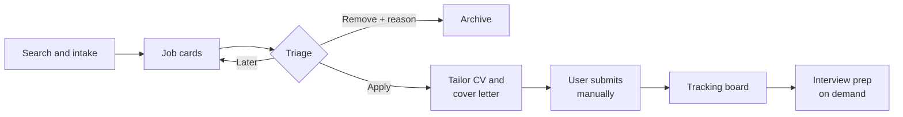

> Exported from the Claude Doc "Job Search Pipeline — Product Spec" on 2026-10-03. This is the original vision. Several points were refined later in detailed-design.md and docs/DECISIONS.md, which take precedence.

# Job Search Pipeline — Product Spec

Sep 24, 2026 · @Goncalo Silva

## Overview and principles

A local, open-source web app that finds relevant jobs, helps the applicant position themselves for each one, and tracks every application on one board. The user reviews and submits every application personally; the app never applies on their behalf.

The main value is not volume. It is helping the applicant see, articulate and present their own value for each specific role.

Guiding principles:

- **Human in the loop.** The app prepares; the user decides and submits.
- **Honesty first.** The AI draws facts out of the user and rephrases them. It never invents experience or inflates claims.
- **Reusable by anyone.** No personal data, criteria or credentials in the code.
- **Swappable providers.** AI, search and storage each sit behind their own module.
- **On demand.** Costly work (tailoring, interview prep, web search) runs only when the user asks.
- **Nothing forced.** Enrichment sessions and interview prep are optional, short and skippable.

## End-to-end workflow

Jobs flow from intake to cards, through a quick triage, into tailored applications the user submits manually, and then onto the tracking board.

The fact bank feeds every AI step, and each step can feed new facts back into it (see Fact bank and ongoing enrichment).

## Job sourcing

Jobs come from official feeds and user intake, never from scraping sites whose terms forbid it.

| Source | How it works | Notes |
| --- | --- | --- |
| Manual intake | User pastes a URL or the job text | Always available; build first |
| Company job boards (Greenhouse, Lever, Ashby) | Public job listings per company, as structured data | Good for a target-company list |
| Job aggregator APIs | Official APIs that collect postings from many sites | Check each one's terms and free allowance |
| Job alert emails | Parse alerts the user already receives | Optional email connector |
| LinkedIn and similar sites | Not supported | Terms prohibit scraping |

Requirements:

- **Snapshot at intake.** Store the full description when the job is found; postings often disappear before interviews.
- **Keep provenance.** Store the source URL and the date found.
- **Deduplicate.** The same role is often posted in several places; match on company, normalized title, location and description similarity.
- **Search criteria are user settings,** never hardcoded.

## Job cards and triage

Each job becomes a short card the user can apply to, remove, or keep for later.

**Card contents:** title, company, location and work mode, salary if listed, a 3–5 line summary, key requirements, a fit score with its reasons, and source and date found. The full description is one tap away.

**Structured fields extracted at intake:** location, work mode (remote, hybrid, onsite), seniority, salary range, industry, company size, key skills, visa sponsorship, date posted and source. Users can add their own free-form tags.

**Normalization.** Values are mapped at intake to controlled lists, so "Remote (EU)", "remote" and "work from anywhere in Europe" land in one group. The lists are editable in settings.

**Grouping and filtering.** Company is its own entity, so all roles at one company appear together with shared contacts, notes and application history. The board supports group-by and filters on any structured field or tag, rather than hardcoded views.

**Triage actions:**

- **Apply** moves the job into tailoring.
- **Remove** archives it and asks for a quick reason (for example, too junior, wrong location). Reasons help refine search criteria over time.
- **Later** keeps the card in the deck.

## Application board and tracking

Every application lives on one board with its status, dates, contacts and the exact documents that were sent.

**Statuses** are configurable in settings. Suggested defaults: Preparing, Applied, Screening, Interviewing, Offer, Rejected, Withdrawn.

**Each application holds:**

- The job snapshot and a link to its company
- The exact CV and cover letter versions sent, and the fact versions they used
- Contacts (recruiter, hiring manager, referrer)
- Events: interview dates, follow-ups, deadlines
- Notes and a timeline of status changes

**Reminders.** Optional follow-up nudges, for example when there is no response after a set number of days (user-defined).

**Views.** Columns by status by default, with the same group-by and filters as job cards (company, work mode, tags and so on).

## Fact bank and ongoing enrichment

The fact bank is the single source of truth about the user, and it grows throughout the job search rather than being filled in once.

**What it stores.** Individual facts (roles, achievements, metrics, skills) and stories captured as situation, action and result. Each links to a role and to skills from the controlled list. One story can become a CV bullet, a cover letter paragraph and an interview answer.

**Interviewer agent modes:**

- **Guided walkthrough:** role by role, coach-style questions (What changed because you were there? How many, how much, how fast?).
- **Gap-driven:** requirements common across saved jobs with no matching facts become questions (for example, 12 saved jobs ask for stakeholder management).
- **Per-application:** a few targeted questions before tailoring for a specific job.

**Enrichment moments** (all optional):

| Moment | What the agent asks about |
| --- | --- |
| Applying to a job | That job's key requirements |
| After an interview | Questions asked, what landed, what was missed |
| After a rejection | Feedback received and possible gaps |
| Periodic check-in | Changes across saved jobs; open backlog items |
| Anytime capture | Expands short notes the user jotted down |

**Session design:**

- Short sessions of 3–5 questions; the user can skip, answer "not sure" or "ask me later".
- A question backlog, prioritized by impact across saved jobs, so each session continues where the last one ended.
- A record of questions already asked; "not sure" answers are revisited later from a different angle.
- A coverage view showing strong and thin areas, as information rather than pressure.
- User-controlled frequency.

**Fact lifecycle and honesty guardrails:**

- The agent asks open questions and records answers in the user's own words; it never supplies facts.
- New facts start as drafts; only facts the user confirms feed CVs, letters and answers.
- Facts are versioned. Each application links to the exact versions it used.

## Positioning and tailoring

Tailoring selects, orders and rephrases confirmed facts for a specific job; it never adds claims the user has not confirmed.

**Positioning angles.** From the fact bank, the AI proposes a few ways to present the user (for example, "engineer who bridges product and tech" or "reliability specialist"). The user picks the angle per application or per type of role, and tailoring follows it.

**CV tailoring:**

- Built only from confirmed facts, following the chosen angle.
- Shown as a diff against the master CV; the user approves or edits before saving.
- CV style, length and language are configurable, since norms vary by country.

**Cover letter.** Drafted from the same facts and angle, then reviewed and edited by the user.

**Honest gap check.** Before tailoring, the AI notes real gaps against the job's requirements. It suggests honest framing of related experience, and says plainly when a role may not be worth applying for.

**Versioning.** Every generated document is stored as a version linked to its application, with the model and prompt version that produced it.

## Interview preparation (on demand)

Interview prep is optional and runs only when the user presses a button on an application; nothing is generated automatically.

**Question sets, in layers:**

- **From the job:** behavioral, technical and role-specific questions, plus motivation questions about the company.
- **From the CV sent:** questions about what the interviewer actually read, including gaps and weak spots.
- **From the web (opt-in):** questions people report being asked for that company or role. Each question is labeled "AI-generated" or "reported online" with its source.
- **Questions to ask them.**

Results start as a short list of the most likely questions, with "show more" for depth.

**Answer feedback.** The user writes an answer (voice later, perhaps). The AI checks whether it answers the question, is structured, cites concrete evidence, fits a reasonable length, and matches the CV sent. It suggests facts from the bank, never invented ones. A mock-interview mode with follow-up questions is a later option.

**Narrative builder.** Help with recurring answers: tell me about yourself, why this role, why you are leaving, strengths and weaknesses. These follow the chosen positioning angle and are reusable across similar roles.

**Loops back into the app:**

- New memories surfaced during prep become draft facts to confirm.
- An optional post-interview debrief records the questions actually asked, building a personal question bank.

**Caching and limits.** Generated results are saved with the application, with a "regenerate" button. Web searches respect the usage budget and each provider's terms on storing results.

## Architecture

Three swappable modules (AI, search and storage) keep providers and methods replaceable without touching the rest of the app.

| Module | Responsibility | First implementation |
| --- | --- | --- |
| AI | Task-level functions: summarize job, score fit, tailor CV, draft cover letter, interview tasks, enrichment questions. Returns JSON checked against a schema. Logs model and prompt version per output. | Claude Agent SDK on the user's Claude subscription; API key as an alternative |
| Search | Web search as a capability, with usage counting and budgets | Agent SDK built-in web search; self-hosted SearXNG as the free fallback; Brave optional |
| Storage | Repository interface over the database | SQLite with built-in full-text search |

**Prompt library.** Prompts are templates in their own folder, filled from the job, CV version and fact bank. They contain no personal details, are user-editable and are versioned.

**Fact retrieval for AI requests:**

1. While the bank is small, send all confirmed facts with each request and let the AI choose.
2. When that becomes slow or uses too much allowance, send a selection chosen by search (keywords and tags).
3. If needed, add semantic search with embeddings (sqlite-vec) inside the same database. This needs a separate embedding model; Claude does not produce embeddings.

Storage stays the same across all three steps; only retrieval changes.

**Subscription note.** Agent SDK usage currently draws from the Claude plan's usage limits, shared with chat and Claude Code. Anthropic announced and then paused a change to this in June 2026, so the AI module must allow switching to an API key easily.

## Data model

The model centers on jobs, applications and a versioned fact bank, all stored in one SQLite file in the user's data folder.

| Entity | Key contents | Linked to |
| --- | --- | --- |
| Company | Name, website, careers feed, notes | Jobs, contacts |
| Job | Description snapshot, source URL, date found, structured fields, fit score, triage state, removal reason | Company; at most one application |
| Application | Status, status history, notes | Job, contacts, events, documents, fact versions used |
| Contact | Name, role, email, notes | Company, applications |
| Event | Type (interview, follow-up, deadline), date and time, notes | Application |
| Generated document | Type (CV, cover letter, prep), version, content, model and prompt version | Application, fact versions used |
| Role | Employer, title, dates | Facts |
| Fact | Text, status (draft or confirmed), tags, version history | Role, skills, stories |
| Story | Situation, action, result | Facts, skills |
| Skill | Term from the controlled list | Facts, stories, jobs |
| Enrichment question | Text, priority, status (open, asked, skipped, later), origin | Facts it produced |
| Usage record | Provider, timestamp, success | Usage budget |
| Settings | Providers, criteria, controlled lists, statuses, budgets | — |

API keys are deliberately absent: they live in the operating system's keychain (see Settings).

## Settings, providers, keys and usage budgets

A settings panel lets each user choose providers, enter credentials and set usage budgets without editing code.

**Providers.** Dropdowns for AI provider and search provider. Each choice shows only the fields it needs: an API key, a server address (self-hosted SearXNG), a model choice, or nothing (Claude via the user's subscription uses the Claude Code login). A "test connection" button checks the setup immediately.

**API keys:**

- Stored in the operating system's keychain (Python's keyring library), never in the database or a plain file.
- Never sent back to the browser after saving; shown masked with a "replace" option.
- Never logged, and excluded from exports and backups.
- A `.env` file remains supported for developers.

**Usage budgets** (per paid service, all user-defined; example values):

| Setting | Example |
| --- | --- |
| Monthly allowance | 1,000 searches |
| First warning | 500 |
| Second warning | 900 |
| Blocking point | 950 |
| Reset day | Provider's billing date |

The app validates the order: first warning < second warning < blocking point ≤ allowance.

**Behavior:**

- The budget is checked before each request, so nothing slips past the block.
- Each warning shows the count (for example, 500 of 1,000 used) and asks whether to continue, once per cycle.
- At the blocking point, requests stop; the rest of the app keeps working. Only the user can raise the limit.
- Every request is recorded with a timestamp; monthly counts and resets are calculated from these records.
- For agent tasks, the Agent SDK's tool-call interception enforces the budget on built-in web search.

**Provider-reported usage.** Provider modules declare whether they report usage. Brave returns remaining monthly requests and time to reset in its response headers. When available, these correct the local count and the reset date. Thresholds apply to whichever count shows more usage. Providers that report nothing rely on the local count.

## Reusability, privacy and security

The repository holds only code, defaults and fictional demo data; everything personal lives outside it.

**Data separation:**

- User data (database, CVs, generated documents) lives in a data folder outside the project, with a configurable path, and is gitignored as a second layer.
- Secrets go in a gitignored `.env`; a blank `.env.example` is committed.
- A secret scanner (such as gitleaks) runs as a pre-commit hook to catch accidental commits of personal data or keys.

**Everything configurable:** search criteria, grouping fields and their allowed values, statuses, prompts, CV style, language and providers.

**Onboarding for new users:**

- First-run setup imports an existing CV into draft facts for the user to review.
- A demo mode with a fictional person and sample jobs, for testing, screenshots and development without real data.
- JSON export and import for backups (never including keys).

**Local security:** the app listens only on the user's own machine (127.0.0.1) and checks that requests come from its own page.

**Disclosure in the README:** each user brings their own AI and search access and is bound by those providers' terms. CV and job data is sent to whichever providers the user configures.

**License:** choose an open-source license before sharing, since code without one is not legally reusable.

## Suggested build order

Each step is useful on its own, and automated search comes last so real search criteria are learned before they are automated.

1. **Foundation:** data folder, settings panel, SQLite, and the AI, search and storage module interfaces.
2. **Fact bank:** manual entry, CV import and the first enrichment sessions.
3. **Job intake and cards:** manual intake, summaries, structured fields, triage.
4. **Board:** applications, statuses, contacts, events, reminders.
5. **Tailoring:** positioning angles, CV and cover letter, diffs, versions.
6. **Interview prep:** on-demand questions, feedback, narrative, debriefs; web search with usage budgets.
7. **Automated job sourcing:** company job boards and other official feeds.
8. **Retrieval upgrades** (search-selected facts, embeddings), only when the fact bank needs them.

## Decisions and open questions

Seven decisions are settled so far; the open questions below shape the next iteration.

| Decision | Choice | Reason |
| --- | --- | --- |
| Submitting applications | Always manual | User control and reputation |
| AI integration | Task-level module, provider-independent | Swap providers or methods anytime |
| Storage | SQLite with full-text search | Relationships, board, versions; one file, no server |
| Fact retrieval | Send all confirmed facts while the bank is small | Simplest; upgrade path kept |
| Web search | Agent SDK built-in first; SearXNG fallback; Brave optional | No extra cost or key to start |
| API keys | Operating system keychain | Keeps secrets out of data and exports |
| Usage budgets | User-defined thresholds, monthly reset | Prevents surprise charges |

Open questions:

- [ ] Which factors matter most for the fit score and card design?
- [ ] Tech stack: backend language and frontend framework?
- [ ] Output formats for CV and cover letter (PDF, Word, both)?
- [ ] Which job sources for the first automated version?
- [ ] Does Brave's reported monthly count match its $5 monthly credit? Test with a real key.
- [ ] Which open-source license?
- [ ] Default frequency for enrichment check-ins?

## Sources

- [Use the Claude Agent SDK with your Claude plan](https://support.claude.com/en/articles/15036540-use-the-claude-agent-sdk-with-your-claude-plan) (Claude Help Center)
- [Brave Search API pricing](https://api-dashboard.search.brave.com/documentation/pricing)
- [Brave Search API terms of service](https://api-dashboard.search.brave.com/terms-of-service)
- [Brave Search API rate limiting guide](https://api-dashboard.search.brave.com/documentation/guides/rate-limiting)
